# 01 – Produkt, UX & Design-System von AppKittie (öffentliche Seiten)

> **Agent-Prefix:** `ux` · **Stand:** 25./26.10.2026 · **Status:** Recherche (kein Produktcode)
> **Kennzeichnung:** **[beobachtet]** = selbst im Browser gesehen oder aus Dateien gelesen, die eine öffentliche Seite
> selbst lädt (URL/Datei angegeben, Rohdaten im Scratch-Ordner) · **[extern]** = aus einer verlinkten Fremdquelle ·
> **[abgeleitet]** = eigene Schlussfolgerung/Vermutung.
> **Regeln eingehalten:** kein Login, kein Account, kein Checkout, nichts abgesendet, keine Paywall umgangen,
> keine AppKittie-Daten massenhaft abgegriffen. Es wurden nur Seiten aufgerufen, die ein normaler Besucher
> sieht, plus 11 vorsichtige Pfad-Probes (Liste in §2.2). Popover, Tabs und Akkordeons wurden nur lokal geöffnet.
> Das löst keine Such- oder Daten-Requests aus.

---

## 0. Das Wichtigste in Kürze

1. **Der „eingeloggte“ Bereich ist zum Teil öffentlich.** `/dashboard` leitet auch ohne Login auf
   `/dashboard/explore?excludedCategories=Games&countries=US&releasedAfter=90d&hasMetaAds=true` weiter. Gäste
   sehen die **vollständige App-Shell**: Sidebar, Filterleiste mit allen Filter-Popovers, Seitentitel. Wo die
   Ergebnisse stehen würden, sitzt eine **Inline-Paywall mit den Preiskarten** **[beobachtet]**. Darüber ließ sich
   die Informationsarchitektur des Produkts fast vollständig erfassen, ohne einzuloggen (§7).
2. **Öffentliche SEO-Seiten pro App:** `/app/<slug>` (z. B. `/app/app-cal-ai-calorie-tracker-id6480417616`)
   wird serverseitig gerendert und ist `index, follow`. Store-Metadaten, Screenshots und eine KI-Kurzbeschreibung
   sind sichtbar. **Alle Kennzahlen sind maskiert** („•••“ mit Schloss) und führen zur Paywall **[beobachtet]**.
   `robots.txt` und `sitemap.xml` liefern **404**. Die App-Seiten sind also nicht über eine Sitemap erschlossen
   **[beobachtet]**.
3. **Positionierung:** „Find what's winning in mobile apps“. Revenue, Downloads, Ads, virale Videos, Keywords und
   Onboardings in einem Tool, „updated daily“. Zielgruppe: Indie-Gründer, App-Studios, Growth-Teams. Die
   Value-Proposition lautet **„erfolgreiche Apps finden und nachbauen“** („find proven apps to replicate their
   success“, „Steal the onboarding that converts“) **[beobachtet]**.
4. **Ein Plan:** Pro für **$79/Monat** oder **$49/Monat bei jährlicher Zahlung ($588/Jahr, „−38%“)**. Enthalten
   sind 5.000 API-Credits/Monat und 3 Team-Seats (weitere **$20/Monat** pro Seat). Laut Code gibt es einen
   **3-Tage-Trial mit Kartenverifikation** **[beobachtet in `stripe.getPricing` + JS-Strings]**.
5. **Funnel:** Jeder CTA „Get Instant Access“ zeigt auf `/api/checkout/resume?plan=pro:monthly&next=/pricing`.
   Ohne Session folgt ein **307 auf `/sign-in?redirect=…`**. Nach dem Login geht es zum Checkout (Stripe
   **Embedded Checkout** unter `/checkout`), danach nach `/dashboard/explore` **[beobachtet: Redirects; abgeleitet:
   Schritte nach dem Login]**.
6. **Login-Methoden:** nur **Google OAuth** und **E-Mail-Magic-Link** (Auth.js/NextAuth mit Provider „resend“).
   Kein Passwort, kein Apple-Login. Die zuletzt benutzte Methode bekommt einen „Last used“-Badge **[beobachtet]**.
7. **Produktmodule (Sidebar):** EXPLORE (Apps, Ads, Organic, Onboardings, Trending, Rising) · FAVORITES ·
   ASO TRACKING (Keyword Explorer, Your Apps) · TOOLS (Review Analytics, Competitor Tracking) · AI AGENTS (MCP,
   API) · Feedback. Dazu kommen App-Detailseiten, Developer-Portfolios, Settings (Team, API Keys, Billing)
   **[beobachtet]**.
8. **App-Explorer:** 13 Filtergruppen mit insgesamt über 30 Parametern, darunter Zeit, Store, Kategorie
   (Include/Exclude pro Store), Primärsprache, Monetarisierung (inkl. „Web funnel“), Min-Revenue/Downloads/Reviews/
   Rating, Wachstum (7–90 Tage), Marketing-Signale (Meta-/TikTok-/Apple-Ads, Creators), Meta-Ads-Spend/-Reach und
   Kontakt-E-Mail. Tabellenspalten: App · Category · Downloads (+Δ) · Revenue (+Δ) · Growth 30D (+Sparkline) ·
   Rating · Released · Last Update **[beobachtet]**.
9. **„Growth“ ist Review-Wachstum.** Die öffentliche API-Doku schreibt: „Growth is measured as the percentage change
   in review count“. Im UI heißt der Filter „Rank by review growth over 7d…90d“. Die Landingpage spricht dagegen von
   „MRR growth“ **[beobachtet]**. Das ist ein Transparenzproblem, das wir besser lösen können.
10. **AI/MCP als zweites Standbein:** Remote-MCP-Server `https://mcp.appkittie.com` mit Bearer-Key oder OAuth,
    14 Tools mit Credit-Preisen, 11 „Agent Skills“ als GitHub-Repo, dazu REST-API `/api/v1/*` mit
    Mintlify-Doku unter `/docs` **[beobachtet]**.
11. **Design:** Dunkle, grünstichige Marketingseite (`#020908`). Helle „Shells“ mit 30px Radius liegen darin.
    Primärgrün `#00bc7c`, CTA-Pill mit Verlauf und Sheen. **Satoshi Variable** für Text, **JetBrains Mono** für
    Eyebrows im Stil „[ FEATURES ]“. Das Dashboard nutzt **shadcn/ui-Tokens** (Light/Dark, `next-themes`), eine
    schwarze Sidebar und eine helle Canvas mit Punkt-Textur **[beobachtet in CSS]**.
12. **Tech-Stack (aus öffentlichen Bundles):** Next.js App Router (Turbopack), React, tRPC (httpBatchStreamLink +
    superjson), TanStack Query, Auth.js, Stripe, Tailwind CSS v4, Radix/shadcn, Recharts, react-day-picker,
    next-themes, nprogress. Cloudflare sitzt davor (Bot-Challenge), das Video liegt auf Cloudflare R2. Insgesamt
    gibt es **113 tRPC-Prozeduren** in 15 Routern (§7.2) **[beobachtet]**.

---

## 1. Methode & Umfang

| Schritt | Werkzeug | Ergebnis (Scratch: `…/scratchpad/ux/`) |
|---|---|---|
| Seiten rendern, Text, Links, Buttons, Requests, Full-Page-Screenshot | Headless Chromium (CDP 9223) + eigenes Playwright-Skript `uxmap.js` (langsames Scrollen für In-View-Animationen) | `pages/*.json`, `pages/*.png` |
| Filter-Popover und Dropdowns öffnen (nur lokal) | `popovers.js` | `pop/*.json`, `pop/*-popNN.png` |
| Tabs/Akkordeons/AI-Demo-Frames | `interact.js`, `faq.js` | `inter/*` |
| CSS/JS, die die Seiten selbst laden (ohne Extra-Requests aus dem Browser-Cache extrahiert) | Playwright-Response-Bodies + Chrome-SQL-Cache | `static/*.css|js`, `js/*.js` (103 Chunks) |
| Analyse von Tokens, Klassen, Strings, Routen, tRPC-Prozeduren | Python/grep | `ui-strings.txt`, `trpc-procs.txt` |
| Öffentliche Doku | `/docs/llms.txt` + 4 Markdown-Seiten (Mintlify bietet sie selbst an) | `docsdl/*` |
| Mobile 390px | `uxmap.js` mit Viewport 390×844 (Seitenbreite effektiv 375px wegen Scrollbar) | `pages/m-*.png` |

Insgesamt waren es etwa 45 Seitenaufrufe auf appkittie.com über rund 90 Minuten verteilt, mit 3–5 s Pause
dazwischen. Nicht gemacht wurden: Login, Magic-Link-Versand, Checkout, Abruf von API-Endpunkten, die keine
Seite selbst lädt, und Video-Download.

---

## 2. Seiten-Inventar

### 2.1 Öffentliche Seiten (über Navigation, Footer und Sidebar gefunden)

| URL | HTTP | Robots | Zweck | Screenshot |
|---|---|---|---|---|
| `/` | 200 | index, follow | Landingpage (10 Sektionen inkl. Footer, 12.719px hoch) | [ux-01](assets/ux-01-home-hero.webp), [ux-02](assets/ux-02-home-features.webp), [ux-03](assets/ux-03-home-track-widgets.webp), [ux-04](assets/ux-04-home-ai-demo.webp) |
| `/pricing` | 200 | index, follow | Eigenständige Preisseite (zwei Karten, Trust-Zeile) | [ux-05](assets/ux-05-pricing.webp) |
| `/affiliate` | 200 | index, follow | Partnerprogramm (Rewardful), 30% wiederkehrend | [ux-06](assets/ux-06-affiliate.webp) |
| `/sign-in` | 200 | noindex, nofollow | Registrierung/Login (Google + Magic Link) | [ux-07](assets/ux-07-signin.webp) |
| `/mcp` | 200 | index, follow | MCP-Server und Agent-Skills (SEO-Landingpage für Devs) | [ux-08](assets/ux-08-mcp.webp) |
| `/docs` (+ Unterseiten) | 200 | – | API-Doku (Mintlify, gehostet unter derselben Domain) | – |
| `/terms` | 200 | index, follow | AGB (Stand 23.10.2026) | – |
| `/privacy` | 200 | index, follow | Datenschutzerklärung (Stand 23.10.2026) | – |
| `/app/<slug>` | 200 | index, follow, max-image-preview:large | **Öffentliche App-Detailseite (SEO-Teaser, Werte maskiert)** | [ux-12](assets/ux-12-app-detail-guest.webp) |
| `/developer/<name>` | 200 | noindex, follow | Developer-Portfolio, für Gäste komplett hinter Paywall | – |
| `/dashboard` → `/dashboard/explore?…` | 200 | index, follow | App-Explorer (Shell + Filter, Ergebnisse hinter Paywall) | [ux-09](assets/ux-09-dashboard-explore-guest.webp), [ux-10](assets/ux-10-explore-filter-popovers.webp) |
| `/dashboard/ads`, `/organic`, `/onboarding?sortBy=revenue`, `/trending`, `/rising` | 200 | index, follow | Explore-Module (Shell + Filter + Paywall) | [ux-11](assets/ux-11-dashboard-pages-guest.webp) |
| `/dashboard/aso/keywords`, `/dashboard/aso/apps` | 200 | – | ASO-Module mit „PRO“-Modal über leerem Workspace | – |
| `/dashboard/reviews` → `/dashboard/reviews/overview` | 200 | – | Review Analytics, Leerzustand „No apps monitored yet“ | [ux-11](assets/ux-11-dashboard-pages-guest.webp) |
| `/dashboard/favorites` → `/favorites/apps` | 200 | – | Favoriten, Leerzustand „Sign in to see your favorites“ | – |
| `/dashboard/competitors`, `/dashboard/feature-requests`, `/dashboard/onboarding/<slug>` | 200 → `/sign-in` | – | nur mit Login (clientseitige Weiterleitung) | – |
| `/settings/api-keys` | 307 → `/sign-in?callbackUrl=%2Fsettings%2Fapi-keys` | – | nur mit Login (serverseitige Weiterleitung) | – |
| Mobile 390px: `/`, `/dashboard/explore`, `/app/<slug>` | 200 | – | Responsive-Verhalten | [ux-13](assets/ux-13-mobile-390.webp) |

Quelle: `pages/*.json` (Felder `status`, `robots`, `canonical`, `links`, `text`).

### 2.2 Pfad-Probes (11 von max. ~20, langsam, `probe.js` → `probes1.json`)

| Pfad | Ergebnis |
|---|---|
| `/blog`, `/api-docs`, `/apps`, `/top-apps`, `/changelog`, `/llms.txt` | **404**. Eigene 404-Seite: „404 — LOST IN THE APP GALAXY · We couldn't find that page · The link may be broken or the app you're looking for isn't indexed yet.“ |
| `/docs` | **200**, Mintlify-Doku (Index: `/docs/llms.txt`) |
| `/mcp` | **200**, MCP-Landingpage |
| `/dashboard` | **200** → Client-Redirect auf Explore mit Default-Filtern (siehe oben) |
| `/dashboard/explore` | **200** |
| `/checkout` | **200** → Client-Redirect auf `/sign-in?redirect=/api/checkout/resume?plan=pro%3Amonthly&next=%2Fpricing` |
| `/robots.txt`, `/sitemap.xml` | **404** (aus der Koordinator-Recon `scratchpad/recon/*robots*`, `*sitemap*`) |

Blog, Changelog, öffentliche Ranking- oder Kategorie-Seiten und eine öffentliche App-Liste gibt es nicht. Die
SEO-Fläche besteht aus `/app/<slug>`, `/mcp`, `/affiliate`, `/pricing` und `/docs` **[beobachtet]**. Über eine
Websuche nach `site:appkittie.com` oder `"appkittie.com/app/"` fanden sich keine indexierten App-Seiten
**[extern, WebSearch 25.10.2026]**.

---

## 3. Seiten im Detail

### 3.1 Startseite `/`

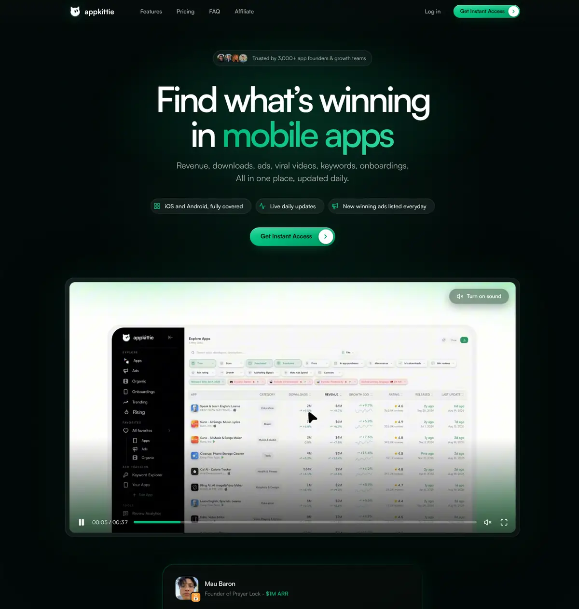

**Header (sticky):** Logo (Katzenkopf + Wortmarke „appkittie“, kleingeschrieben) · Features · Pricing · FAQ
(scrollen zu `#features`, `#pricing`, `#faq`) · Affiliate · „Log in“ · grüne Pill „Get Instant Access ›“. Über den
hellen Sektionen wechselt die Header-Schrift auf Schwarz (`!text-black` vs. `!text-white` im JS) **[beobachtet]**.

| # | Sektion (Eyebrow) | Kernaussage (Zitat) | Inhalt / Widget | CTA |
|---|---|---|---|---|
| 1 | Hero | „**Find what's winning in mobile apps**“ · „Revenue, downloads, ads, viral videos, keywords, onboardings. All in one place, updated daily.“ | Trust-Pill „Trusted by 3,000+ app founders & growth teams“ mit Avatar-Stack. Drei Signal-Chips: „iOS and Android, fully covered“, „Live daily updates“, „New winning ads listed everyday“. Produktvideo 0:37 (Poster zeigt die Explore-Tabelle, „Turn on sound“). Darunter eine Gründer-Testimonial-Karte mit Produkt-Screenshot („Insane database of millions of apps, winning ads and viral content“, Founder Prayer Lock, „$1M ARR“) | Get Instant Access |
| 2 | `[ FEATURES ]` | „**Search the entire app market**“ · „Explore our database of millions of iOS and Android apps using precise filters: revenue, downloads, category, launch date and more.“ | Zwei Karten: **„Every number behind any app“** (App-Profil-Karussell) und **„Find the apps already winning“** (Filter-Demo mit rollendem Zähler) | Get Instant Access |
| 3 | `[ TRACK ]` | „**Unlock the growth playbook behind winning apps**“ · „Watch their winning ads with high ROAS, mega-viral videos, high-volume keywords, onboardings and high-converting paywalls.“ | Fünf Feature-Karten: ADS LIBRARY „See what ads are actually converting“, SPEND TRACKER „Track how much they spend, and where“, ORGANIC VIDEOS LIBRARY „Spot every app's viral videos“, ASO TRACKER „Rank for the keywords that pay“, ONBOARDING LIBRARY „Steal the onboarding that converts“ | Get Instant Access |
| 4 | `[ AI ACCESS ]` | „**Ask your AI**“ · „Connect ChatGPT, Claude and more to appkittie, then research apps, winning ads, viral videos, high-converting onboardings, keywords and markets, in your own language.“ | Chat-Demo mit 4 rotierenden Prompts und passenden Ergebniskarten. „WORKS WITH“: ChatGPT, Gemini, Claude, Perplexity, Grok | Get Instant Access |
| 5 | `[ OUR USERS ]` | „**Yes, they all use appkittie**“ · „From breakout apps to global teams, ambitious builders use appkittie to find their next edge.“ | Logo-Wall: 20 App-Icons mit Metrik-Unterzeile (z. B. „$6 Billion ARR“, „Acquired for $530M“). „See more“ klappt 15 weitere auf (insgesamt 35) | – |
| 6 | `[ STRAIGHT FROM USERS ]` | 8 Testimonials | 2 große Gründer-Karten mit Produkt-Screenshot, 6 Karten im X/Twitter-Stil mit Verified-Badge. Themen: genaue Schätzungen bei organisch wachsenden Apps, ASO-Keywords, Onboarding kopiert und Conversion gesteigert, Claude-Anbindung | – |
| 7 | `[ PRICING ]` | „**One plan, everything unlocked**“ · „Every feature on every card above, with no per-seat pricing and no feature gates. Pick how you want to pay.“ | Monthly $79 / Yearly $49 (~~$79~~, „−38%“), je 10 Feature-Zeilen | Start now |
| 8 | `[ F.A.Q ]` | „**Frequently asked questions**“ · „Everything you need to know before finding your next winner.“ | 6 Fragen im Akkordeon, u. a. „How do you calculate app revenue?“: „We estimate app revenue using multiple datasets and continuously monitor apps for changes in rankings, performance, and monetization signals…“ | – |
| 9 | `[ JOIN 3,000+ USERS ]` | „**Ready to win in the app market?**“ | Produkt-Screenshot (Explore-Tabelle) | Get Instant Access |
| 10 | Footer | „© 2026 appkittie. A product of ALGO MEDIA LLC.“ · „Built for app founders, app studios, developers and growth teams.“ | Terms · Privacy | – |

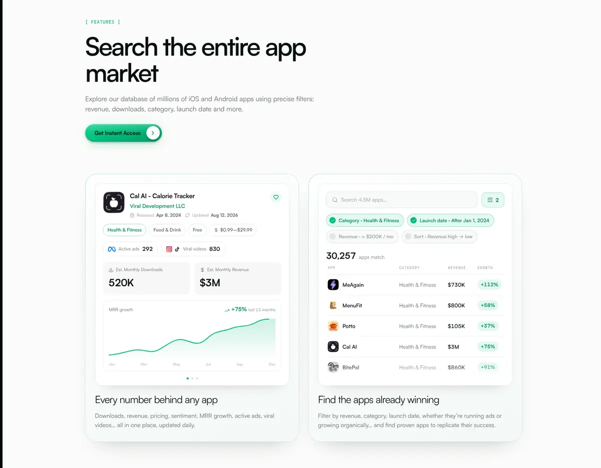

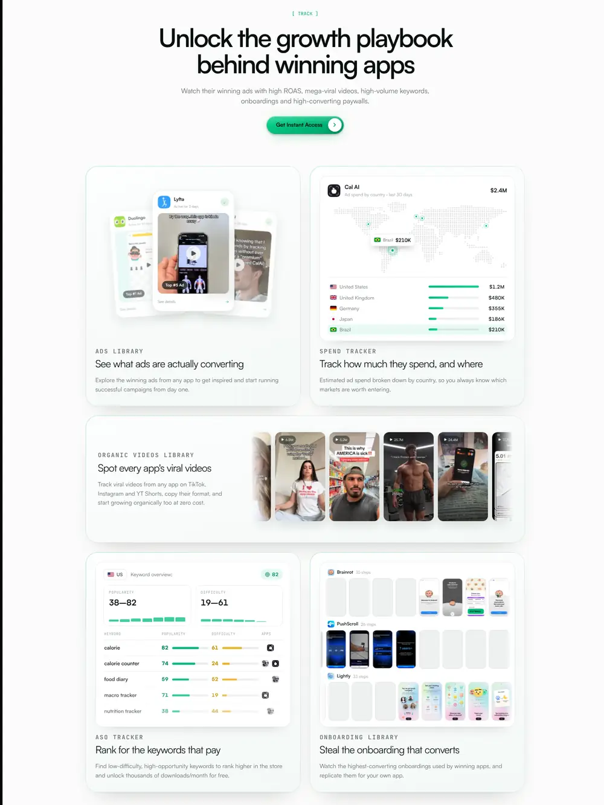

Widersprüche in der Copy **[beobachtet]**: In der Pricing-Sektion steht „no per-seat pricing“. Die Preis-API
nennt dagegen „3 team seats included; add more for $20/month each“. Die FAQ sagt „Pro users can export data to CSV
and share dashboards with team members“.

### 3.2 `/pricing`

H1 „Pricing for sharper app decisions“ · „Get full access and start researching immediately.“ Zwei Plan-Karten
(Monthly: „Everything that sells on the stores, and why it sells.“; Yearly: „The same access, at the lowest price
we offer.“). Feature-Zeilen jeweils mit „Unlimited“: App Store and Google Play data · 4,500,000+ app database ·
Winning ads library · Viral videos library · High-converting onboardings library · Ad spend tracker · Global
rankings · ASO tracker · Review tracker. Dazu „API credits 5,000/month“. Trust-Zeile: „Cancel anytime · Secure
payment · No hidden fees“. Die Meta-Description „Get started for free“ passt nicht zum Inhalt **[beobachtet]**.
Die Seite lädt `stripe.getAffiliateOffer`, `settings.getSubscription` und `stripe.getPricing` per tRPC (§6.4).

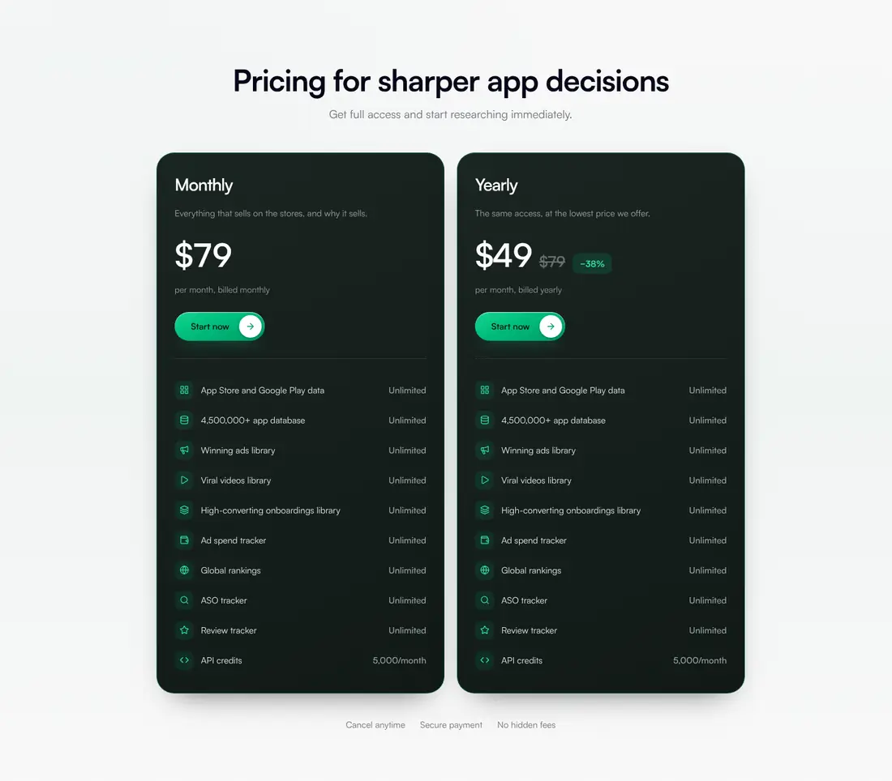

### 3.3 `/affiliate`

| Block | Inhalt (beobachtet) |
|---|---|
| Hero | „AFFILIATE PROGRAM · **Earn 30% recurring commission** · Promote the tool app founders love — and get paid every month for every customer you bring. No cap, no catch.“ CTAs: „Join the Affiliate Program“ → `https://appkittie.getrewardful.com/signup` und „See what you could earn“ (`#earnings`) |
| KPI-Leiste | 30% COMMISSION PER SALE · ∞ RECURRING, EVERY PAYMENT · 30 days COOKIE WINDOW · $0 NO CAP, FREE TO JOIN |
| How it works | STEP 01 Sign Up („No approval wait“) · STEP 02 Share Your Link · STEP 03 Earn Recurring Revenue |
| Why | 30% Recurring Commission („for the lifetime of every customer“) · 30-Day Cookie · High-Converting Product · Real-Time Dashboard · Monthly Payouts · Dedicated Support |
| Earnings example | 5 → $118.50/mo · 10 → $237 · 25 → $592.50 · 50 → $1,185 · 100 → $2,370 (gerechnet mit $79/mo) |
| Zielgruppen | App Dev Content Creators · App Marketing Consultants · Newsletter & Community Owners · Indie Hackers & App Founders |
| FAQ | Auszahlung monatlich ab Mindestbetrag (PayPal, Bank). Kein Kundenstatus nötig. Cookie 30 Tage. Material: Banner, Social Assets, E-Mail-Templates, Talking Points. Kein Cap |

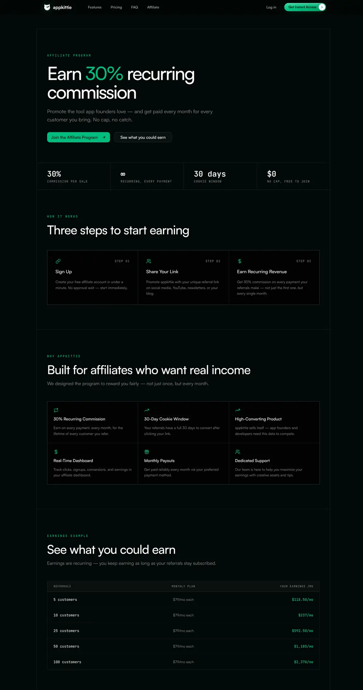

### 3.4 `/sign-in` (nur angesehen)

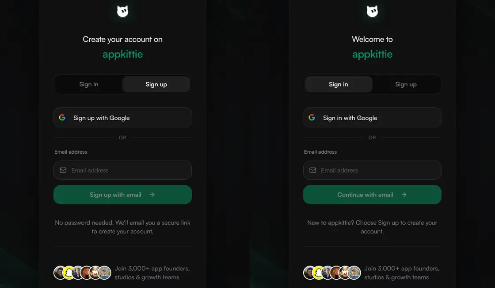

- **Default-Tab „Sign up“:** H1 „Create your account on appkittie“ · „Sign up with Google“ · OR · E-Mail-Feld ·
  „Sign up with email“ · „No password needed. We'll email you a secure link to create your account.“ ·
  „Join 3,000+ app founders, studios & growth teams“ mit Avatar-/Logo-Stack.
- **Tab „Sign in“:** „Welcome to appkittie“ · „Sign in with Google“ · „Continue with email“ · „New to appkittie?
  Choose Sign up to create your account.“
- **Zustände (aus JS):** „Check your email · We sent a secure sign-in link to … · Use a different email“. Ein
  „Last used“-Badge erscheint an der zuletzt genutzten Methode (localStorage, `getLastUsedAuth`). Ein
  Pending-Auth-Status gilt maximal 30 Minuten (`18e5` ms).
- **Technik:** Google über `GET /api/sign-in/google?redirect=…`, E-Mail über Auth.js `signIn("resend", {email,
  redirectTo})`. Der Redirect-Parameter heißt `redirect` oder `callbackUrl`. Erlaubt sind nur relative Pfade
  (`startsWith("/") && !startsWith("//")`) **[beobachtet in `c980a30ca8b6e104.js`]**.
- **Design:** dunkle Vollfläche `#0A0A0A` mit Hintergrundbild `bg_v1.webp` (10% Deckkraft, mix-blend-screen),
  Karte `#111111/80` mit Radius 24px, `backdrop-blur-xl` und Ring `white/5`, maximal 380px breit.

### 3.5 `/mcp` – „App Store intelligence in your IDE“

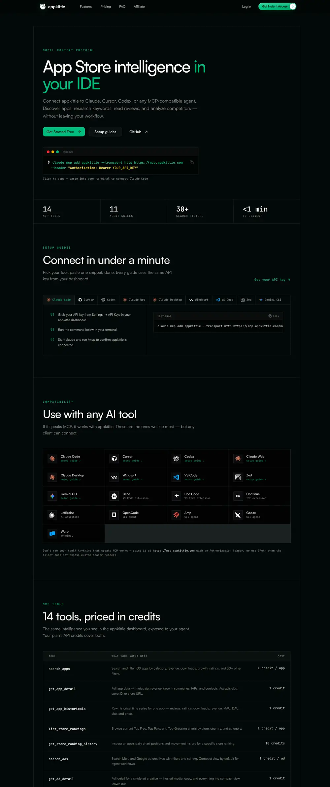

- Hero: „MODEL CONTEXT PROTOCOL“. Copy-Snippet im Terminal-Stil:
  `claude mcp add appkittie --transport http https://mcp.appkittie.com --header "Authorization: Bearer YOUR_API_KEY"`.
  KPI-Leiste: **14** MCP TOOLS · **11** AGENT SKILLS · **30+** SEARCH FILTERS · **<1 min** TO CONNECT.
- Setup-Guides als Tabs für Claude Code, Cursor, Codex, Claude Web, Claude Desktop, Windsurf, VS Code, Zed und
  Gemini CLI, jeweils mit nummerierten Schritten und Copy-Snippets. Claude Web/Desktop verbinden sich über
  **OAuth** (Client ID `appkittie-claude`, API-Key als Client Secret, URL `https://mcp.appkittie.com/mcp`).
- Kompatibilitäts-Grid mit 17 Clients (zusätzlich Cline, Roo Code, Continue, JetBrains, OpenCode, Amp, Goose,
  Warp).
- Tool-Tabelle (Tool · „What your agent gets“ · Cost):

| Tool | Kosten | | Tool | Kosten |
|---|---|---|---|---|
| `search_apps` | 1 Credit/App | | `list_creators` | 1/Creator |
| `get_app_detail` | 1 | | `list_organic_content` | 1/Item |
| `get_app_historicals` | 1 | | `get_keyword_difficulty` | 10 |
| `list_store_rankings` | 1/App | | `batch_keyword_difficulty` (≤10) | 10/Keyword |
| `get_store_ranking_history` | 10 | | `get_app_reviews` | 1/Review |
| `search_ads` | 1/Ad | | `get_supported_countries` | FREE |
| `get_ad_detail` | 1 | | `search_onboarding_screens` | 1/App |

- „Agent Skills“ (Repo `github.com/appkittie/aso-mcp-skills`, `npx skills add appkittie/aso-mcp-skills`):
  App Discovery, Keyword Research, Metadata Optimization („3 variants and character counts“), Competitor Analysis,
  Growth Analysis, Ad Intelligence, Creator Discovery, Revenue Analysis, Review Analysis, Onboarding Analysis,
  Marketing Context.
- „Just ask your agent“: 13 Beispiel-Prompts, z. B. „Find apps making $10K–50K/month with <1000 reviews“.
- FAQ: API-Keys beginnen mit `appkittie_` und werden unter Settings → API Keys erzeugt. MCP und API teilen sich
  die Credits.

### 3.6 `/docs` (Mintlify)

Titel „Introduction - AppKittie“. Tabs: Documentation · API Reference · Reference. Links zu Dashboard und API Keys.
Seiten: Introduction, Quickstart, Authentication, Credits, Rate Limiting, Error Handling, 12 Endpunkte, Enums,
Filters Reference, Supported Countries. Es gibt eine Suche (Ctrl K), einen KI-Assistenten („Ask a question…“),
„Copy page“ und `llms.txt`. Schriften: Inter und Paper Mono. Auffällig: Die Doku spricht von **„2M+ mobile
apps“**, die Landingpage von **„4,500,000+“** **[beobachtet]**. Endpunkt-Tabelle: `GET /api/v1/apps`,
`/apps/:appId`, `/apps/:appId/historicals`, `/trending`, `/trending/:appSlug/history`, `/ads`, `/ads/:adId`,
`/creators`, `/organic`, `GET|POST /keywords/difficulty`, `POST /reviews`. Details zur API gehören in ein eigenes
Dokument.

### 3.7 `/terms`, `/privacy`

Zweck laut AGB: „competitive intelligence platform … app store analytics, keyword research, ad intelligence, and
market insights“. Erwähnt werden auch „Monitor influencer collaborations and UGC campaigns“ und „**Generate
professional App Store screenshots**“. Weitere Punkte: Mindestalter 18. Verboten sind Bots und Scraper ohne
Erlaubnis sowie „Resell or redistribute data“. **14-Tage-Geld-zurück-Garantie** gilt nur für Erstabos. Betreiber:
**Algo Media LLC, Casper (Wyoming)**. Laut Datenschutzerklärung ist Stripe der Zahlungsdienstleister, dazu kommen
GDPR/CCPA-Abschnitte. Erfasst werden u. a. Suchanfragen und Filter, angesehene, getrackte und exportierte Apps
sowie beobachtete Wettbewerber **[beobachtet]**. Einen Cookie-Consent-Banner haben wir in keiner Sitzung gesehen,
obwohl Meta-, Reddit- und Google-Pixel laden (§6.8) **[beobachtet; Standort des Proxys unbekannt]**.

### 3.8 Öffentliche App-Detailseite `/app/<slug>`

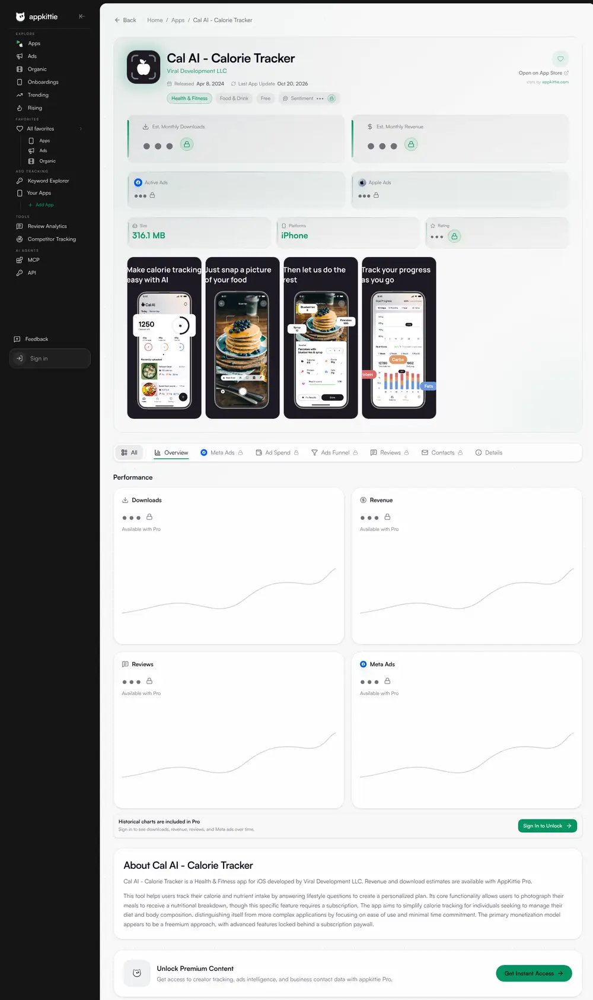

- **SEO:** Titel „Cal AI - Calorie Tracker App: Revenue, Downloads, Winning Ads & Organic Videos (2026) |
  Appkittie“. H1 aus App-Name plus `sr-only`-Text „App Revenue, Downloads, Winning Ads & Organic Videos“. Robots
  `index, follow, max-image-preview:large`, Canonical auf die eigene URL. Slug-Schema
  `app-<titel-slug>-id<storeId>` **[beobachtet, Slug aus Doku-Beispiel]**.
- **Layout:** Breadcrumb „Home / Apps / <App>“ und „Back“. Darunter die Header-Karte: Icon (Squircle), Name,
  Developer als grüner Link auf `/developer/<name>`, Released, Last App Update, „Open on App Store“, „stats by
  appkittie.com“, Kategorie-Chips, Preis-Chip, Sentiment-Chip (gesperrt) und Herz für Favorit.
- **KPI-Kacheln:** Est. Monthly Downloads · Est. Monthly Revenue (beide mit grünem Akzentstreifen links) · Active
  Ads (Meta-Logo) · Apple Ads · Size („316.1 MB“, sichtbar) · Platforms („iPhone“, sichtbar) · Rating. Gesperrte
  Werte erscheinen als „•••“ mit Schloss.
- **Store-Screenshots** werden direkt von `is1-ssl.mzstatic.com` eingebunden, also Apples CDN per Hotlink.
- **Tab-Leiste (Sticky-Anker):** All · Overview · Meta Ads · Ad Spend · Ads Funnel · Reviews · Contacts · Details.
  Gesperrte Tabs zeigen ein Schloss-Icon.
- **Performance:** vier Chart-Karten (Downloads, Revenue, Reviews, Meta Ads) mit Platzhalter-Kurve, „Available
  with Pro“ und „Historical charts are included in Pro · Sign In to Unlock“.
- **„About <App>“:** ein KI-generierter Absatz („This tool helps users… The primary monetization model appears to
  be a freemium approach…“), dazu die Store-Beschreibung.
- **Teaser-Karten (PRO):** „See every Meta ad they run“, „Know what they spend on Meta“ („Lifetime and 7, 30 and
  90-day spend · Reach, spend and CPM by country · Audience by age and gender“), „Explore their ads funnel“
  („Landing pages ranked by ad count“), „Read what their users say“, „Reach the team behind the app“ („Decision
  makers with email and LinkedIn“).
- **Details-Tabelle:** Provider, Size, Category, Compatibility („iOS 18.0+“), Languages („AR, AZ, NL +12“), Age
  Rating, Price, Released.

### 3.9 Developer-Seite `/developer/<name>`

`noindex, follow`, Titel „<Developer> – Developer portfolio | appkittie“. Für Gäste gibt es nur „← Back to
Explore“, „Developer portfolios require a paid plan · Unlock full publisher portfolios: every app, revenue and
download estimates, search, filters, and pagination.“ und die Preiskarten **[beobachtet]**. Laut CSS hat das
Portfolio eine Umsatz-Balkengrafik (`developer-portfolio-metric-revenue`) **[abgeleitet]**.

### 3.10 Dashboard als Gast

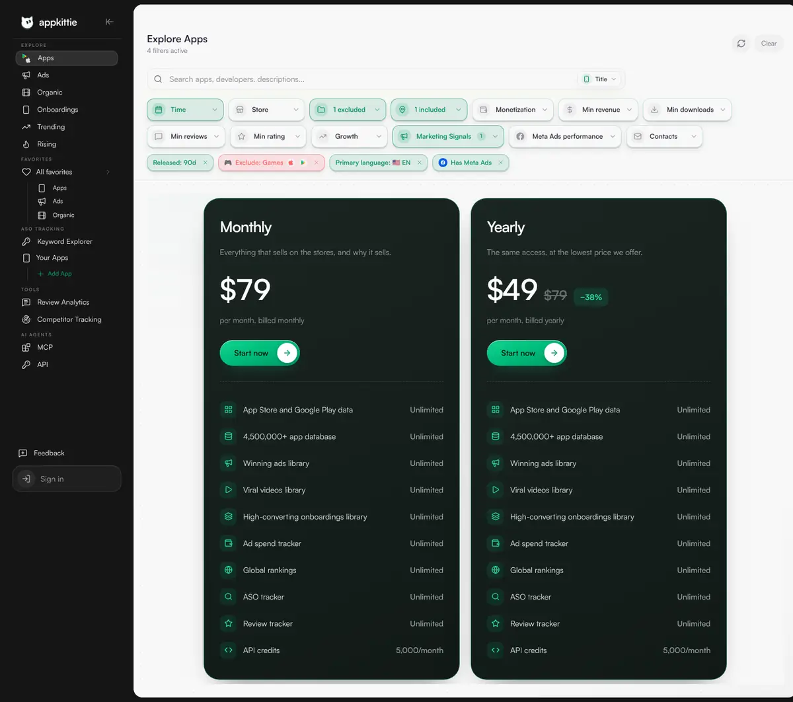

- **App-Shell:** schwarze linke Sidebar (ca. 240px, einklappbar über „Collapse sidebar“) mit Gruppenlabels in
  Versalien. Unten in der Sidebar stehen „Feedback“ und die Account-Karte (Gast: „Sign in“). Rechts liegt eine
  helle Canvas mit großem oberen linken Radius. Seitenkopf: Titel (H1) mit Untertitel bzw. „N filters active“,
  rechts Refresh, „Clear“ und (laut Marketing-Screenshot) ein grüner Export-Button.
- **Inline-Paywall:** Statt der Ergebnisse erscheinen die zwei dunklen Preiskarten. Bei ASO gibt es stattdessen ein
  zentriertes Modal „PRO · Unlock Keyword Explorer“ mit „Close paywall“, dahinter den leeren Workspace.
- **Module (Screens in [ux-11](assets/ux-11-dashboard-pages-guest.webp)):**

| Seite | H1 / Untertitel | Steuerelemente (beobachtet) |
|---|---|---|
| Ads | „Ads Library · Browse Meta and TikTok ads from mobile apps“ | Ansicht **Grouped / Ads** · Suche „Search apps“ + Search-in · Ad network · Media type · Category · App Language · MRR · Downloads · Ad estimates · Sort |
| Organic | „Organic Content · Browse apps with creator videos“ | **Grouped / Table** · Platform · App category · Content language · Followers · Views · Likes · App downloads · App MRR · Sort |
| Onboardings | „Onboarding Flows“ (Default: Sort App MRR · High first) | App category · App language · App downloads · App MRR · Screens · Sort · **Flow type: All / Onboardings / Web funnels** · **SCREENS-Chips:** Apps, All, Onboarding, Quiz, Home, Paywall, Permissions, Content, Profile Setup, Feature Intro, Welcome, Preferences, Other, Sign Up, Settings, Login, Success, Subscription, Lesson, Discount, Search, Checkout |
| Trending | „Store Rankings · Browse top charts by country and category.“ | Segment **Top Free / Top Paid / Top Grossing** · Apple Store / Google Play · Select country · Select category · Refresh |
| Rising | „Rising Apps · Discover apps with accelerating monthly recurring revenue“ | LAUNCHED **3M/6M/1Y** · GROWTH SIGNAL **2W/1M/3M** · Refine results (App store, Languages, Categories). Default: Exclude China (Chinese Simplified) + Exclude Games · „Top 100 apps“ · „View in Explore“ |
| Keyword Explorer | „Check keyword difficulty, popularity, and discover related keywords“ | Eingabe „Search, paste keywords, or start a topic…“ · „Keyword Workspace“ mit Tabs **All · Opportunities · Low diff · Pending** · Newest / Explore · rechte Spalte „Select a keyword“ |
| Your Apps | „Track your apps and discover AI-powered keyword opportunities“ | App-Liste + „Add“ · rechte Spalte „Select an app“ |
| Reviews | „Reviews · Monitor reviews, sentiment & AI insights across your apps“ | „How review monitoring works“ · Tabs **Overview · Reviews · Semantics · Improvements** · „All Apps 0“ · „Add app“ |
| Favorites | „Favorites · Apps, onboardings, ads, creators, and saved ideas“ | Tabs **Apps · Onboardings · Ads · Apple ads · Creators · Organic · Hot ideas** |

---

## 4. Produkt-Features im Detail

### 4.1 App-Explorer (`/dashboard/explore`)

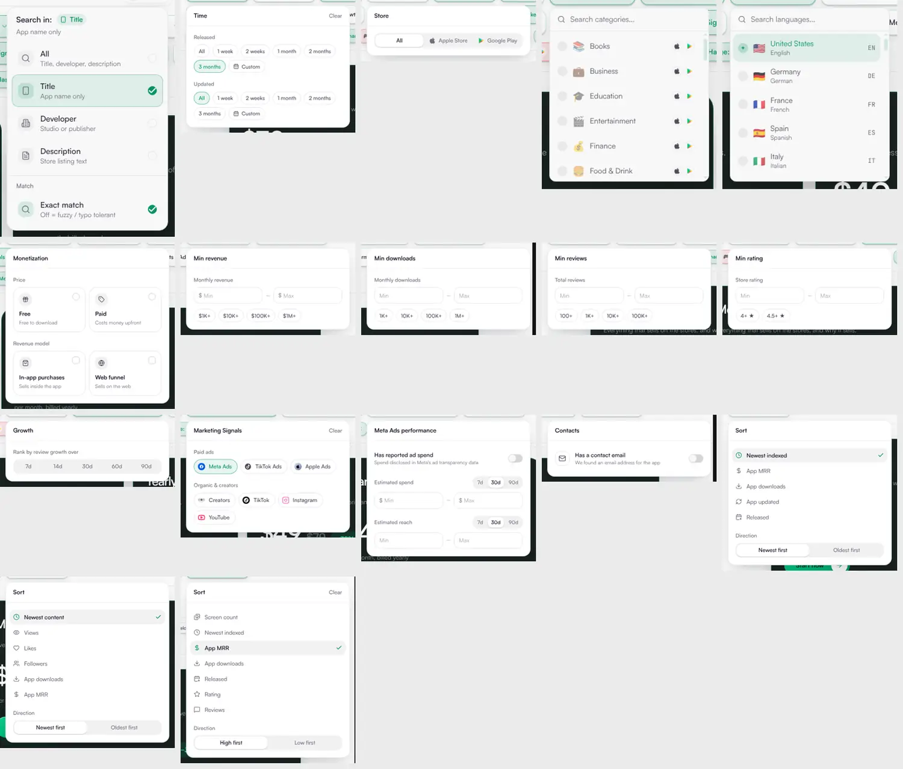

**Filterleiste (Popover-Chips, alle Optionen beobachtet):**

| Chip | Optionen | URL-/API-Parameter (Doku) |
|---|---|---|
| Suche + „Search in“ | Freitext „Search apps, developers, descriptions…“. Felder: **All** (Title, developer, description), **Title** (Default, „App name only“), **Developer** („Studio or publisher“), **Description** („Store listing text“). Schalter **Exact match** („Off = fuzzy / typo tolerant“) | `search` |
| Time | **Released** und **Updated**: All · 1 week · 2 weeks · 1 month · 2 months · 3 months · Custom (Datumspicker From/Apply) | `releasedAfter`, `updatedAfter` (UI-URL nimmt auch `90d`) |
| Store | All · Apple Store · Google Play | `source`, `excludedSource` |
| Category | 37 Kategorien mit Emoji-Icon (Books … Personalization, Store-übergreifend gemappt, z. B. „Books & Reference“, „Art & Design“). **Pro Zeile Include/Exclude und Auswahl pro Store** (Apple-/Play-Icon) | `categories`, `excludedCategories` |
| App Language (Primärsprache) | 59 Einträge Land + Sprache + Code mit Flagge (🇺🇸 United States · English · EN …), Include (+) und Exclude | `countries`, `excludedCountries` (gemappt auf `primary_language`), `languages` |
| Monetization | Price: **Free** („Free to download“) / **Paid** („Costs money upfront“) · Revenue model: **In-app purchases** („Sells inside the app“) / **Web funnel** („Sells on the web“). Laut JS zusätzlich App price, „Minimum number of in-app products“, Product price | `priceType`, `minPrice/maxPrice` |
| Min revenue | „Monthly revenue“ $Min–$Max + Presets **$1K+ · $10K+ · $100K+ · $1M+** | `minRevenue/maxRevenue` |
| Min downloads | „Monthly downloads“ Min–Max + **1K+ · 10K+ · 100K+ · 1M+** | `minDownloads/maxDownloads` |
| Min reviews | „Total reviews“ + **100+ · 1K+ · 10K+ · 100K+** | `minReviews/maxReviews` |
| Min rating | „Store rating“ + **4+ ★ · 4.5+ ★** | `minRating/maxRating` |
| Growth | „Rank by review growth over“ **7d · 14d · 30d · 60d · 90d** | `growthPeriod`, `growthType`, `min/maxGrowth` |
| Marketing Signals | Paid ads: **Meta Ads · TikTok Ads · Apple Ads** · Organic & creators: **Creators · TikTok · Instagram · YouTube** | `hasMetaAds`, `hasTikTokAds`, `hasAppleAds`, `hasCreators`, `organicSources`, `adsSource` |
| Meta Ads performance | Toggle „Has reported ad spend · Spend disclosed in Meta's ad transparency data“ · **Estimated spend** 7d/30d/90d $Min–$Max · **Estimated reach** 7d/30d/90d Min–Max | (Meta-Transparenzdaten, `meta_ads_transparency.summary.all_spend_usd`) |
| Contacts | Toggle „Has a contact email · We found an email address for the app“ | `hasEmails` (zusätzlich in der API: `hasWebsite`, `contentRating`, `developer`, Lifetime-Downloads/-Revenue) |

**Aktive Filter** stehen als Chip-Reihe unter der Leiste, jeder mit ×. Beispiele: „Released: 90d“ (grün), „🎮
Exclude: Games “ mit Store-Icons (rot getönt), „Primary language: 🇺🇸 EN“, „Has Meta Ads“, „Revenue:
$100K+“. Filter, die gerade aktiv sind, werden selbst grün getönt („1 excluded“, „1 included“) **[beobachtet]**.
Der Filterzustand steht vollständig in der URL, Links lassen sich also teilen. Die Default-Ansicht nach `/dashboard`
ist „neue Nicht-Spiele-Apps (90 Tage) auf Englisch mit Meta-Ads“. Das ist ein bewusst kuratierter Einstieg in
„was gerade gewinnt“ **[beobachtet + abgeleitet]**.

**Ergebnistabelle** (nur im öffentlichen Marketing-Screenshot sichtbar:
[`/assets/appkittie-explore-v2.webp`](https://www.appkittie.com/assets/appkittie-explore-v2.webp) und
Video-Poster `/assets/hero-poster-0824.webp`) **[beobachtet]**:

| Spalte | Darstellung |
|---|---|
| APP | Icon (Squircle) · Titel · Developer (grau, gekürzt) · Store-Icon (Apple bzw. Play-Dreieck) |
| CATEGORY | grauer Pill-Chip (Store-native Kategorie, z. B. „Music & Audio“, „Tools“ bei Play) |
| DOWNLOADS ↕ | „311K“, darunter Δ in % mit Pfeil (grün ↗ / rot ↘) |
| REVENUE ↕ | „$831K“ + Δ %, Default-Sortierung (fett hervorgehoben) |
| GROWTH 30D ↕ | „↗ +14.0%“ + Mini-Sparkline |
| RATING ↕ | „★ 4.8“ + „54.4K“ bzw. „362.8K reviews“ |
| RELEASED ↕ | relativ grün („1y ago“) + Datum („Aug 6, 2025“) |
| LAST UPDATE ↕ | relativ („25d ago“) + Datum |

Darüber: „Showing 50 of 61 apps“ mit „Prev · Page 1 / 2 · Next“, also Seitenblättern mit 50 Einträgen pro Seite.
Weitere Sortierschlüssel aus den Favoriten-Sortierungen: Growth 30d, Rating, Reviews, Downloads, Revenue,
Released, Last update **[beobachtet in JS]**. Leerzustand: „Try adjusting your filters or search criteria.“
Limitzustand: „Today's Explore limit is reached · Explore is paused for this request window. Come back when the
limit resets.“ **[beobachtet in JS]**.

### 4.2 App-Detail (eingeloggt, aus JS-Strings und Teasern) **[beobachtet in JS; Layout abgeleitet]**

- **Kopf und KPIs:** Est. Monthly Downloads, Est. Monthly Revenue, Sentiment („Unlock review sentiment“), IAP-
  Preisspanne („In-app purchases price range“), Active Ads, Apple Ads, Google Play Ads, Organic Videos, Size,
  Platforms, Rating, „Latest available chart positions by country“.
- **Sektionen:** Overview (Charts Downloads/Revenue/Reviews/Meta Ads über die Zeit, `appStore.historicals.getChartData`),
  Meta Ads (Creative-Bibliothek, längstlaufende zuerst), Ad Spend (Lifetime sowie 7/30/90 Tage, Reach, Spend und
  CPM pro Land, Alter/Geschlecht), Ads Funnel („Building your ads funnel · Analyzing creatives, landing pages, and
  campaign paths…“), Apple Search Ads („Only EU data is available.“), Google Play Ads, Onboarding, Organic Videos
  und Creators, Reviews (neueste zuerst, Sternefilter), Contacts (Decision makers, Emails, Social profiles: X,
  Facebook, Discord, LinkedIn, Instagram, YouTube, TikTok; Websites, Careers/Hiring, „Copy email“) und Details
  (Provider, Compatibility, Languages, Age Rating, In-App Purchases, Version, Release notes).
- **Datenmodell laut Doku (`GET /api/v1/apps/:appId`):** Identifikatoren (`_id`, `app_slug`, `source`, `app_id`,
  `store_id`), Basisdaten, Genres, `content_rating`, `languages`, `primary_language`, Preis, `score`, `reviews`,
  `current_version_*`, **`downloads`** (geschätzt/Monat), **`revenue`** (geschätzte MRR in USD), Datumsfelder,
  Developer-Infos, Kontakte (`emails`, `websites`, **`funnel`** mit Web-Funnel-Domains und `onboarding_url`,
  `socials`, `decision_makers`, `hiring`), `screenshots`, `historical_counts` (z. B. `reviews_growth_7d`,
  `downloads_growth_30d`, `revenue_growth_90d`), IAPs (Name, Preis, Dauer), `meta_ads_transparency` (pro Land und
  als Summary: `all_spend_usd`, `all_reach`, `ads_count`, `countries_count`), `organic_sources`.

### 4.3 Ads Library (`/dashboard/ads`)

- **Grouped-Ansicht** (Testimonial-Screenshot `alex-review-post-v2.webp`) **[beobachtet]**: pro App eine Zeile.
  Links steht eine App-Karte mit Rang-Badge, Icon, Name, Rating, REVENUE, INSTALLS, RELEASED und META ADS, dazu
  eine Creative-Collage. Rechts läuft ein horizontaler Streifen mit Ad-Karten (#1, #2 …, Netzwerk-Icons FB/IG/
  Messenger/Audience Network, Ad-Titel, Copy, Herz zum Speichern, externer Link, Video/Bild mit Play-Overlay).
  Darüber: „Showing 12 of 147 apps“ mit Pagination.
- **Ads-Ansicht:** einzelne Creatives. **Filter:** Ad network (All/Meta/TikTok), Media type (All/Image/Video),
  Category, App Language, MRR ($1K+…$1M+), Downloads, Ad estimates (Spend/Reach 7/30/90d). **Sort:** Newest indexed ·
  App MRR · App downloads · App updated · Released, jeweils Newest/Oldest first **[beobachtet]**.
- **Ad-Detail** (JS + Doku): Placements (Facebook, Instagram, Messenger, Threads, Audience Network, Google,
  Google Search/Display), Headline, Ad copy, Call to action, Est. spend · 30d, Lifetime spend, Est. reach · 30d,
  Impressions, Started/Stopped/Running, Advertiser, Landing page, „View in Meta Ad Library“, Länder. Hinweis im UI:
  „Modelled from Meta's transparency delivery data. Directional, not billed spend.“ Felder laut API:
  `is_active`, `publisher_platform`, `countries`, `start_date`, `end_date`, `num_served_days`,
  `impressions_text`, `average_impressions`, `cta_text`, `link_url`. Medien liegen auf `storage.appkittie.com`.
- **Landingpage-Widget:** gefächerte Ad-Karten (App-Name, „Active for 93 days“, Badge „✓ Top #1 Ad“, „See details
  →“) mit Netzwerk-Logos Meta, Instagram und TikTok.

### 4.4 Spend Tracker

Das Landing-Widget zeigt „Cal AI · Ad spend by country · last 30 days · **$2.4M**“. Dazu eine Punkt-Weltkarte mit
Pins und Bubbles, die im 15-s-Zyklus durch die Länder wechseln („🇧🇷 Brazil $210K“), und ein Länder-Leaderboard
mit Flagge, Balken und Betrag (US $1.2M, UK $480K, DE $355K, JP $186K, BR $210K) **[beobachtet]**. Im Produkt ist
das die Sektion „Ad Spend“ auf der App-Seite mit „Est. spend (30d)“, „Est. reach (30d)“, „Est. total spend/reach“,
„Ads in transparency report“ und „Countries“ **[beobachtet in JS]**. Als Datenbasis nennt das UI selbst Metas
Transparenzberichte (EU-DSA-Daten) **[beobachtet; Einordnung abgeleitet]**.

### 4.5 Organic Videos & Creators (`/dashboard/organic`)

- Filter: Platform (TikTok/Instagram/YouTube), App category, Content language, Followers (10K+/100K+/1M+), Views
  (10K+/100K+/1M+), Likes (1K+/10K+/100K+), App downloads, App MRR. Sort: Newest content · Views · Likes ·
  Followers · App downloads · App MRR. Ansichten **Grouped / Table** **[beobachtet]**.
- Post-Detail (JS): Caption, Views, **Engagement rate** („Likes, comments, shares & saves per view“), Likes,
  Comments, Shares, Saves, Posted, Platform, Format, Language, Post ID, „Original post“, „Save video“. Dazu
  Creator-Profile (Handle, Plattform, Follower, Land) zum Speichern.
- Landing-Widget: Endlos-Marquee aus vertikalen Video-Thumbnails mit Play-Icon und View-Zahl (25.7M, 24.4M,
  17.7M …). Alt-Texte haben das Schema „<App> — <Thema>“.

### 4.6 Onboarding Library (`/dashboard/onboarding`)

- Flow-Liste pro App, „Flow type: Onboardings / Web funnels“, Screen-Typ-Chips (20 Typen, siehe §3.10). Filter
  Screens („Screens in the flow“, Min–Max). Sort: Screen count · Newest indexed · App MRR · App downloads ·
  Released · Rating · Reviews (High/Low first) **[beobachtet]**.
- Screen-Viewer (JS): „Screens in this flow“, „View complete flow“ und pro Screen **„Design details“**: Colors,
  Fonts, UI elements, Typography details („Sizes in screenshot pixels“), Layout, „Corner radius“, Analysis notes.
  Die API liefert dieselben Daten als `onboarding_image_designs` (Farbpalette mit Rollen, Typografie mit
  `font_confidence`, UI-Elemente, Layout, Notes). Das heißt: **Jeder Screen wird per Vision-LLM analysiert**
  **[beobachtet in Doku; Verfahren abgeleitet]**. Die Library enthält nur Flows ab 4 Screens.
- Landing-Widget: „Lanes“ pro App (Icon, Name, „35 steps“). Darin läuft ein horizontaler Streifen mit
  Screen-Thumbnails, einzelne Screens tragen Tags **PAYWALL** oder **DISCOUNT**.

### 4.7 Store Rankings („Trending“) und Rising

- **Trending:** Top Free / Top Paid / Top Grossing × Store × Land × Kategorie. Tabellenspalten: **Rank · Rank
  change** („Compared with the previous recorded rank; updates may be more than a day apart.“) **· App · Trend
  (last 30 days) · Estimated monthly recurring revenue**. Die Ranking-Historie lässt sich pro App aufklappen
  **[beobachtet in JS]**.
- **Rising:** Ranking „accelerating MRR“ mit Launch-Fenster (3M/6M/1Y, Labels „Fresh launches / Early traction /
  Scaled launches“) und Growth-Signal (2W/1M/3M, „Fast signal / Momentum / Compounding“). Tabelle laut Testimonial-
  Screenshot: **Rang-Badge (Gold/Silber/Bronze) · App · MRR · Growth · Downloads**. Tooltip: „Review growth in the
  selected growth signal window“ **[beobachtet]**. Auch hier misst „Growth“ also das Review-Wachstum.

### 4.8 ASO: Keyword Explorer und Your Apps

- **Keyword Explorer** (Testimonial-Screenshot `filip-review-v2.webp` + JS): Länderwahl (Flagge) und „Keyword
  overview: calorie“ mit Badge „66 opportunity“. Vier KPI-Karten zeigen jeweils eine Spanne über alle Keywords des
  Workspaces mit Mini-Balken: **Opportunity 13–66 · Popularity 15–91 · Difficulty 23–52 · Ranking apps 210**.
  Tabs Ideas / Opportunities / Low Difficulty / Tracked, Buttons „Get keyword ideas“ und „+ Add Keyword“. Tabelle
  **Keyword · Opportunity (Pill + Balken) · Popularity (grüner Balken) · Difficulty (gelber Balken) · Apps (Icons)
  · Action**. Aktionen: Refresh, Copy, Export (CSV/JSON, „Spreadsheet format“/„Developer format“) und Clear.
- **Opportunity-Score** (Tooltip im JS, wörtlich): „When available, AppKittie uses the scraped traffic score…
  Otherwise it estimates: **popularity x (100 - difficulty) / 80**“ **[beobachtet]**.
- Weitere Funktionen (JS): „Keyword radar · Extract keyword ideas from competitor app titles“, „AI Keyword Ideas“,
  Country-Breakdown („Metrics across other markets for…“), eine Markt-Analyse mit Fortschritt („Select Store and
  Markets · More countries = longer analysis time“), Positions-Tracking pro eigener App („Position data will be
  collected daily“) sowie Best/Worst position.
- Landing-Widget: „🇬🇧/🇺🇸 Keyword overview: meditation · 77“, POPULARITY 33–77, DIFFICULTY 17–59 mit
  Balkenreihen, Tabelle Keyword/Popularity/Difficulty/Apps. Zwischen „meditation“ und „calorie“ wird animiert
  gewechselt.

### 4.9 Review Analytics (`/dashboard/reviews/*`)

App per Suche oder per Store-URL hinzufügen (für Gäste und Free-Nutzer: „App search requires a paid plan…
paste a store URL“). Der Fortschritt läuft in Stufen: **Validating URL → Fetching App Info → Extracting Reviews →
Analyzing Reviews → Preparing Dashboard**, minimierbar („the process continues in the background“). Tabs:
**Overview** (Total Reviews, Average Rating, Apps Monitored, Total satisfaction, **AI Summary**, „What Users Love /
What Needs Work“, Top topics, Vergleich zur Vorperiode), **Reviews** (Feed mit Suche, Sentiment Positive/Negative/
Neutral/Mixed, Topics), **Semantics** (Topic Timeline, Topic Trends Top 5/10), **Improvements** (Needs Work /
Strengths, Improvement Trends). Zeiträume 7/14/30/90/180 Tage. **Alerts per Slack** (OAuth
`/api/slack/oauth/authorize`) und per E-Mail **[beobachtet in JS]**.

### 4.10 Competitor Tracking (`/dashboard/competitors`, nur mit Login)

Aus dem JS **[beobachtet]**: „Monitor competitor launches, store updates, ads, organic content, and performance
changes in one daily timeline.“ Wettbewerber findet das Tool automatisch („We'll find similar apps… This takes a
few minutes“) oder man fügt sie manuell hinzu (Suche/URL, „Minimum MRR“). Die tägliche Diff-Timeline („Each daily
scan compares this app with the day before“) kennt die Ereignistypen **Launched · Stopped running · Running again ·
No longer listed · Edited**. Kategorien: Releases, Pricing, Metrics, Organic, Listing, Ads. Liste mit Downloads,
Growth (7d) und Meta ads. **E-Mail-Alerts** mit wählbaren Feldern.

### 4.11 Favoriten und „Hot ideas“

Favoriten gibt es für Apps, Onboardings, Ads, Apple-Ads, Creators und Organic-Videos. Sie lassen sich in
**Ordnern** ablegen (anlegen, umbenennen, löschen, verschieben). „Hot ideas“ sind gespeicherte App-Ideen mit
eigener Route `/dashboard/hot-ideas/<slug>`, ihr Inhalt war nicht feststellbar **[beobachtet in JS]**.

### 4.12 AI Access, MCP und API

Siehe §3.5 und §3.6. Im Produkt sind „MCP“ (→ `/mcp`) und „API“ (→ `/settings/api-keys`) eigene
Sidebar-Einträge unter „AI AGENTS“. Credits gelten für API und MCP gemeinsam (5.000/Monat). Auf der Landingpage
rotiert die AI-Demo durch vier Prompts **[beobachtet]**:

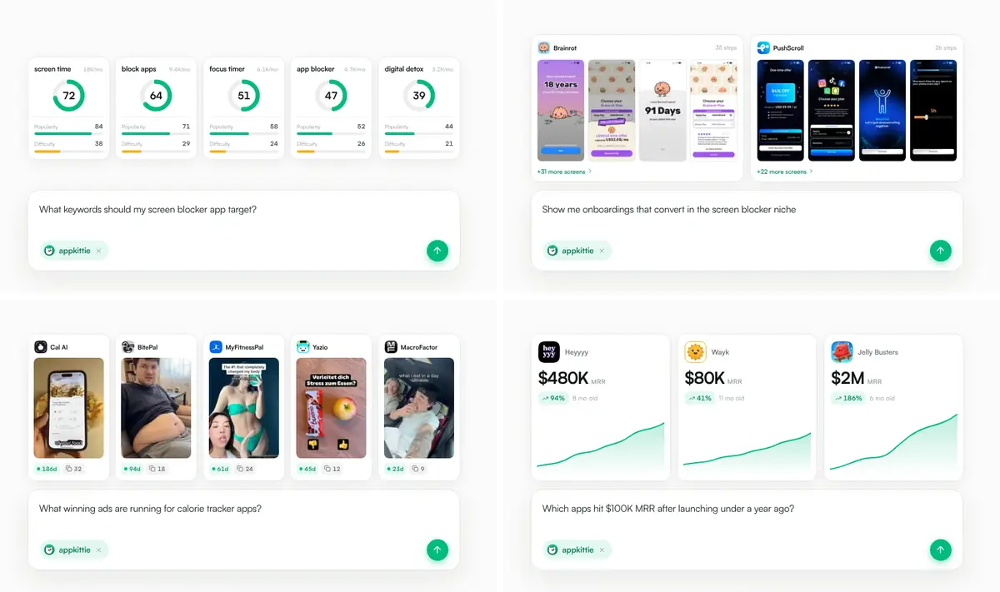

| Prompt | Ergebniskarte (Felder) |
|---|---|
| „What keywords should my screen blocker app target?“ | Keyword · Suchvolumen („18K/mo“) · Gauge-Score (72) · Popularity · Difficulty |
| „Show me onboardings that convert in the screen blocker niche“ | App · „35 steps“ · Screen-Streifen · „+31 more screens“ |
| „What winning ads are running for calorie tracker apps?“ | App · Creative-Thumbnail · Laufzeit („186d“) · Anzahl Creatives (32) |
| „Which apps hit $100K MRR after launching under a year ago?“ | App · MRR („$480K“) · Growth („94%“) · Alter („8 mo old“) |

### 4.13 Weitere Funktionen

| Funktion | Befund |
|---|---|
| **Export** | Grüner Download-Button im Explore-Header (Marketing-Screenshot). Keyword-Export als CSV/JSON. „Export is a paid feature“. Laut Pricing-Konfiguration „Export to CSV/JSON“ **[beobachtet]** |
| **Team** | `/settings/team`. 3 Seats inklusive (`NEXT_PUBLIC_TEAM_INCLUDED_SEATS`), weitere für $20/Monat. „This subscription is managed by your team owner“ **[beobachtet]** |
| **Billing** | `/settings/billing` („Plans & billing“). Kündigen „anytime from your dashboard“ |
| **Account-Menü** | Sidebar-Footer: Team, API keys, Plans & billing, Theme-Umschalter Light/Dark, Support (`mailto:support@appkittie.com`), Sign out **[beobachtet in JS]** |
| **Globale Suche** | Quick-Search mit „Cmd K“-Hinweis, Ergebnisse mit geschätzten Downloads/Revenue und „Search all results for…“ (`appStore.apps.quickSearch`) |
| **Feedback** | `/dashboard/feature-requests`: Typ Feature/Bug, Screenshots, Farblabels, „Your requests“ mit Status (`featureRequests.*`) |
| **Screenshot-Generator** | In AGB und Pricing-Features genannt („App Store Screenshot Generator“). Im JS gibt es nur Rate-Limit-Abfragen (`screenshots.crud.getRateLimits`, `screenshotTranslations.getRateLimits`) und keinen Sidebar-Eintrag, das Feature ist also vermutlich ausgeblendet oder Legacy **[abgeleitet]** |
| **Onboarding nach Signup** | Einfrage-Survey „How did you find us? · One question, and it genuinely shapes where we put our effort.“ (Optionen u. a. X / Twitter, Google Search, Reddit, Friend / Referral) plus `settings.completeOnboarding`. Onboarding-Varianten laufen als A/B-Test (`onboardingVariant`) **[beobachtet in JS]** |
| **Rate-Limits / Bot-Schutz** | Pro Modul ein Tageslimit („Today's Ads Library limit is reached“). Bei Verdacht: „Automated usage detected · We have detected automated usage. Your usage will reset in 24 hours.“ mit Countdown in Stunden, Minuten und Sekunden. Vor der Seite sitzt die Cloudflare-Challenge-Platform **[beobachtet]** |

---

## 5. Design-System

### 5.1 Technische Basis (aus den Bundles, die die Seiten laden) **[beobachtet]**

Next.js App Router mit **Turbopack** (`turbopack-*.js`, `?dpl=`-Deployment-Hash, RSC-Prefetch `?_rsc=`), React,
**tRPC** (`httpBatchStreamLink`, `superjson`, Header `x-trpc-source: nextjs-react`), **TanStack React Query**,
**Auth.js/NextAuth** (Session `/api/auth/session`, Provider `resend` + Google), **Stripe.js** (Embedded
Checkout), **Tailwind CSS v4** (`@layer properties`, Farben zusätzlich als `lab()`), **shadcn/ui** (Token-Satz
inkl. `--sidebar-*`, `--chart-1..5`), **Radix UI** (Popover, Dialog, Dropdown, Accordion), **Recharts**,
**react-day-picker**, **next-themes** (`attribute="class"`, `defaultTheme="light"`, `enableSystem`), **nprogress**
(Seitenlade-Balken), **lucide-react**-Icons, **tailwindcss-animate**. Landingpage-Komponenten nutzen CSS Modules
(`landing-module__…`, `AppFilterDemo-module__…`). Docs laufen auf Mintlify.

### 5.2 Typografie

| Einsatz | Schrift | Werte (CSS) |
|---|---|---|
| Fließtext/UI | **Satoshi Variable** (woff2, Gewichte 300–900, plus Italic; Fallback Arial mit size-adjust 109.35%) | `--font-satoshi`, `--font-sans`, im Dashboard `--font-dashboard-stack` |
| Eyebrows, Labels, Codes | **JetBrains Mono** | 11px, `letter-spacing: .03em`, Farbe `#00ab71`, Klammer-Stil „[ FEATURES ]“ |
| Hero-H1 | Satoshi | `clamp(50px, 6vw, 90px)`, Gewicht **590**, `letter-spacing: -.065em`, `line-height: .99` |
| Kapitel-H2 | Satoshi | `clamp(38px, 4.2vw, 63px)`, 590, `-.055em`, 1.02 |
| Proof/FAQ/Final-H2 | Satoshi | `clamp(40px, 4.5vw, 64px)`, 560, `-.055em` |
| Hero-Copy | Satoshi | `clamp(17px, 1.45vw, 21px)`, 1.5 |
| Sektions-Lead | Satoshi | 16px, `#68716d`, max. 600px |
| Demo-Widgets | Satoshi | sehr klein: 7–14px (häufig 9–13px), Gewichte 560–700 |

Typisch sind sehr enges Tracking bei großen Headlines und **feine Zwischengewichte** (560/590/620/650), die nur
mit Variable Fonts gehen. Zahlen nutzen `tabular-nums` (`.rank-badge`).

### 5.3 Farben

**Landingpage** (CSS-Variablen in `.landing-module__page`):

| Token/Wert | Verwendung |
|---|---|
| `#020908` | Seitenhintergrund (fast schwarz, grünstichig) |
| `--ink #07100f` / `--paper #fbfbfa` | Text bzw. Fläche der hellen „Shells“ |
| `--lime/--green #00bc7c` | Primärgrün (Akzente, Häkchen, Balken, Unterstrich der Nav-Links) |
| `--mint #62e8b6`, `#14d48f`, `#009a63`, `#068a5d`, `#00ab71` | Verlaufsstufen und Eyebrow-Farbe |
| CTA-Verlauf | `linear-gradient(160deg, #14d48f 0%, #00bc7c 45%, #009a63 100%)`, Text `#04180f` |
| `#101815` + Alpha (`…14`, `…1a`, `…73`) | Linien, Rahmen und Schatten auf Hell |
| `#68736e`, `#97a29d`, `#68716d` | Sekundär- und Tertiärtext |
| `#f0b429` | Sterne/Gold |
| Rot (Δ negativ) | Tailwind-Rottöne (z. B. `red-500 #fb2c36`) sind im CSS vorhanden, die genaue Zuordnung ist nicht geprüft **[abgeleitet]** |

**Dashboard** (shadcn-Tokens, `:root` = Light, `.dark` = Dark) **[beobachtet in `fe8823ccc2f06613.css`]**:

| Token | Light | Dark |
|---|---|---|
| `--background` | `#f8f8f8` | `#010203` (in `.dashboard-canvas`: `#020908`) |
| `--foreground` | `#080619` | `#f8f8f8` |
| `--card` / `--popover` | `#fff` | `#03060b` (Canvas: `#000`) |
| `--secondary` / `--muted` | `#f1f1f8` | `#0c121a` / `#151b24` |
| `--muted-foreground` | `#70707d` | `#8f8f8f` |
| `--border` / `--input` | `#e4e4eb` | `#ffffff14` / `#ffffff1f` (Canvas: Lime 12–16%) |
| `--primary` = `--kittie-lime` | **`#069461`** (dark `#047a50`, vivid `#07bc7c`, fg `#0a0a0a`) | gleich |
| `--destructive` | `#d42f34` | `#f14d4c` |
| `--chart-1..5` | Lime, `#00d3cb`, `#00d3cb`, `#ff8566`, `#f45fb0` | gleich |
| `--sidebar` | `#fdfdff` | `#000002` |
| Extra | `--color-kittie-orange #fb923c`, `.glow-purple` (`#a855f7`), `.gradient` (Konik-Verlauf Neon-Gelbgrün `#c8ff00`) | |

Beobachtet: Die Sidebar ist auch im Light-Mode schwarz, obwohl das Token `#fdfdff` lautet. Vermutlich ist die
Sidebar fest dunkel gesetzt **[abgeleitet aus Screenshots]**.

**Checkout** (`checkout-module__page`): `--ink #020908`, `--sheet #f6f8f7`, `--mint #62e8b6`,
`--green #00bc7c`, Textstufen `#aab3b0/#7d8884/#5f6a66`, `--line #ffffff17`, `color-scheme: dark`.

### 5.4 Raster, Abstände, Radien, Schatten

- **Grid/Spacing:** Tailwind-Basis `--spacing: .25rem`, Container bis `80rem`. Landing-Hero: `min-height:
  1060px`, Padding `calc(12px + shell-offset) 24px 110px`, Shell-Offset 88/112px (Header-Höhe). Review-Grid 3
  Spalten mit 16px Gap. Explore-Tabelle mit `--row-height: 49px` (Demo).
- **Hintergründe:** Hero und Final-CTA haben ein feines 52px-Linienraster in Lime 2% plus Radial-Glow
  (`#2de6a414`). Die Dashboard-Canvas trägt **ambient radial gradients** (Lime 4–5% oben links, Neutral unten
  rechts) und ein **Punkt-Raster** (0.85px-Punkte, 24px Abstand, 6.5–7% Deckkraft).
- **Radien:** Pills/CTAs `999px` · Pricing- und Review-Karten **28px** · helle Shell **30px** (mobil 22px) ·
  Demo-Panels 18px · Login-Karte 24px · Inputs/Chips 6–12px · App-Icons **22.5%** (iOS-Squircle) · Tailwind
  `radius-2xl 1rem`, `3xl 1.5rem`.
- **Schatten:** lange, weiche Schatten mit negativem Spread (`0 14px 30px -26px #10181573`, `0 24px 48px -30px
  #000000b3`). Grüne Glows (`0 0 55px -16px #00bc7c38`, `.glow-lime`). Innenkanten-Highlights (`inset 0 1px
  #ffffff0a`). Hover-Lift für Karten: `translateY(-8px)` + `0 25px 50px -12px #00000080`.
- **Rahmen:** Verlaufsrahmen über `padding-box`/`border-box` (Review-Karten: Lime 50% → 14% → Weiß 6% → Lime
  26%). Glas-Effekte `.glass` (`blur(12px)`, `#ffffff08`) und `.glass-lime`.

### 5.5 Komponenten-Katalog

| Komponente | Merkmale (beobachtet) |
|---|---|
| **Pill-CTA** | Grüner Verlauf, Text dunkelgrün, 15px/700, Padding `5px 5px 5px 26px`, rechts ein weißer Kreis mit „›“ bzw. Pfeil. Innen Glanzverlauf, beim Hover ein diagonaler Sheen-Sweep (`pillSheen .7s`), dazu mehrlagige Schatten |
| **Nav-Link** | 14px/500, Deckkraft 68% → 100%. Hover: Pill-Hintergrund mit 10% currentColor (Federanimation) und 2px-Unterstrich in Lime von der Mitte aus |
| **Trust-Pill / Signal-Chips** | Dunkle Pills mit Avatar-Stack bzw. Icon + Text |
| **Feature-Karte** | Heller Rahmen (Mint-Ton), Radius ~28px, oben das Demo-Widget, unten Titel und Text |
| **Filter-Chip (Dashboard)** | Icon links · Label · Chevron. Aktiv grün getönt mit grünem Rand. Zähler-Badge (z. B. „Marketing Signals 1“) |
| **Aktiver-Filter-Chip** | Klein und abgerundet, grün (Include) oder rot (Exclude), optional mit Store-Icons und × |
| **Popover** | Weiß, Radius ~12px, Titel + „Clear“, Sektionen mit kleinem Label. Darin Segmented Controls (7d/14d/…), Min–Max-Inputs plus **Preset-Chips** ($1K+ …), Auswahlkarten mit Icon, Titel, Untertitel und Radio (Monetization) sowie Switches |
| **Listen-Popover** | Suchfeld „Search categories…/Search languages…“, Zeilen mit Emoji/Flagge, Name, Code und Include/Exclude-Steuerung pro Store |
| **Segmented Control** | Grouped/Ads, Grouped/Table, Top Free/Paid/Grossing, 3M/6M/1Y. Aktiv grün getönt mit Punkt |
| **Datentabelle** | Header in Versalien und grau mit ↕-Sortierpfeilen. Zeilen 49–68px mit Icon, Zweizeilern (Wert + Δ), Sparkline, relativen Daten in Grün |
| **Δ-Anzeige** | „↗ +14.0%“ grün bzw. „↘ -3.4%“ rot, Pill-Variante „+112%“ auf hellgrünem Grund |
| **KPI-Kachel** | Label mit Icon, großer Wert; gesperrt „•••“ + Schloss im Kreis, grüner Akzentstreifen links |
| **Rang-Badge** | Gold/Silber/Bronze-Quadrate (Rising), `tabular-nums` |
| **Preis-Karte** | Dunkler Verlauf (`#1a2522 → #111917`), Lime-Rand 32%, Radius 28px. Preis groß, durchgestrichener Altpreis, Rabatt-Pill „−38%“. Feature-Zeilen mit Icon-Kachel und rechtsbündigem „Unlimited“ |
| **FAQ-Akkordeon** | Gestrichelte Trennlinie (`1px dashed #ffffff1f`), Frage 13px/650, Plus-Icon. Öffnen über `grid-template-rows 0fr → 1fr` (.34s) |
| **Tabs mit Lock** | Icon + Label + Schloss (App-Detail) |
| **Paywall-Modal** | „PRO“-Badge, Titel „Unlock …“, Text, zwei Preiskarten, „Cancel anytime · Secure payment · No hidden fees“ |
| **Leerzustände** | Zentriertes Icon, Titel („No apps monitored yet“), ein Satz Erklärung, Primär-Button |
| **Testimonial-Karten** | Dunkel mit Verlaufsrahmen und Glow, Avatar mit App-Icon-Badge, X-Logo, Verified-Häkchen |

### 5.6 Animationen und Bewegung

- **Scroll-Reveal:** `[data-reveal]` startet mit `opacity: 0`, `blur(6px)`, `translate 0 26px`, `scale .985` und
  geht über .62s mit `cubic-bezier(.22,.68,.24,1)` in die Endlage, gestaffelt per `--reveal-delay`.
- **Hero:** `heroIn` (.85s), `heroRise` (.95s, Verzögerung .5s), `heroGlowIn`, `heroShine` (4.2s loop).
- **Widgets:** Zähler-Roll im Filter-Demo (4,512,908 → 141,402 → 30,257 → 482). Filter-Pills aktivieren sich
  nacheinander. Bubbles und Pins der Spend-Karte im 15-s-Zyklus, um je 3 s versetzt. Wechsel der ASO-Datasets
  (`swapIn .3s`). Ad-Stack und Video-**Marquee** (`translate(calc(-50% - .75rem))`). Getippter Prompt mit Caret in
  der AI-Demo. `orbitSpin` (24s) und `radarPulse` in Modulen, die aktuell nicht sichtbar sind (Klassen
  `orbitalStage`, `radarDemo`, `analysisDemo`, `trafficChart` existieren noch im CSS).
- **Checkout:** `rise` mit Staffelung 40–300ms, Reviews-Karussell mit 10-s-Fortschrittsbalken, Skeleton-
  `shimmer`.
- **Barrierefreiheit:** 14 `prefers-reduced-motion: reduce`-Blöcke. Ein Inline-Style setzt bei Bedarf
  `[data-reveal]` auf sichtbar **[beobachtet]**.

### 5.7 Dark/Light

- Die Landingpage ist **fest dunkel mit hellen Inseln** (keine Umschaltung). Das `<html>` trägt Klasse `light`
  wegen `next-themes`, `defaultTheme="light"`.
- Das Dashboard hat einen vollwertigen Light- und Dark-Mode (Umschalter im Account-Menü, `localStorage.theme`,
  System-Option). Im Dark-Mode wird die Canvas grünstichig schwarz, Ränder bekommen Lime-Ton und Muted-Text wird
  weiß **[beobachtet in CSS]**.
- Sign-in und Checkout sind fest dunkel.

### 5.8 Responsive (390px)

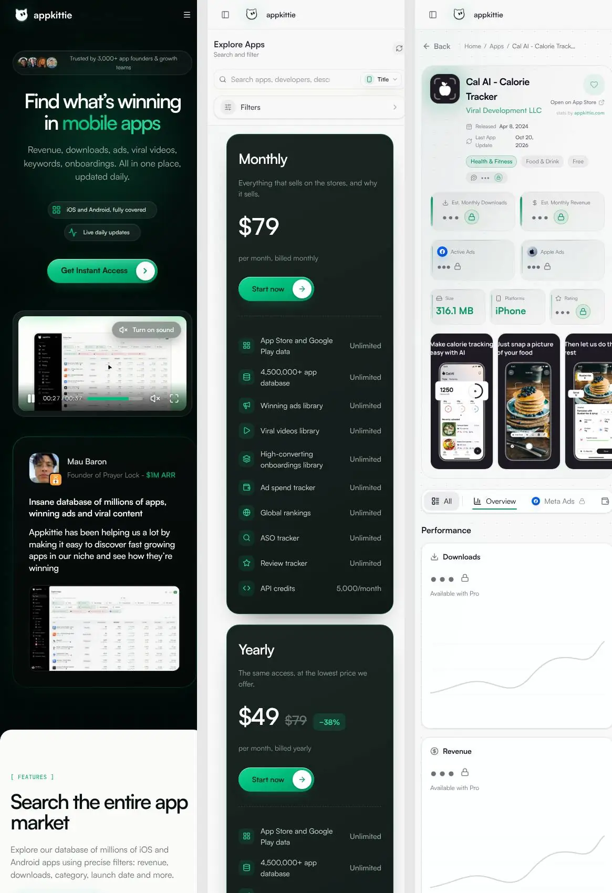

- **Landing:** Hamburger-Menü statt Nav. Die H1 bricht auf zwei Zeilen, Signal-Chips stapeln sich, das Video wird
  verkleinert. Die helle Shell hat 22px Radius ohne Seitenrand. Preiskarten stehen untereinander. Breakpoints sind
  individuell (max-width 800/700/600/560/520/480px), Hover-Effekte entfallen bei `hover: none`.
- **Dashboard:** Die Sidebar wird Off-Canvas („Displays the mobile sidebar“, Toggle-Icon im Header). Die
  Filterleiste schrumpft auf **einen „Filters ›“-Button** (Drawer mit „Active filters“, „Reset all filters“,
  „Close filters“). Suche mit „Title“-Selector bleibt sichtbar.
- **App-Detail:** KPI-Kacheln im 2er-Raster, Screenshots horizontal scrollbar, Tab-Leiste horizontal scrollbar,
  Charts volle Breite.
- Das Verhalten der Datentabelle auf Mobile ließ sich nicht prüfen (Paywall). Die Tabelle hat 8 Spalten und
  braucht vermutlich horizontales Scrollen **[abgeleitet]**.

---

## 6. Conversion-Funnel und Monetarisierung

### 6.1 Ablauf

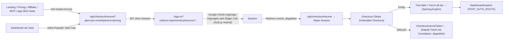

- **Beobachtet:** CTA-Ziel, der 307 auf `/sign-in` mit verschachteltem `redirect`, Client-Redirect von
  `/checkout` auf Sign-in, Konstante `POST_AUTH_ROUTE = "/dashboard/explore"` und `PRIMARY_CTA_ROUTE` im JS.
  Prefetches von `/checkout?_rsc`.
- **Parameter von `/api/checkout/resume` (aus JS):** `plan=<tier>:<billingPeriod>` (z. B. `pro:monthly`,
  `pro:yearly`), `next`, `skipTrial=1`, `offer`, `trial` (Trial-Checkout-Quelle), `source` (Checkout-Quelle),
  `onboarding` (Onboarding-Variante). Zwischenzustand im Storage-Key `pendingCheckout` **[beobachtet]**.
- **Checkout-Seite** (CSS- und JS-Strings): links Pitch „Start your … / Unlock what's …“ mit „Revenue, downloads,
  winning ads, viral videos, keywords and onboardings for every iOS and Android app. Updated daily.“ und der Liste
  **„Everything in Pro“**: 4.5M+ iOS & Android apps · Winning ads & ad spend · Viral videos & creators ·
  Onboardings & paywalls · Keyword & ASO tracking · Connect ChatGPT & Claude · Global charts & reviews · „Work on
  the same plan with your team“. Dazu „Trusted by 3,000+ app founders“ und ein Testimonial-Karussell („What app
  founders say about appkittie“). Rechts ein Sheet mit Stripe-Embed und Skeleton.
- **Fehler- und Sonderzustände:** „You already have Pro“, „Please sign in again“ (Session abgelaufen), „That offer
  has ended · The discount ran out before checkout opened, so nothing was created at the old price · Continue at the
  regular price“, „Checkout couldn't open“, „Checkout was canceled. You can try again anytime.“

### 6.2 Trial, Recovery, Rabatte **[beobachtet in JS]**

- **3-Tage-Trial mit Kartenprüfung:** „Verifying your card · Please keep this tab open“, „Your card was verified
  successfully“, „You have full access to all paid features for the next 3 days“. Bei Fehlschlag: „Card
  verification failed · You used a card without funds…“ mit „Try Another Card“. Eine Sofortzahlung ist über
  `skipTrial=1` bzw. `stripe.convertTrialToPaid` möglich. Felder im Subscription-Status: `isTrialEligible`,
  `trialVerificationStatus`, `canRetryTrial`, `showDashboardTrialPrompt`.
- **Payment Recovery:** „Your last payment didn't go through · Restore your Pro access · Add a new card. Your access
  comes back the moment the payment clears.“ (`stripe.getPaymentRecoveryDetails`).
- **Win-back:** „Restore your existing plan · Your 50% loyalty discount will be preserved automatically.“
- **Partner-Rabatt:** „A little gift from our partner · 20% off your first month“, „Partner gift · Your first month
  · partner discount applied at checkout“ (`stripe.getAffiliateOffer`, gekoppelt an Rewardful-Referrals).
- **Upsell im Kontext:** Wer an eine Grenze stößt, sieht „This feature is only for premium users, upgrade to
  premium now? / Not right now“ oder „Unlock Paid Features · Create a free account, then upgrade to unlock
  everything · **Your current filters stay in place**“. Nach dem Kauf: „**You're upgraded!** Your subscription is
  active. **Starting your request now.**“ Die blockierte Aktion wird also automatisch fortgesetzt.

### 6.3 Preise und Tier-Konfiguration (`stripe.getPricing`, von `/pricing` selbst geladen) **[beobachtet]**

| Tier (`tiers`) | Preis | Features laut Konfiguration |
|---|---|---|
| `anonymous` „Guest“ | 0 | „5 app searches per day · Basic app details · No historical data“ (`searchesPerDay: 5`) |
| `free` „Free“ | 0 | „10 app searches per day · Basic app details · Limited historical data · Community support“ |
| `pro` „Pro“ | monthly 79, yearly 588 | Unlimited app searches · Full app details & analytics · Meta Ads, Apple Ads, UGC content tracking · Review Tracker · Keyword Explorer & Tracker – ASO · App Store Screenshot Generator · Competitor Ad Spend Tracker · Historical data & trends · Export to CSV/JSON · API access — 5,000 credits/month · Priority support · 3 team seats included; add more for $20/month each |

`planTiers` (Stripe-Produkte): `free` (nicht self-serve), `starter` („appkittie-starter“, nicht self-serve),
**`pro` („appkittie-pro“, self-serve)** und `enterprise` (nicht self-serve). Alle zahlenden Tiers haben gleiche
Features (`ads`, `creators`, `videos`, `screenshots`) und Limits (`trackedKeywords`, `asoApps`, `reviewApps` =
∞, `apiCreditsMonthly` = 5000). **Abgeleitet:** Früher gab es mehrere Pläne (Starter, Enterprise), heute ist es
„One plan“. Die Gast- und Free-Kontingente werden in der UI kaum ausgespielt: Als Gast sahen wir in Explore sofort
die Paywall und gar keine Ergebnisse. Laut JS hat die Free-Stufe nur eingeschränkte Detailseiten („Downloads,
revenue and their history are part of paid plans“).

### 6.4 Social Proof (Übersicht)

„Trusted by/Join 3,000+ app founders & growth teams“ steht auf Hero, Sign-in, Checkout und Final-CTA. Dazu
kommen: Logo-Wall mit 35 Marken und Metrik-Unterzeilen, 8 Testimonials (Gründer mit ARR- oder User-Angaben und
X-Posts), ein Produktvideo, Screenshots des echten UIs in den Testimonials, „chatgpt recommended appkittie to me“
(AI-Sichtbarkeit als Proof) und Affiliate-Claims („Join hundreds of affiliates“, „the #1 app intelligence
platform“) **[beobachtet]**.

### 6.5 Tracking und Attribution **[beobachtet in Requests/JS]**

Google Ads (`AW-18125348783`) und GA4 (`G-8NXGKPZ9ZS`) via gtag, **Meta Pixel** plus serverseitige Conversions
(`POST /api/tracking/meta/page-visit` mit Event-ID zur Deduplizierung), **Reddit Pixel** plus
`/api/tracking/reddit/page-visit`, Simple Analytics, **Rewardful** (`r.wdfl.co/rw.js`, `data-rewardful`),
eigene Attribution `POST /api/attribution/events` mit `utm_source/medium/campaign/content/term`, `fbclid`,
`gclid`, `msclkid`, `rdt_cid`, `atp`, `sub1` (3 Retries). Cloudflare Bot-Challenge (`/cdn-cgi/challenge-platform`)
und E-Mail-Obfuscation (Docs). Ein Consent-Banner war nicht zu sehen.

---

## 7. Informationsarchitektur des eingeloggten Produkts

### 7.1 Navigations- und Routenbaum (beobachtet über Sidebar-Links und JS-Routen; Inhalte teils abgeleitet)

```
/dashboard ─► /dashboard/explore?excludedCategories=Games&countries=US&releasedAfter=90d&hasMetaAds=true
EXPLORE
├─ Apps .............. /dashboard/explore?…            (Filter-Tabelle, Export, Pagination)
├─ Ads ............... /dashboard/ads                   (Grouped | Ads)
│   ├─ /dashboard/ads/app/<slug>                        (alle Ads einer App)
│   └─ /dashboard/ads/<adId>                            (Ad-Detail)
├─ Organic ........... /dashboard/organic               (Grouped | Table)
│   └─ /dashboard/organic/<slug>
├─ Onboardings ....... /dashboard/onboarding?sortBy=revenue
│   └─ /dashboard/onboarding/<slug>?from=…              (Screen-Viewer + Design-Details)
├─ Trending .......... /dashboard/trending              (Store-Charts + Ranking-Historie)
└─ Rising ............ /dashboard/rising                (Top 100 „accelerating MRR“)
FAVORITES
├─ All favorites ..... /dashboard/favorites → /favorites/apps
├─ Apps | Ads | Organic  /dashboard/favorites/{apps,ads,organic}  (+ Tabs Onboardings, Apple ads, Creators, Hot ideas; Ordner)
└─ Hot ideas ......... /dashboard/hot-ideas/<slug>
ASO TRACKING
├─ Keyword Explorer .. /dashboard/aso/keywords?…
├─ Your Apps ......... /dashboard/aso/apps?app=<id>
│   └─ (eigene Apps inline in der Sidebar, „View all N“)
└─ Add App ........... /dashboard/aso/apps?add=1
TOOLS
├─ Review Analytics .. /dashboard/reviews/{overview,feed,semantics,improvements}  (feed?improvementArea=…)
└─ Competitor Tracking /dashboard/competitors
AI AGENTS
├─ MCP ............... /mcp (öffentlich)
├─ API ............... /settings/api-keys
└─ Feedback .......... /dashboard/feature-requests
Objektseiten
├─ /app/<slug> ....... App-Detail (öffentlich SSR, Pro-Inhalte nur eingeloggt)
└─ /developer/<name> . Publisher-Portfolio
Account (Sidebar-Footer)
├─ /settings/team · /settings/api-keys · /settings/billing · Theme · Support · Sign out
Kauf & Auth
├─ /sign-in · /api/sign-in/google · /api/auth/* · /api/checkout/resume · /checkout · /checkout/cancel?plan=
Onboarding nach Signup (abgeleitet): Discovery-Survey → completeOnboarding → (Trial-Prompt) → Explore
```

### 7.2 Backend-Module laut tRPC-Prozeduren (aus öffentlichen JS-Chunks, 113 Stück) **[beobachtet]**

| Router | Prozeduren (Auswahl) | Bedeutung für uns |
|---|---|---|
| `appStore.apps` | `getApps`, `getById`, `getPreview`, `quickSearch` | Explore, App-Detail, Cmd-K |
| `appStore.historicals` | `getChartData` | Zeitreihen-Charts |
| `appStore.trending` | `getCurrentCountryRankings`, `getRankingHistory`, `getRankingTrends` | Charts/Rankings |
| `appStore.reviews` / `appStore.meta` | `getSentimentByApp` / `getCategories` | Sentiment, Kategorie-Mapping (inkl. Emoji, Store-Quellen, Synonyme) |
| `ads` | `getAds`, `getAdById`, `getAdsByAppSlug(s)`, `getAppsWithAds`, `quickSearchApps` | Ads Library |
| `organic` | `getApps`, `getAppCount`, `getContent`, `getContentByAppSlugs` | Videos/Creators |
| `onboarding` | `getApps`, `getApp`, `getScreens` | Onboarding Library |
| `keywordTracking.keywords` | `add`, `getAll`, `getSuggestions`, `addSuggestion`, `getKeywordApps`, `getKeywordAppDetails`, `getCountryBreakdown`, `getAvailableCountries`, `refresh`, `refreshCountry`, `recommendFromCompetitors`, `exportSuggestions`, `delete` | Keyword Explorer |
| `keywordTracking.apps` | `add`, `getAll`, `getKeywordsWithHistory`, `getAppRankHistory`, `getKeywordAppsForApp`, `getAppKeywordAppDetails`, `addCustomKeyword`, `deleteKeyword`, `refresh`, `deactivate` | Your Apps (Rank-Tracking) |
| `keywordTracking.progress` / `reviewMonitor.progress` | `get` | Fortschritt langer Jobs (Polling) |
| `reviewMonitor.*` | `apps.{add,getAll,refresh,delete}`, `reviews.{list,getStats}`, `metrics.getHistory`, `insights.getSummary`, `semantics.{getTopics,getTopicTimeSeries,getDistinctTopics,getDistinctImprovementAreas}`, `improvements.{getImprovements,getImprovementTrends}`, `alerts.{create,update,delete,list,isSlackConfigured,getSlackInstallations}` | Review Analytics + Alerts |
| `competitorTracking` | `track`, `untrack`, `isTracked`, `listTracked`, `listTrackedIndex`, `listEvents`, `listDismissed`, `markChangesSeen`, `startDiscovery`, `getDiscoveryProgress`, `alerts.*` | Competitor-Timeline |
| `favorites` | `toggle`, `listKeys`, `listApps`, `listAppSlugs`, `listSnapshotFavorites`, `listHotIdeas`, `listFolders`, `listAllFolders`, `listAppFolders`, `renameFolder`, `deleteFolder`, `updateAppFolder`, `updateFavoriteFolder` | Favoriten + Ordner (Snapshot-Favoriten: Zustand zum Speicherzeitpunkt) |
| `dashboard` | `getCollection`, `getCountries`, `getTrendingCategories` | Kuratierte Sammlungen (abgeleitet) |
| `settings` | `getSubscription`, `needsDiscoverySurvey`, `completeOnboarding` | Abo-Status, Onboarding |
| `stripe` | `getPricing`, `getAffiliateOffer`, `createCheckoutSession`, `getCheckoutSessionStatus`, `convertTrialToPaid`, `getPaymentRecoveryDetails` | Billing |
| `featureRequests` | `create`, `listMine`, `listStatuses` | Feedback |
| `screenshots.crud` / `screenshotTranslations` | `getRateLimits` | Screenshot-Generator (versteckt) |

---

## 8. Empfehlungen für unser Interface

### 8.1 Diese Muster übernehmen wir (eigene Umsetzung, eigenes Branding)

1. **App-Shell mit Sidebar nach Aufgaben:** Entdecken (Apps, Ads, Videos, Onboardings, Charts, Aufsteiger),
   Merken (Favoriten mit Ordnern), Tracken (Keywords, eigene Apps, Reviews, Wettbewerber), Integrieren (API, MCP).
   Getrackte Apps stehen inline in der Sidebar. Die Sidebar ist einklappbar, auf Mobile Off-Canvas.
2. **Filter als Popover-Chips plus Zeile aktiver Filter**, der **gesamte Zustand in der URL**. Preset-Chips
   ($1K+, 10K+ …) zusätzlich zu Min–Max-Feldern. Include/Exclude pro Kategorie und Store. Ein kuratierter
   Default-Filter beim ersten Besuch („neue Apps mit Ads, die gerade wachsen“) liefert sofort ein Aha-Erlebnis.
3. **Dichte Datentabelle:** Wert und Δ in einer Zelle, Sparkline, relative Zeit plus Datum, sortierbare Spalten,
   Store-Icon, Kategorie-Chip. Dazu Export, Refresh und „Clear“ im Kopf.
4. **Grouped vs. Liste** für Medien-Bibliotheken (Ads, Videos): pro App gruppiert mit horizontalem Creative-
   Streifen, alternativ als flache Liste oder Tabelle.
5. **Objektseiten mit Anker-Tabs** (Overview, Ads, Spend, Funnel, Reviews, Kontakte, Details) und KPI-Kacheln
   oben.
6. **Öffentliche, SSR-gerenderte SEO-Seiten pro App** als Akquise-Kanal, Kennzahlen maskiert. Bei uns zusätzlich
   mit Sitemap, `schema.org/SoftwareApplication`, internen Links (Kategorie, Developer, Alternativen) und
   indexierbaren Ranking- und Kategorie-Seiten. AppKittie hat hier eine Lücke: keine Sitemap, kein robots.txt,
   keine Listen-Seiten.
7. **Inline-Paywall im Kontext:** Wer an eine Grenze stößt, behält Filter und Kontext, und nach dem Upgrade läuft
   die Aktion automatisch weiter („Starting your request now“).
8. **Zustände für lange Jobs** (Review-Extraktion, Keyword-Analyse, Wettbewerber-Discovery) mit benannten Stufen,
   Minimieren und Hintergrundverarbeitung. Saubere **Leerzustände** mit einem Satz und einem Primär-Button.
9. **API, MCP und Agent-Skills als eigene Produktfläche**, mit Credit-Preisliste pro Tool, Copy-Snippets pro
   Client, OAuth für Claude Web/Desktop und `llms.txt` für die Doku.
10. **Tägliche Diff-Timeline für Wettbewerber** (neue oder gestoppte Ads, Releases, Preisänderungen,
    Metrik-Sprünge) mit E-Mail- und Slack-Alerts.
11. **KI-Design-Analyse von Onboarding-Screens** (Farben, Fonts, UI-Elemente, Layout) als Differenzierungsmerkmal
    der Onboarding-Library.
12. **Cmd-K-Schnellsuche** über Apps, Developer und Keywords.

### 8.2 Hier machen wir es anders oder besser

| Thema | AppKittie (beobachtet) | Unser Ansatz |
|---|---|---|
| **Transparenz der Schätzungen** | „Growth“ ist Review-Wachstum, auf der Landingpage heißt es „MRR growth“. Kaum Methodik im UI | Metriken eindeutig benennen („Review-Wachstum 30T“, „gesch. MRR“). Jede Schätzung mit Info-Tooltip (Methode, Datenstand, Konfidenzband z. B. „$80K–$140K“) und „zuletzt aktualisiert“ |
| **Konsistente Zahlen** | 4.5M Apps (Marketing) vs. 2M+ (Docs), „no per-seat pricing“ vs. $20/Seat | Eine Quelle für Claims, automatisch aus der DB gezählt („X Apps, heute aktualisiert“) |
| **Free/Gast-Erlebnis** | Als Gast keine einzige Ergebniszeile, sofort Paywall | Echte Vorschau: Top 10–20 Zeilen sichtbar, Rest unscharf, z. B. 3 App-Details pro Tag frei. Gespeicherte Suchen erst nach Signup |
| **Gespeicherte Ansichten & Alerts** | Teilbare URLs, aber keine sichtbaren „Saved views“ | „Gespeicherte Suchen“ mit Benachrichtigung bei neuen Treffern (z. B. wöchentlicher Digest) |
| **Tabellen-Komfort** | Feste 8 Spalten, Pagination mit 50 | Spaltenwahl, Spaltenreihenfolge, Dichte-Umschalter, Virtualisierung/Infinite Scroll, Vergleichsmodus (2–4 Apps) |
| **Mobile** | Tabelle auf Mobile vermutlich nur scrollbar | Karten-Layout für Tabellen unter 640px, Bottom-Sheet für Filter |
| **Barrierefreiheit** | Sekundärtext `#97a29d` auf Weiß (≈2,6:1), Demo-Schrift 7–11px | WCAG AA (≥4,5:1), mindestens 12px in der UI, sichtbarer Fokus, Tastaturbedienung der Popover |
| **Datenschutz/EU** | Meta-, Reddit- und Google-Pixel ohne sichtbaren Consent | Consent-Management (TCF/Opt-in) vor Marketing-Pixeln, serverseitige Events nur mit Einwilligung, EU-Hosting-Option |
| **Sprache/Markt** | Nur Englisch, nur USD | UI auf DE + EN, Preise in EUR und USD, MwSt.-korrekte Rechnungen |
| **Pricing** | Ein Plan, Trial mit Karte (3 Tage) | Klarer Free-Tier plus Pro, Team-Plan mit transparenten Seats, API-Credits als Add-on. Trial ohne Karte oder mit klarer Erinnerung |
| **Wording** | „Steal“, „winning“, „replicate their success“ | Eigene Tonalität: „lernen“, „verstehen“, „Chancen finden“. Keine Übernahme von Claims oder Formulierungen |

### 8.3 Branding-Leitplanken (keine 1:1-Kopie)

- **Eigene Farbe statt Grün `#00bc7c` auf Schwarzgrün.** Vorschlag: eigene Primärfarbe aus einem anderen
  Farbraum (z. B. Indigo/Violett oder Koralle) mit neutralem Grau-Hintergrund. Positiv/Negativ bleiben
  semantisches Grün/Rot.
- **Eigene Schrift:** nicht Satoshi + JetBrains Mono. Freie Alternativen z. B. Inter, Geist oder Manrope mit
  Geist Mono oder IBM Plex Mono.
- **Eigenes Logo und Maskottchen**, kein Katzenmotiv. Keine Assets, Screenshots, Testimonials, Logo-Walls oder
  Texte von AppKittie übernehmen.
- Keine Eyebrow-Klammern „[ … ]“ und keine identische Sektionsreihenfolge, wohl aber das bewährte Grundmuster
  einer SaaS-Landingpage (Hero → Features → Proof → Pricing → FAQ → CTA).
- Paywall- und Preiskarten in eigener Bildsprache. Die Geste „Wert maskieren mit Schloss“ ist ein generisches
  Muster und darf bleiben.

### 8.4 Priorisierte Screens für unseren MVP (abgeleitet)

1. App-Explorer (Filter, Tabelle, Export) mit öffentlicher SEO-App-Seite.
2. App-Detail (KPIs, Charts, IAPs, Ratings, Ranking-Historie, Kontakte).
3. Store-Charts (Top Free/Paid/Grossing × Land × Kategorie) und „Aufsteiger“.
4. Keyword-Explorer (Popularity, Difficulty, Opportunity, rankende Apps) und Rank-Tracking eigener Apps.
5. Ads-Library (Meta-/TikTok-Creatives aus offiziellen Transparenz-Quellen) und Spend nach Land.
6. Review-Analytics (Sentiment, Topics, KI-Zusammenfassung) mit Alerts.
7. Onboarding-Library (später, weil eigene Capture-Pipeline nötig).
8. API- und MCP-Server mit Credits.

---

## 9. Offene Fragen

> **Nachtrag 26.10.2026:** Hot Ideas, `/checkout/cancel`, Screenshot-Generator, Trial-Prompt, Kontingente und das
> Produktvideo sind in [08 §2–3](08-produktvideo-und-luecken.md) beantwortet bzw. eingegrenzt.

- Wie sehen Explore-Ergebnisse, App-Detail-Inhalte und Ad- oder Video-Detailansichten eingeloggt genau aus
  (Spaltenkonfiguration, Mobile-Tabelle, Export-Dialog, Team-Verwaltung)? Hier sind wir auf Marketing-Screenshots,
  JS-Strings und Doku angewiesen.
- Greifen die Kontingente „5 searches/day“ (Gast) und „10/day“ (Free) heute überhaupt? Beobachtet haben wir nur die
  sofortige Paywall.
- Wann genau kommt der Trial-Prompt (`showDashboardTrialPrompt`), und welche Onboarding-Varianten laufen im
  A/B-Test?
- Was zeigt die Seite `/checkout/cancel` (Countdown-Rabatt-Ticket: Höhe, Dauer)? Bekannt sind nur die
  CSS-Klassennamen.
- Was ist ein „Hot idea“ und wie entsteht es (KI-generiert?)? Inhalt von `dashboard.getCollection`?
- Ist der Screenshot-Generator noch aktiv?
- Wie verhält sich das Produktvideo inhaltlich (37 s)? Frames ließen sich nicht extrahieren, der eigene Player legt
  das Poster darüber.

---

## 10. Quellen und Rohdaten

**Seiten (alle abgerufen am 25.10.2026, Headless Chromium über den Container-Proxy):**
[Startseite](https://www.appkittie.com/) · [Pricing](https://www.appkittie.com/pricing) ·
[Affiliate](https://www.appkittie.com/affiliate) · [Sign-in](https://www.appkittie.com/sign-in) ·
[MCP](https://www.appkittie.com/mcp) · [Docs](https://www.appkittie.com/docs) ·
[Docs-Index llms.txt](https://www.appkittie.com/docs/llms.txt) ·
[Filters Reference](https://www.appkittie.com/docs/reference/filters.md) ·
[Get App](https://www.appkittie.com/docs/api-reference/apps/get-app.md) ·
[Onboarding Screens](https://www.appkittie.com/docs/api-reference/onboarding/list-onboarding-screens.md) ·
[Get Ad](https://www.appkittie.com/docs/api-reference/ads/get-ad.md) ·
[Terms](https://www.appkittie.com/terms) · [Privacy](https://www.appkittie.com/privacy) ·
[Dashboard/Explore](https://www.appkittie.com/dashboard/explore) ·
[Beispiel-App-Seite](https://www.appkittie.com/app/app-cal-ai-calorie-tracker-id6480417616) ·
[Beispiel-Developer-Seite](https://www.appkittie.com/developer/Viral%20Development%20LLC) ·
[MCP-Skills-Repo](https://github.com/appkittie/aso-mcp-skills) ·
[Rewardful-Signup](https://appkittie.getrewardful.com/signup) ·
Marketing-Screenshot des eingeloggten Explorers:
[appkittie-explore-v2.webp](https://www.appkittie.com/assets/appkittie-explore-v2.webp),
[hero-poster-0824.webp](https://www.appkittie.com/assets/hero-poster-0824.webp).

**Rohdaten im Scratch-Ordner** `/tmp/claude-0/-home-user-app-check/d63162d4-fab3-5636-9ce0-a454efc0c4f0/scratchpad/ux/`:
`pages/*.json|png` (Seitentext, Links, Buttons, Requests, Screenshots) · `pop/` (Filter-Popover) · `inter/`
(Sign-in-Tabs, FAQ-Antworten, AI-Demo-Frames) · `static/` und `js/` (CSS/JS-Chunks der Seiten) ·
`ui-strings.txt` (1.521 UI-Strings) · `trpc-procs.txt` (113 Prozeduren) · `pricing-trpc.txt`
(Antwort von `stripe.getPricing`) · `probes1.json` (Pfad-Probes) · `docsdl/` (Doku-Markdown).

**Screenshots** (`docs/research/assets/`, WebP, auf max. 1.500px verkleinert): `ux-01-home-hero` ·
`ux-02-home-features` · `ux-03-home-track-widgets` · `ux-04-home-ai-demo` · `ux-05-pricing` · `ux-06-affiliate` ·
`ux-07-signin` · `ux-08-mcp` · `ux-09-dashboard-explore-guest` · `ux-10-explore-filter-popovers` ·
`ux-11-dashboard-pages-guest` · `ux-12-app-detail-guest` · `ux-13-mobile-390`.
