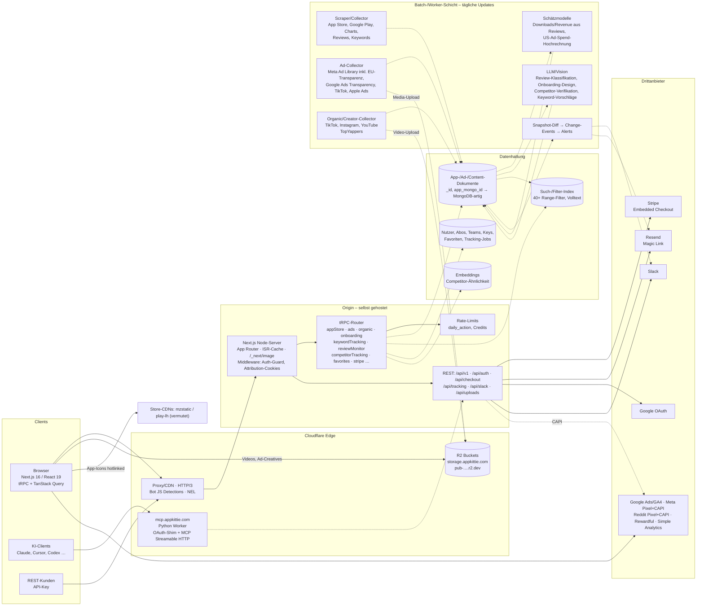
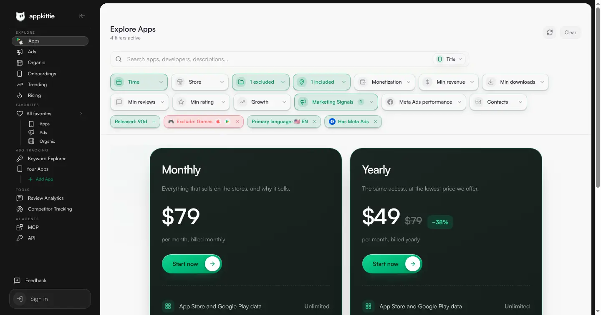

# 02 – Technik-Stack von AppKittie (Reverse Engineering des öffentlichen Clients)

> **Stand:** 25./26.10.2026 · **Build:** Next.js-Build-ID `I27JnNTJI4S3A_M7ufZ2S`, Deployment-ID `dpl=6b3d5cfd6d76f14a0089a7c00386b0a7b4d3dfff` (Assets mit `last-modified: Fri, 23 Oct 2026 11:02:51 GMT`)
> **Methode:** passive Analyse des öffentlich ausgelieferten Client-Codes und der Antworten öffentlicher Seiten mit **REA** (Reverse Engineer Anything) und eigenen Python-Auswertungen. Kein Login, kein Account, kein Checkout, keine selbst gebauten API-Aufrufe.
> **Kennzeichnung:** **[B]** = beobachtet (mit Quelle) · **[A]** = abgeleitet/vermutet · **offen** = nicht feststellbar.
> Zitierte Chunks liegen unter `https://www.appkittie.com/_next/static/chunks/<hash>.js?dpl=6b3d5cfd…` (im Text nur `<hash>.js`).

---

## 0. Kurzfazit

| Thema | Ergebnis |
|---|---|
| Hosting Web | **Cloudflare** als Proxy/CDN vor einem **selbst gehosteten Next.js-Node-Server** (`next start`/standalone), **nicht Vercel** [B Header, A Schluss] |
| Frontend | **Next.js 16.1.6** (App Router, **Turbopack**-Build), **React 19.3 canary**, **Tailwind CSS v4**, **shadcn/ui** auf Radix, lucide-Icons, Framer Motion, Recharts, Sonner, Zustand, date-fns, Zod [B] |
| API-Schicht | **tRPC v11** (`/api/trpc`, `httpBatchStreamLink`, **superjson**, TanStack Query): **89 Prozeduren in 13 Routern** im Client referenziert. Daneben wenige REST-Routen (`/api/auth/*`, `/api/checkout/resume`, Tracking, Uploads, Slack-OAuth) [B] |
| Muster | Fast wörtlich das **„T3-Stack“-Muster** (Next.js + tRPC + NextAuth + TanStack Query + Zod; Header `x-trpc-source: nextjs-react`) [B Code, A Einordnung] |
| Auth | **Auth.js / NextAuth v5** (`/api/auth/session`, `signIn("resend", …)` für Magic Links per **Resend**) + eigene Route **`/api/sign-in/google`** [B] |
| Payments | **Stripe** mit **Embedded Checkout** (`/checkout`, `clientSecret`, Stripe.js), Produkt-Keys `appkittie-pro` / `appkittie-starter` [B] |
| Tracking | Google Ads `AW-18125348783`, GA4 `G-8NXGKPZ9ZS`, **Meta Pixel** `1366173628208587` (+ serverseitige CAPI-Route), **Reddit Pixel** `a2_j41y0gpfo7fd` (+ CAPI-Route), **Rewardful** `47258e`, **Simple Analytics**, eigene Attribution [B] |
| Kein Fund | Kein Sentry/Fehler-Monitoring, keine Feature-Flag-Dienste, kein Support-Chat (Feedback ist eigenes Tool), keine Source Maps [B, begrenzte Suche] |
| Medien | Eigene Medien-Domain **`storage.appkittie.com`** (Cloudflare, vermutlich R2) für Ad-Creatives/Videos/Avatare, R2-Public-Bucket `pub-5fd76a8c…r2.dev` für das Hero-Video. App-Icons werden nicht über `/_next/image` geleitet [B, teils A] |
| MCP | **`https://mcp.appkittie.com/mcp`** (Streamable HTTP), Bearer-API-Key oder **OAuth-Shim** (Client-ID `appkittie-claude`, API-Key = Client-Secret, Scope `appkittie:read`). Discovery-Dokumente öffentlich, JSON im Python-Format → Python-Server (laut [06] Cloudflare Python Worker) [B] |
| Datenmodell | Client-seitige **Zod-Schemas** legen das App-, Ad-, Organic-Video-, Creator-, Onboarding-, Keyword- und Ranking-Objekt nahezu vollständig offen (snake_case-Felder, `_id`/`app_mongo_id` → **MongoDB-artiger Dokumentenspeicher** [A]) |
| Wichtig für die Datenbank-Frage | Felder wie `downloads_per_review`, `revenue_per_review`, `estimated_us_ad_count_multiplier`, `eu_reach`, Pipeline-Schritte `preparing_embedding`/`finding_similar_apps`/`classifying` zeigen: **Schätzungen auf Basis von Reviews, Hochrechnung aus EU-Ad-Transparenzdaten, Embeddings + LLM für Competitor-Matching und Review-Analyse, Vision-LLM für Onboarding-Design** [B Felder, A Verfahren] |

---

## 1. Methode, Werkzeuge, Grenzen

### 1.1 Ablauf (alle Schritte passiv und gedrosselt)

| # | Schritt | Werkzeug / Befehl | Ergebnis (Scratch, nicht im Repo) | REA-Evidence |
|---|---|---|---|---|
| 1 | Response-Header Startseite, Assets, `/_next/image`, Routen | `curl -sS -D -` (~25 Einzel-Requests, 0,5–1,5 s Pause) | `tech/headers-home.txt`, `tech/html/*.html` | – |
| 2 | Headless-Chromium (CDP-Port 9224), Startseite passiv beobachtet (Scrollen ohne Navigation) | `rea inspect-web-page … --observation-ms 20000 --include-json-body-shapes --include-storage-keys --include-console-text --include-script-sources` | `tech/inspect-home.json` (23 Skripte, 52 Requests, Storage-Keys) | `ev_f32a0a66…2f939c5f` |
| 3 | Bundle-Analyse Startseite inkl. Source-Map-Versuch | `rea analyze-web-bundle … --fetch-source-maps --detail summary --evidence_output … --view '{"kind":"javascript-routes",…}'` | `tech/bundle-home.evidence.json` | `ev_00051377…5443e5072d` (View `ev_0f79ed12…`) |
| 4 | Skripte exportieren und statisch analysieren | `rea export-web-scripts`, `rea analyze-javascript-application` (Startseite: Timeout bei 1 von 23 Dateien → Teil-Evidence) | `tech/scripts-home/`, `tech/jsapp-home.summary.json` | Export `ev_ec29e396…`, Teil-Analyse `ev_83f0140e…` |
| 5 | Öffentliche Seite `/dashboard` als Gast laden, Netzwerk mitschneiden | `rea capture-browser-scenario` (connect-Modus, nur `wait_for_timeout`); bricht nach 3,8 s ab, weil die App clientseitig nach `/dashboard/explore?…` umleitet. Teilbeobachtung mit 74 Requests verwertbar | `tech/scen-dashboard.json` | Teilbeobachtung (ohne ID) |
| 6 | Explore-Seite (Gast) passiv inspizieren, 47 Skripte exportieren | `rea inspect-web-page`, `rea export-web-scripts` | `tech/inspect-explore.json`, `tech/scripts-explore/` | `ev_5a532dd7…`, Export `ev_ac6b8632…` |
| 7 | Prerender-HTML der 20 Sidebar-Routen (je 1 GET) → Chunk-Listen → 45 neue Route-Chunks (je 1 GET, statisch, Cloudflare-Cache) | `curl` | `tech/html/`, `tech/chunks-app/` (2,7 MB) | – |
| 8 | Statische Analyse der 45 Route-Chunks (vollständig, 707.687 AST-Knoten, 1.797 Findings) | `rea analyze-javascript-application chunks-app --analysis-timeout-ms 900000 --max-heap-mb 3072 --detail summary --view …` | `tech/jsapp-app.evidence.json` (107 MB) | `ev_fea6ff7f…f1a2022e` (View `ev_62e76672…`) |
| 9 | ES-Modul-Importe prüfen | `rea trace-web-module-imports scripts-explore/manifest.json 39` | `tech/trace-turbopack.json` | `ev_1b044ad0…` |
| 10 | String-/Schema-Mining über alle 99 Chunks | eigene Python-Skripte (`tech/scripts/mine.py`, `trpc.py`, `ctx.py`, `dirmine.py`), Brace-Matching für `z.object({…})` | Konsolen-Ausgaben, `tech/mine-*.txt` | – |
| 11 | MCP-Discovery (nur öffentliche `.well-known`-Dokumente, 5 GETs + 1 HEAD) | `curl` | `tech/mcpdisc/` | – |

Scratch-Basis: `/tmp/claude-0/-home-user-app-check/d63162d4-fab3-5636-9ce0-a454efc0c4f0/scratchpad/tech/`

### 1.2 Grenzen

- **Keine Source Maps:** Kein Chunk enthält `sourceMappingURL` [B, `grep` über alle 99 Chunks]. `analyze-web-bundle --fetch-source-maps` fand nichts zum Laden. Originalpfade und Komponentennamen bleiben unbekannt; Namen stammen aus Turbopack-Exporten (`e.s(["PaywallInline",…])`) und Strings.
- **Nur Client-Code:** Server-Logik, Datenbank-Schema, Cronjobs und Scraper sind nicht sichtbar. Alle Aussagen dazu sind **[A]**.
- **Turbopack-Chunks sind klassische Skripte:** `trace-web-module-imports` liefert 0 native ES-Importe (`imports: []`) [B, `ev_1b044ad0…`]. Modulbeziehungen laufen über Turbopack-IDs (`e.i(843447)`).
- **REA vs. Regex:** REA erkennt tRPC-Hooks semantisch (`trpc:procedure:useQuery`), meldet aber nur 25 eindeutige Prozeduren. Die Regex-Inventur (`api.<router>….use*`) findet 89. Beide Listen stimmen überein, wo sie sich überschneiden.
- **Gast-Limit:** Gäste haben laut Server-Antwort „5 app searches per day“. Unsere wenigen Seitenaufrufe zählen dagegen. Datenzeilen (echte Apps) wurden nicht geladen (Paywall), also auch nicht gespeichert.

---

## 2. Hosting & Infrastruktur (HTTP-Header)

### 2.1 Beobachtete Header

| URL | Status | Relevante Header [B] |
|---|---|---|
| `https://appkittie.com/` | 301 → `https://www.appkittie.com/` | `server: cloudflare` |
| `https://www.appkittie.com/` | 200 | `server: cloudflare`, `cf-cache-status: DYNAMIC`, `x-powered-by: Next.js`, `x-nextjs-cache: HIT`, `x-nextjs-prerender: 1`, `x-nextjs-stale-time: 300`, `cache-control: s-maxage=31536000`, `vary: rsc, next-router-state-tree, next-router-prefetch, next-router-segment-prefetch`, `alt-svc: h3`, `nel`/`report-to` (Cloudflare NEL), **3 Cookies**: `_fbp` (Meta), `__attrib_visitor` (HttpOnly, signiert), `__attrib` (JSON: referrers, landingPage, pages, ts) |
| `/_next/static/chunks/turbopack-456de6ebf7224587.js` | 200 | `cache-control: public, max-age=31536000, immutable`, **`etag: W/"281d-1a1686d8778"`**, `last-modified: Fri, 23 Oct 2026 11:02:51 GMT`, `cf-cache-status: HIT`, `age: 203061` |
| `/_next/image?url=%2Fassets%2Fbabbel.webp&w=64&q=75` | 200 | `content-type: image/webp`, **`cache-control: public, max-age=2678400, must-revalidate`**, `content-disposition: attachment`, `content-security-policy: script-src 'none'; frame-src 'none'; sandbox;`, `x-nextjs-cache: HIT`, `vary: Accept`, `cf-cache-status: DYNAMIC` |
| `/assets/appkittie-explore-v2.webp` (public-Ordner) | 200 | `cache-control: public, max-age=14400`, `etag: W/"e410-1a1686be198"`, `cf-cache-status: REVALIDATED` |
| `/robots.txt`, `/sitemap.xml` | **404** | Next.js-404-Seite (`noindex`), Middleware setzt trotzdem Tracking-Cookies |
| `/dashboard`, `/dashboard/explore`, `/pricing`, `/sign-in`, `/affiliate`, `/mcp` u. a. | 200 | prerendered (`x-nextjs-prerender: 1`, `x-nextjs-cache: HIT`) |
| `/settings/api-keys`, `/settings/billing`, `/settings/team` | **307** | `location: /sign-in?callbackUrl=%2Fsettings%2Fapi-keys` (serverseitiger Auth-Guard, Auth.js-Parameter `callbackUrl`) |
| `/app/your-app-slug` | 200 | `cache-control: private, no-cache, no-store` → dynamisch gerendert, Titel „App Not Found \| appkittie“ |
| `/.well-known/oauth-authorization-server` (www) | 404 | – |
| `https://storage.appkittie.com/` | 404 | `content-type: text/plain;charset=UTF-8`, `server: cloudflare` |
| `https://pub-5fd76a8c179a4c9894c6a47e946b0a1d.r2.dev/0824%281%29.mp4` (HEAD) | 200 | `video/mp4`, 38,4 MB, `Accept-Ranges: bytes`, `Server: cloudflare`, `Last-Modified: Mon, 24 Aug 2026` |
| `https://mcp.appkittie.com/` (HEAD) | 405 | `content-type: application/json`, CORS `*`, `access-control-allow-headers: … X-AppKittie-API-Key, X-API-Key, Api-Key, Mcp-Session-Id, MCP-Protocol-Version …` |

Außerdem lädt jede Seite **`/cdn-cgi/challenge-platform/scripts/jsd/main.js`** und schickt einen `POST …/jsd/oneshot/…` [B, `tech/scen-dashboard.json`]. Das sind die **Cloudflare JavaScript Detections** (Bot Fight Mode / Bot Management).

### 2.2 Interpretation

| Frage | Befund | Status |
|---|---|---|
| CDN / Proxy | Cloudflare für alle Hosts (www, mcp, storage, r2.dev), HTTP/3, NEL-Reporting, Bot-JS-Detections | [B] |
| Vercel? | **Nein.** Es fehlen alle Vercel-Header (`x-vercel-id`, `x-vercel-cache`, `server: Vercel`). Der `dpl`-Parameter ist Next.js' `deploymentId` (40-hex, vermutlich ein Git-SHA) und kein Vercel-Beleg. | [B] fehlende Header · [A] Schluss |
| Origin-Server | ETags der Form `W/"<size-hex>-<mtime-hex>"` stammen vom Node-Paket `send`/`serve-static`, das der Next.js-Node-Server für statische Dateien nutzt. Dazu `x-powered-by: Next.js` und `x-nextjs-cache` (Next-eigener ISR-Cache auf dem Origin). → **selbst gehosteter `next start`/standalone-Server** hinter Cloudflare. Keine PaaS-Header (Railway `x-railway-*`, Render `rndr-id`, Fly `fly-request-id`) → VPS/Container (z. B. Hetzner/Coolify, AWS) oder Cloudflare Tunnel; nicht unterscheidbar. | [B] Header · [A] Schluss |
| HTML-Caching | Next sendet `s-maxage=31536000`, Cloudflare cacht HTML aber nicht (`cf-cache-status: DYNAMIC`). Ausgeliefert wird aus dem ISR-Cache des Origins (`x-nextjs-cache: HIT`). | [B] |
| Bild-Optimierung | **Next.js-eigener Optimizer** auf dem Origin (`/_next/image`, nur WebP, Qualität 75). `minimumCacheTTL` ist auf **31 Tage (2.678.400 s)** hochgesetzt; der Next-16-Default sind 4 h. Genutzt nur für lokale Marketing-Assets. | [B] |
| App-Icons | Werden **nicht** über `/_next/image` geladen. Im Code: `<Image … unoptimized referrerPolicy="no-referrer">` für App-Icons (`11594a08f73f85b4.js` @25606), also Hotlinking der Store-CDNs (mzstatic.com / play-lh.googleusercontent.com). | [B] Code · [A] Ziel-Domains (keine echten Datenzeilen geladen, Paywall) |
| Medien (Ads, Videos, Avatare, Onboarding) | Helper `getStorageMediaUrl(path)` → `https://storage.appkittie.com/<path>` (`cdbef04e7c509b76.js` @29237). Felder `video_storage_url`, `video_cover_storage_url`, `carousel_urls`, Ad-`src`/`poster`, Creator-`avatar_url` laufen darüber. | [B] |
| Speicher-Backend | `storage.appkittie.com` = Cloudflare (404 `text/plain` an der Wurzel), sehr wahrscheinlich **R2 Custom Domain**; das Hero-Video liegt nachweislich in einem **R2-Public-Bucket** (`pub-…r2.dev`, `37a1e7abf3faa446.js` @40446) | [B] r2.dev · [A] storage = R2 |
| Video-Streaming | Progressives MP4 per `<video>` (Range-Requests), **kein HLS/DASH, kein Mux/Stream/Bunny** gefunden | [B] negative Suche (`hls.js`, `mux`, `video.js`, `plyr`, `media-chrome`) |
| Security-Header | Auf HTML-Antworten **fehlen** HSTS, CSP, X-Frame-Options, X-Content-Type-Options, Referrer-Policy und Permissions-Policy. CSP gibt es nur auf `/_next/image` (Next-Default). | [B] |
| Server-Timing | nicht vorhanden | [B] |
| Middleware | setzt bei **jeder** Antwort (auch 404) `_fbp` und die `__attrib*`-Cookies, schützt `/settings/*` per 307 | [B] |

---

## 3. Frontend-Stack

| Komponente | Version / Beleg | Status |
|---|---|---|
| **Next.js** | **16.1.6** – String in `63b3f8bb93e2b961.js` (Next-Client-Runtime). App Router (`self.__next_f`-RSC-Payloads, `vary: rsc…`), Route-Gruppen `(marketing)` und `(pay)` im RSC-Baum (`tech/html/*.html`) | [B] |
| **Turbopack** (Production-Build) | Runtime-Chunk `turbopack-456de6ebf7224587.js`, `globalThis.TURBOPACK.push(…)`, reine Hash-Dateinamen | [B] |
| **React** | **19.3.0-canary-f93b9fd4-20251217** (die von Next 16 gebündelte Canary), `8570b780b951719d.js`, `63b3f8bb93e2b961.js` | [B] |
| **REA-Fingerprints** | `vendor_fingerprint: Next.js (high)`, `React (medium)` | [B] `ev_00051377…` |
| **Tailwind CSS v4** | CSS mit `@layer properties/theme/base/components/utilities`, `@property --tw-*`, `lab()`-Farben (Lightning CSS), `fe8823ccc2f06613.css` (395 KB) | [B] |
| **shadcn/ui** (neuer v4-Stil) auf **Radix UI** | `data-slot="avatar-fallback"`, `cn()`-Helper (`clsx` + tailwind-merge), Tokens `--background`, `--sidebar-accent-foreground`, `--radius`; `tw-animate-css` (`--tw-animation-*`); 8 Chunks mit `data-radix` | [B] |
| **Icons** | **lucide-react** (`createLucideIcon`, Modul 843447: `play`, `megaphone`, `circle-alert`, `trending-down` …) | [B] |
| **Animation** | **Framer Motion / motion** (`framerAppearId`, Projection-Engine; `96e18c1134dd115c.js`, `37a1e7abf3faa446.js`, `c25bd2b6c784d2d4.js`) | [B] |
| **Charts** | **Recharts** über **shadcn `<ChartContainer>`** (`data-slot="chart"`, `.recharts-curve`, `.recharts-surface`; `031df8e5e9353b9b.js`, `051d6e21719a2729.js`, `1fb92a6fbdc55a71.js`) | [B] |
| **Toasts** | **Sonner** (`data-sonner-toaster`, `6ebe34da4029324e.js`) | [B] |
| **Client-State** | **Zustand** mit `persist` (`1ed3b4761f4d1095.js`, localStorage `appkittie-pending-operations`) | [B] |
| **Datum** | **date-fns** + **react-day-picker** (`rdp-`-Klassen, `ffa276809eed795c.js`) | [B] |
| **Validierung** | **Zod** – Fehlercodes `invalid_type`, `too_small` …; Schemas für Filter und Datenobjekte im Client (`ac564ad456a248bc.js`, `7a317190dfe2bad1.js`) | [B] |
| **Server-State** | **TanStack Query** (`QueryClient`, `QueryCache`, `MutationCache`, `staleTime: 3e4`, `keepPreviousData`) | [B] |
| **API-Client** | **tRPC React** (`createTRPCReact`, `httpBatchStreamLink`, `loggerLink`) + **superjson** (`fb8f1c8b137b1b79.js` @111665) | [B] |
| **Video-Player** | eigener Player um natives `<video>` (Fullscreen, Mute, Fortschritt) | [B] |
| **Fonts** | Satoshi (Variable, selbst gehostet) + JetBrains Mono via `next/font` | [B] |
| **Branding-Tokens** | `--kittie-lime: #069461`, `--kittie-lime-vivid: #07bc7c`, Dark/Light-Theme | [B] CSS |
| Nicht gefunden | SWR, Redux, Jotai, react-hook-form, TanStack Table, react-virtual, Embla/Swiper, hls.js, Chart.js/ECharts/visx/nivo | [B] negative Suche |

---

## 4. Routen

### 4.1 App-Routen (aus Sidebar-DOM, Chunk-Strings und REA-Routeninventar)

Quellen: Gast-DOM von `/dashboard/explore` (`tech/snap-explore.json`), Navigationsdefinition in `134b16f7a8b8a4fb.js`, REA-Routeninventar `ev_62e76672…` (23 Routen, alle `confidence: low` = statische Kandidaten).

| Bereich | Route | Funktion (Label) | Zugriff Gast |
|---|---|---|---|
| Explore | `/dashboard` → leitet auf `/dashboard/explore` um | Einstieg | Shell öffentlich |
| | `/dashboard/explore` | „Apps“ – App-Datenbank mit 30+ Filtern | Filter sichtbar, Ergebnisse hinter Paywall |
| | `/dashboard/ads` | „Ads“ – Winning-Ads-Library | Shell |
| | `/dashboard/organic`, `/dashboard/organic/[slug]` | „Organic“ – virale Videos | Shell |
| | `/dashboard/onboarding` | „Onboardings“ | Shell |
| | `/dashboard/trending` | „Trending“ – Store-Charts | Shell |
| | `/dashboard/rising` | „Rising“ – schnell wachsende Apps | Shell |
| Favoriten | `/dashboard/favorites`, `/apps`, `/ads`, `/organic`, **`/creators`, `/onboardings`, `/apple-ads`, `/ideas`** | Ordner-basierte Favoriten | Shell |
| ASO | `/dashboard/aso/keywords` | „Keyword Explorer“ | Shell |
| | `/dashboard/aso/apps` (`?add=1`, `?app=…`), `/dashboard/aso/app/[id]`, `/dashboard/aso/competitors` | „Your Apps“, Keyword-Tracking pro eigener App | Shell |
| Tools | `/dashboard/reviews` + `/overview`, `/feed`, `/semantics`, `/improvements` | „Review Analytics“ | Shell |
| | `/dashboard/competitors` | „Competitor Tracking“ | Shell |
| | `/dashboard/feature-requests` | „Feedback“ | Shell |
| App-Detail | **`/app/[slug]`** | öffentliche App-Detailseite (dynamisch, `no-store`) | Teilansicht `_limitedData` |
| AI | `/mcp` | MCP-Landingpage mit Setup-Guides | öffentlich, `index, follow` |
| Settings | `/settings/api-keys`, `/settings/billing`, `/settings/team` | API-Keys, Abo, Team | **307 → `/sign-in`** |
| Kauf | `/pricing`, `/checkout` | Preise, Stripe Embedded Checkout | öffentlich |
| Marketing | `/`, `/affiliate`, `/terms`, `/privacy`, `/sign-in` | | öffentlich |
| Alt/Redirect | `/explore`, `/keywords` (als `signInRedirect`) | Altpfade | – |

Gast-Defaults beim ersten Besuch (localStorage `explore-first-visit-defaults-v2`): `/dashboard/explore?excludedCategories=Games&countries=US&releasedAfter=90d&hasMetaAds=true` [B, Ziel-URL nach dem Redirect].

### 4.2 Server-Routen außerhalb von tRPC

| Route | Methode | Zweck | Beleg |
|---|---|---|---|
| `/api/auth/session` (+ übliche Auth.js-Routen) | GET | Session (Gast: `null`) | [B] Netzwerk, Antwort `null` |
| `/api/sign-in/google?redirect=…` | GET (Redirect) | eigener Google-OAuth-Start | [B] `c980a30ca8b6e104.js` @7424 (`startGoogleSignIn`) |
| `/api/trpc/<proc>[,<proc>…]?batch=1&input=…` | GET/POST | gesamte App-API | [B] |
| `/api/checkout/resume?plan=pro:monthly&next=/pricing` | GET (Redirect) | Kauf-Einstieg aus CTAs | [B] Startseiten-Links |
| `/api/tracking/meta/page-visit` | POST `{eventId, path}` | serverseitige **Meta Conversions API**, Dedup per `eventId` | [B] Netzwerk + `da1b75390a0a40c3.js` @14244 |
| `/api/tracking/reddit/page-visit` | POST | serverseitige **Reddit Conversions API** | [B] Code |
| `/api/attribution/events` | POST `{eventId, occurredAt, campaignQuery, referrer}` | eigene First-Party-Attribution (UTM, `fbclid`, `gclid`, `msclkid`, `rdt_cid`, `atp`, `sub1`) mit Retry | [B] `da1b75390a0a40c3.js` @27475 |
| `/api/uploads/feature-requests` | POST | Datei-Upload für Feedback | [B] String |
| `/api/slack/oauth/authorize?…` | GET | Slack-App-Installation für Review-/Competitor-Alerts | [B] String |
| `/api/v1/*` | GET/POST | öffentliche REST-API mit API-Key (laut öffentlichem GitHub-Repo, siehe [06 §1.8]) | [B] Fremdquelle, **nicht aufgerufen** |

### 4.3 RSC-Payloads (`self.__next_f`)

- Die prerenderten Dashboard-Seiten enthalten **nur die Shell** (Layout, Sidebar, Metadaten, Chunk-Referenzen). **Keine** Datenobjekte; alle Daten kommen clientseitig per tRPC [B, `tech/html/dashboard_*.html`].
- `/mcp` (258 KB) rendert die Setup-Snippets vollständig serverseitig (SEO-Seite) [B].
- Fehlerseite `/app/[slug]` enthält den Hinweis „make sure the slug looks like `/app/your-app-slug`“ [B].

---

## 5. API-Schicht: tRPC

### 5.1 Transport [B]

```text
GET /api/trpc/appStore.meta.getCategories,stripe.getAffiliateOffer,stripe.getPricing
    ?batch=1&input={"0":{"json":null,"meta":{"values":["undefined"]}},…}
Header: x-trpc-source: nextjs-react
Antwort: JSONL-Stream (httpBatchStreamLink, superjson), z. B.
{"json":{"0":[[0],[null,0,0]],"1":[[0],[null,0,1]],"2":[[0],[null,0,2]]}}
{"json":[0,0,[[{"result":0}],["result",0,3]]]}
…
```

- Mehrere Queries werden **gebündelt** und **gestreamt** (tRPC v11).
- Fehler-Retry: kein Retry bei `FORBIDDEN`, `UNAUTHORIZED`, `TOO_MANY_REQUESTS`.
- **Rate-Limit-Modell:** Server liefert `error.data.rateLimitError = {tier: "daily_action", limit, resetInSeconds}`. Der Client feuert das Event `appkittie:daily-action-limit` und zeigt einen Countdown-Drawer (`DailyActionLimitDrawer`, `fb8f1c8b137b1b79.js` @110515). Explore zeigt „Today's Explore limit is reached“.

### 5.2 Prozedur-Inventar (89 Prozeduren, 13 Top-Level-Router)

Erhoben per Regex über 99 Chunks (`tech/scripts/trpc.py`); 25 davon bestätigt REA zusätzlich semantisch (`trpc:procedure:*` in `ev_fea6ff7f…` bzw. Teil-Evidence `ev_83f0140e…`).

| Router | Prozeduren (Q = Query, M = Mutation, IQ = InfiniteQuery) |
|---|---|
| `appStore.apps` | getApps Q, getById Q, getPreview Q, quickSearch Q |
| `appStore.historicals` | getChartData Q |
| `appStore.meta` | getCategories Q |
| `appStore.reviews` | getSentimentByApp Q |
| `appStore.trending` | getCurrentCountryRankings Q, getRankingHistory Q, getRankingTrends Q |
| `ads` | getAds Q, getAdById Q, getAdsByAppSlug Q, getAdsByAppSlugs Q, getAppsWithAds Q, quickSearchApps Q |
| `organic` | getApps Q, getAppCount Q, getContent Q, getContentByAppSlugs Q |
| `onboarding` | getApps Q, getApp Q, getScreens Q |
| `dashboard` | getCollection Q, getCountries Q, getTrendingCategories Q |
| `keywordTracking.keywords` | getAll Q, add M, delete M, refresh M, refreshCountry M, getSuggestions Q, addSuggestion M, exportSuggestions Q, recommendFromCompetitors M, getKeywordApps Q, getKeywordAppDetails IQ, getCountryBreakdown Q, getAvailableCountries Q |
| `keywordTracking.apps` | getAll Q, add M, deactivate M, refresh M, addCustomKeyword M, deleteKeyword M, getKeywordsWithHistory Q, getKeywordAppsForApp Q, getAppKeywordAppDetails IQ, getAppRankHistory Q |
| `keywordTracking.progress` | get Q |
| `reviewMonitor.apps` / `.progress` / `.alerts` | getAll Q, add M, cancel M, delete M, refresh M · get Q · getSlackInstallations Q, isSlackConfigured Q |
| `competitorTracking` (+ `.alerts`) | listTracked Q, listTrackedIndex Q, track M, untrack M, listDismissed Q, listEvents IQ, markChangesSeen M, startDiscovery M, getDiscoveryProgress Q · alerts.list Q, createEmail M, update M, delete M |
| `favorites` | listAllFolders Q, listKeys Q, listAppSlugs Q, listSnapshotFavorites Q, toggle M |
| `featureRequests` | create M, listMine Q, listStatuses Q |
| `screenshots.crud` | getRateLimits Q |
| `settings` | getSubscription Q, completeOnboarding M, needsDiscoverySurvey Q |
| `stripe` | getPricing Q, getAffiliateOffer Q, createCheckoutSession M, getCheckoutSessionStatus Q, getPaymentRecoveryDetails Q, convertTrialToPaid M |

### 5.3 Beobachtete Gast-Antworten (Struktur, Werte gekürzt) [B, `tech/scen-dashboard.json`]

- `settings.getSubscription` → `{tier:"free", plan:"Free", status:"none", currentPeriodEnd, cancelAtPeriodEnd, priceId, isSubscribed, hasPaidAccess, hasProAccess, team, isTrialing, trialEnd, billingInterval:"monthly", trialVerificationStatus, trialVerificationFailedAt, canRetryTrial, isTrialEligible, showDashboardTrialPrompt}`
- `appStore.meta.getCategories` → 37 Einträge `{id, name, icon(Emoji), storeSources:["apple_mobile","google_mobile"], keywords?:[…]}`. **IDs sind Apple-Genre-IDs** (`6018` Books, `6014` Games, `13018` Kids, `15000` Safari Extensions); reine Play-Kategorien heißen `google-dating`, `google-beauty` usw.; Play-Kategorien werden über `keywords` auf Apple-Genres gemappt (z. B. Games ↔ „Action Games“, „Puzzle Games“ …).
- `stripe.getPricing` → `tiers.{anonymous, free, pro}` mit `limits.searchesPerDay` **5 / 10 / Infinity**, Pro: `teamMembers: 3` („add more for $20/month each“), `planTiers.{free, starter, pro, enterprise}` mit `stripeProductKey` (`appkittie-starter`, `appkittie-pro`), `features {ads, creators, videos, screenshots}`, `limits {trackedKeywords, asoApps, reviewApps, apiCreditsMonthly: 5000}`, Preise `{monthly: 79, yearly: 588}`.
- Konstanten im Client: `TRIALS_ENABLED: false`, `TRIAL_PERIOD_DAYS: 7`, `APPKITTIE_TRIAL_CHECKOUT_SOURCE: "appkittie_trial"`, `PRIMARY_CTA_LABEL: "Get Instant Access"` (`1b30b35df82b9617.js` @14384).

---

## 6. Vermutetes Datenmodell (aus Zod-Schemas und Feldzugriffen)

Hauptquelle: `ac564ad456a248bc.js` (exportiert u. a. `appCreatorSchema`, `appleAdItemSchema`, `metaAdItemSchema`, `topYappersCreatorSchema`, `storeSourceSchema`, `sortBySchema`, `appStoreAdDocumentSchema`) und Feld-Mining je Route-Chunk. Feldnamen sind **[B]**, Bedeutung und Speicherort **[A]**.

### 6.1 App (Kernobjekt, Schema `P`, 70+ Felder)

| Gruppe | Felder |
|---|---|
| Identität | `_id` (Mongo-ObjectId-Stil), `app_slug`, `app_id`, `store_id`, `source` (`apple_mobile` \| `google_mobile`), `url` |
| Metadaten | `title`, `description`, `summary`, `icon`, `genres[]`, `genre_ids[]`, `primary_genre`, `primary_genre_id`, `content_rating`, `languages[]`, `primary_language`, `size`, `required_os_version`, `version`, `released`, `updated`, `release_notes`, `price`, `currency`, `free`, `supported_devices`, `screenshots[]`, `ipad_screenshots[]`, `appletv_screenshots[]` |
| Entwickler | `developer_id`, `developer`, `developer_url`, `developer_website` |
| Kontakte/Enrichment | `emails[]`, `websites[]`, `decision_makers[] {full_name, email, linkedin_url, x_url}`, `socials {twitter, linkedin, email, facebook, instagram, youtube, tiktok, discord}`, `hiring {careers_url, is_hiring}`, `funnel {name, domains[], onboarding_url}` (Web-Funnel) |
| Store-Kennzahlen | `score`, `reviews`, `current_version_score`, `current_version_reviews` |
| **Schätzungen** | `downloads`, `revenue`, `mau`, `dau` (Monatswerte) |
| Zeitreihen | `historical_counts` (Objekt mit je Metrik `value`, `growth_7d/14d/30d/60d/90d`, `date_created`), Erweiterung `historical_data[] {date, value, growth}` bzw. `{rank, reviews, revenue, downloads}` |
| Abgeleitete Metriken | für **reviews, current_version_reviews, score, current_version_score, size, price, downloads, revenue, mau, dau, downloads_per_review, revenue_per_review** jeweils `*_growth_7d/14d/30d/60d/90d`, plus `mau_last_30d`, `dau_last_30d` |
| Ads-Aggregate | `meta_ads[]`, `meta_ads_total_count`, `meta_ads_transparency` (s. 6.3), `meta_ads_estimated_reach_7d/30d/90d`, `meta_ads_estimated_spend_7d/30d/90d_usd`, `tiktok_ads_total_count`, `google_ads_total_count`, `apple_ads_total_count`, `apple_ads[]` |
| Creator/Organic | `app_creators[]` (Organic-Videos, s. 6.4), `topyappers_creators[]` |
| In-App-Käufe | `in_app_purchases[] {iap_id, name, price, duration}` |
| Onboarding | `onboarding_images[]`, `onboarding_url`, `onboarding_video`, `web_funnels` (s. 6.5) |
| System | `date_created`, `date_updated`, `*_timestamp`-Varianten, `app_released_date_timestamp`, `app_updated_date_timestamp`, `_limitedData` (Gast-Teilansicht) |

> **Hinweis für das Schätzmodell [A]:** `downloads_per_review` und `revenue_per_review` als eigene, historisierte Metriken sprechen dafür, dass Downloads/Umsatz **aus Review-Zuwächsen (Review-Velocity) mal Kategorie-/Länder-Faktoren** geschätzt werden. Siehe [04-schaetzmodelle.md](04-schaetzmodelle.md).

### 6.2 Explore-Filter (Input von `appStore.apps.getApps`, `dea32cce0ab9c568.js` @50356 + Schema @16472)

`limit` (50), `cursor` (Offset), `categories[]`/`excludedCategories[]`, `source`/`excludedSource`, `countries[]`/`excludedCountries[]`, `sortBy` ∈ {growth, rating, reviews, updated, released, app_updated, downloads, revenue, downloads_growth, revenue_growth, trending, newest}, `sortOrder`, `secondarySortBy/Order`, `priceType` ∈ {all, free, paid}, `min/maxPrice`, `min/maxRating`, `min/maxReviews`, `min/maxDownloads`, `min/maxRevenue`, `min/maxLifetimeDownloads`, `min/maxLifetimeRevenue`, `growthMetric`, `growthPeriod` ∈ {7d…90d}, `contentRating` ∈ {all, 4+, 9+, 12+, 17+}, `languages[]`, `developer`, `appSlug`, `releasedAfter/Before`, `updatedAfter/Before`, `search` (Phrase in `"…"` = exakt), `textSearchFields` ∈ {title, developer, description}, `hasWebsite`, `hasWebFunnel`, `hasIpadSupport`, `hasCreators`, `organicSources` ∈ {tiktok, instagram, youtube}, `hasOrganic`, `hasMetaAds`, `hasTikTokAds`, `adsSource`, `hasMetaAdSpend`, `min/maxMetaAdSpend`, `min/maxMetaAdsEstimatedSpend{7d,30d,90d}Usd`, `min/maxMetaAdsEstimatedReach{7d,30d,90d}`, `hasAppleAds`, `hasEmails`, `hasInAppPurchases`, `minInAppPurchaseCount`, `min/maxInAppPurchasePrice`. Antwort: `{items[], totalCount, nextCursor}`.

> **[A]** Diese Filterbreite (Range-Filter auf ~40 numerischen Feldern + Volltext + Facetten) passt zu einer **Such-Engine bzw. spaltenorientierten DB** (Elasticsearch/OpenSearch, Typesense, ClickHouse oder MongoDB Atlas Search) und nicht zu einfachen Postgres-Indizes.

### 6.3 Ad (Meta / Google / TikTok) und Ad-Transparenz

**Ad-Dokument** (`appStoreAdDocumentSchema`, @23404), denormalisiert mit App-Feldern:

- Ad: `ad_doc_id`, `ad_source`, `ad_network` (meta \| google \| tiktok), `ad_archive_id`, `page_id`, `page_name`, `page_profile_uri`, `page_like_count`, `type` (image \| video), `src`, `poster`, `preview_url`, `title`, `body`, `caption`, `description`, `label`, `cta_text`, `cta_type`, `link_url`, `display_format`, `format`, `is_active`, `publisher_platform`, `countries`, `regions`, `surfaces`, `primary_surface_code/name`, `start_date`, `end_date`, `first_shown`, `last_shown`, `num_served_days`, `running_days`, `meta_impressions_rank`, `impressions_text`, `impressions_lower_bound/upper_bound`, `average_impressions`, `spend`, `reach_estimate`, `estimated_lifetime_spend_usd`, `estimated_spend_7d/30d/90d_usd`, `estimated_lifetime_reach`, `estimated_reach_7d/30d/90d`, `transparency_by_location`, `region_stats`, `content`, `creative_text`, `ad_language`
- App-Kopie: `app_mongo_id`, `appstore_app_id`, `app_slug`, `app_title`, `app_icon`, `category(_id)`, `app_downloads`, `app_revenue`, `app_meta_ads_*`, `app_google_ads_advertiser_name`, `app_google_ads_total_count`, `app_*_timestamp`
- Filter (`ads.getAds`): `view` (full \| compact), `adSource`, `mediaType`, `status` (active \| inactive), `adLanguages`, `surfaces`, `startedAfter/Before`, `endedAfter/Before`, Spend/Reach-Ranges (Ad und App), `sortBy` ∈ {meta_impressions_rank, start_date, end_date, app_downloads, app_revenue, app_meta_ads_estimated_spend_*, …}

**Meta-Ads-Transparenz** (Schemas @9205–@10976): `summary {ads_count, us_ads_count, source_ads_count, estimated_us_ad_count_multiplier, countries_count, observed_reach, eu_reach, uk_reach, estimated_us_reach, all_reach, summed_reach, observed_spend_usd, eu_spend_usd, uk_spend_usd, estimated_us_spend_usd, all_spend_usd, summed_spend_usd, gender_breakdown {male, female, unknown}, age_breakdown[] {age_range, reach}, age_gender_breakdown[], periods {last_7d, last_30d, last_90d}}`, `countries` / `countries_by_code` (Record je Land: `reach, spend, is_estimated, cpm_usd, spend_usd, …`).

> **[A]** Das ist das Datenmodell der **EU-DSA-Transparenzdaten der Meta Ad Library** (Reach/Demografie nur für EU/UK). Der US-Wert wird **hochgerechnet** (`estimated_us_ad_count_multiplier`, `estimated_us_reach`, `estimated_us_spend_usd`), Spend über **CPM-Annahmen** (`cpm_usd`). Siehe [05-ads-videos-onboardings.md](05-ads-videos-onboardings.md).

**Apple Search Ads** (`appleAdItemSchema`, @11655): `ad_id`, `placement`, `format`, `language`, `audience {age, gender, location, customer_type}`, `first_seen`, `last_seen`, `running_for_days`, `icon_url`, `subtitle`, `has_iap`, `assets[] {video_url, picture_url, order, height, width, orientation}` → Struktur des **Apple Ad Repository** (EU) [A].

### 6.4 Organic-Content / Creator

- **Organic-Video** (`appCreatorSchema`, @5966): `user_id`, `handle`, `owner_id`, `followers_count`, `source` (tiktok \| instagram \| youtube), `content_id`, `media_type` (video \| slideshow), `content_language`, `video_description`, `date_created`, `video_url` (Original), **`video_storage_url`**, **`video_cover_storage_url`**, `carousel_urls[]`, `view_count`, `likes_count`, `comments_count`, `shares_count`, `saves_count`. Engagement-Rate im Client = Summe(likes, comments, shares, saves) / views.
- **Creator** (`topYappersCreatorSchema`, @5821): `user_id`, `handle`, `source`, `country`, `followers`, `avatar_url`. **TopYappers** ist laut [06 §1] ein Schwesterprodukt (gleiche Infrastruktur-Indizien).
- Filter (`organic.getContent`): `contentSources`, `contentLanguages`, `handles`, `createdAfter/Before`, `min/maxFollowers`, `min/maxViews`, `min/maxLikes`, App-Downloads/Revenue-Ranges; `sortBy` u. a. `view_count`, `likes_count`, `carousel_count`, `followers_count`.

### 6.5 Onboarding (`95dace7cadca4a43.js`)

- App-Ebene: `onboarding_images[]`, `onboarding_images_total_count`, `onboarding_image_labels[]`, `onboarding_image_designs[]`, `onboarding_video` mit `onboarding_chapters[] {start_seconds, end_seconds}`, `web_funnels`.
- **Screen-Labels:** onboarding, quiz, home, paywall, permissions, content, profile_setup, feature_intro, welcome, preferences, other, sign_up, settings, login, success, subscription, lesson, discount, search, checkout (@117050).
- **Design-Analyse pro Screen** (Zod, @84617): `{schema_version: 1, measurement_basis: "source_image_pixels", colors[] {name, hex, roles[]}, typography[] {role, font_family, font_confidence (low|medium|high), font_size_px, line_height_px, weight, letter_spacing_px, color}, ui_elements[] {name, kind, layout, appearance, corner_radius_px}, layout, notes}`.

> **[A]** Diese strukturierte Ausgabe (inkl. „font_confidence“ und „Analysis notes“) ist typisch für ein **Vision-LLM mit JSON-Schema-Output**, das jeden Screenshot annotiert. Die Screens selbst stammen aus eigenen Aufnahmen (Video + Kapitelmarken).

### 6.6 Keywords / ASO

- Keyword-Objekt (camelCase, `4aa38c4536b7a346.js`, `b274345e0241249a.js`): `id`, `keyword`, `status` (pending \| error \| …), `popularity`, `difficulty`, `trafficScore`, `storeSource`, `currentRank`, Rank-Historie (7/30/90 Tage), Länder-Breakdown `{country, popularity, difficulty}`.
- **Opportunity-Score:** `trafficScore` falls vorhanden, sonst `round(popularity × (100 − difficulty) / 80)`, begrenzt auf 0–100. UI-Text: „When available, AppKittie uses the **scraped traffic score** …“ (`2d48a893a1db145c.js` @9414).
- Märkte: `APP_STORE_COUNTRIES` mit Tiers 1–3, Paywall-Text „Multi-market analysis across 85+ countries“, KI-Vorschläge (`getSuggestions`, `recommendFromCompetitors`).
- Async: `keywordTracking.progress.get` (Polling).

### 6.7 Rankings / Trending

- `dashboard.getCollection({source, type, country, category, limit: 100, offset})` → `{items, total, updatedAt}`; Collections **TOP_FREE, TOP_PAID, TOP_GROSSING**.
- `appStore.trending.getRankingHistory({appSlug, source, collection, country, category})` → `history[] {date, current_position}`; UI: „Daily rank“ + „7-day average“ (`ec70fb0ab3693524.js`).
- Rising: `appStore.apps.getApps` mit Wachstumssortierung (`4115b13c8afba326.js`: `reviews_growth_14d/30d/90d`).

### 6.8 Reviews

- Monitor-Pipeline (`66d5dd0948f3589c.js` @34805): Schritte **validating → fetching → scraping („Extracting Reviews“) → classifying/generating („Analyzing Reviews“) → saving → completed | error**, Fortschritt per Polling (`refetchInterval` 1–5 s).
- Sentiment: `appStore.reviews.getSentimentByApp({appId, country, source})` → `sentiment {totalReviews, positiveReviews, …}`; Unterseiten `semantics` (Themen) und `improvements` (Verbesserungsvorschläge) [A: LLM-Klassifikation].
- Alerts per Slack (`/api/slack/oauth/authorize`) und E-Mail.

### 6.9 Competitor Tracking (`45b163b35e0732df.js`)

- Discovery-Pipeline: **loading_app → generating_keywords → searching_keywords → preparing_embedding → finding_similar_apps → combining_matches → verifying_matches → saving_competitors**.
- Change-Events `{field, type, before, after, metadata}` für Felder wie `icon`, `screenshots`, `release_notes`, `description`, `in_app_purchases`, `meta_ads`, `meta_ads_transparency` (z. B. „Meta spend (30d)“), `apple_ads`, `tiktok_ads`, `app_creators`, `topyappers_creators`; Typen u. a. `collection_changed`, `items_changed`; `content_fingerprint` zur Dedup.

> **[A]** Competitor-Matching = **Keyword-Suche + Vektor-Ähnlichkeit (Embeddings) + LLM-Verifikation**. Events entstehen durch **Snapshot-Diffs** der täglich aktualisierten App-Dokumente.

### 6.10 Nutzer, Abo, Team, Sonstiges

`User` (Auth.js), `Subscription {tier: free|starter|pro|enterprise, status: active|canceled|past_due|none, priceId, currentPeriodEnd, cancelAtPeriodEnd, billingInterval, trialEnd, trialVerificationStatus: pending|verified|failed}`, `Team {isOwner, Seats (3 inkl.)}`, `ApiKey` (+ Credits 5.000/Monat), `FavoriteFolder` + `Favorite {key, type: app|ad|organic|creator|onboarding|apple-ad|idea}`, `FeatureRequest {status, Upload}`, `AppIdea` (Filter `ideaCategories`, `needsBackend`, `needsDatabase`, `needsAi`; Schema @32722), Screenshot-Generator mit eigenem Rate-Limit (`screenshots.crud.getRateLimits`), `PendingOperation` (clientseitig persistiert).

### 6.11 ER-Skizze [A]

```mermaid
erDiagram
    APP ||--o{ APP_HISTORICAL : "historical_counts / historical_data"
    APP ||--o{ IN_APP_PURCHASE : has
    APP ||--o{ AD : "meta/google/tiktok"
    APP ||--o| META_ADS_TRANSPARENCY : "EU/UK reach+spend, US-Hochrechnung"
    APP ||--o{ APPLE_AD : "Apple Ad Repository"
    APP ||--o{ ORGANIC_CONTENT : app_creators
    APP }o--o{ CREATOR : topyappers_creators
    APP ||--o{ ONBOARDING_SCREEN : onboarding_images
    ONBOARDING_SCREEN ||--o| SCREEN_DESIGN : "Vision-Analyse"
    APP ||--o{ RANKING_ENTRY : "TOP_FREE/PAID/GROSSING je Land/Kategorie"
    APP ||--o{ REVIEW : "gescrapt"
    APP }o--|| CATEGORY : primary_genre_id
    APP ||--o{ CONTACT : "decision_makers/emails/socials"
    KEYWORD ||--o{ KEYWORD_RANK : "App-Rank je Land/Tag"
    USER ||--o| SUBSCRIPTION : Stripe
    USER }o--o| TEAM : seats
    USER ||--o{ API_KEY : credits
    USER ||--o{ FAVORITE_FOLDER : has
    FAVORITE_FOLDER ||--o{ FAVORITE : "app/ad/organic/creator/onboarding/idea"
    USER ||--o{ TRACKED_KEYWORD : ASO
    USER ||--o{ MONITORED_APP : reviews
    USER ||--o{ TRACKED_COMPETITOR : competitors
    TRACKED_COMPETITOR ||--o{ CHANGE_EVENT : "before/after-Diff"
    USER ||--o{ FEATURE_REQUEST : feedback
```



---

## 7. Drittanbieter (mit Fundstelle)

| Kategorie | Anbieter | Beleg [B] |
|---|---|---|
| **Auth** | **Auth.js / NextAuth v5** | `next-auth` + `https://errors.authjs.dev` in `8ad721fda3f5b2fb.js`; `/api/auth/session` im Netzwerk; `useSession`, `signOut({callbackUrl:"/"})` |
| Auth – E-Mail-Magic-Link | **Resend** (Auth.js-Provider-ID `resend`) | `signIn("resend",{email,redirectTo,redirect:!1})` in `c980a30ca8b6e104.js` @9376; Fehlertext „We couldn't send the sign-in email“ |
| Auth – Google | eigener Flow `/api/sign-in/google` | `c980a30ca8b6e104.js` @7424 |
| **Payments** | **Stripe** (Embedded Checkout, Stripe.js) | `stripe.*`-Router; `EmbeddedCheckoutPage`, `clientSecret`, `https://js.stripe.com` in `6900687a682930d5.js`; `stripeProductKey` |
| **Affiliate** | **Rewardful** | `<script src="https://r.wdfl.co/rw.js" data-rewardful="47258e">` (HTML); `stripe.getAffiliateOffer` |
| Ads-Conversion | **Google Ads** `AW-18125348783` | gtag-Script im HTML; Requests an `googleads.g.doubleclick.net`, `google.com/rmkt/collect`, `ccm/collect` |
| Web-Analytics | **Google Analytics 4** `G-8NXGKPZ9ZS` | `gtag/destination?id=G-8NXGKPZ9ZS`, `analytics.google.com/g/collect` (Netzwerk) |
| Web-Analytics | **Simple Analytics** | `scripts.simpleanalyticscdn.com/latest.js`, Beacon `queue.simpleanalyticscdn.com/simple.gif` |
| Ads-Pixel | **Meta Pixel** `1366173628208587` + **Conversions API** | `connect.facebook.net/en_US/fbevents.js`, `signals/config/1366173628208587`; `_fbp` wird **serverseitig** gesetzt; `/api/tracking/meta/page-visit` |
| Ads-Pixel | **Reddit Pixel** `a2_j41y0gpfo7fd` + CAPI | `redditstatic.com/ads/pixel.js?pixel_id=…`, `alb.reddit.com/rp?…event=PageVisit`; sessionStorage `_rdt_cfg`; `/api/tracking/reddit/page-visit` |
| Attribution | eigenes System | Cookies `__attrib`, `__attrib_visitor`; `/api/attribution/events`; localStorage `lastExternalReferrer(Time)`, `_gcl_ls` |
| Bot-Schutz | **Cloudflare JS Detections** | `/cdn-cgi/challenge-platform/scripts/jsd/main.js` |
| Medien-Speicher | **Cloudflare R2** (sicher für `pub-…r2.dev`, wahrscheinlich für `storage.appkittie.com`) | s. §2 |
| Alerts | **Slack** (OAuth-App), E-Mail | `/api/slack/oauth/authorize`, `reviewMonitor.alerts.getSlackInstallations`, `competitorTracking.alerts.createEmail`, localStorage-Key `appkittie:slack-oauth` |
| Creator-Daten | **TopYappers** (Schwesterprodukt) | Feld `topyappers_creators`, Schema `topYappersCreatorSchema` |
| Fehler-Monitoring | **keiner gefunden** (kein Sentry/Datadog/LogRocket/Highlight) | negative Suche über 99 Chunks |
| Produkt-Analytics | **keine** (kein PostHog/Mixpanel/Amplitude/Segment) | negative Suche |
| Feature-Flags | **keine** (Build-Konstanten wie `TRIALS_ENABLED: false`) | negative Suche (GrowthBook, LaunchDarkly, Statsig, Flagsmith, Unleash) |
| Support-Chat | **keiner** (kein Intercom/Crisp/Tawk/Plain); stattdessen eigenes Feedback-Tool `featureRequests.*` + Upload | negative Suche |
| E-Mail (transaktional) | Resend (für Login sicher; Alerts vermutlich ebenso) | [B] Login · [A] Rest |

### Storage-Keys im Browser [B, `inspect-*.json`, `--include-storage-keys`, nur Namen]

- localStorage: `lastExternalReferrer`, `lastExternalReferrerTime`, `_gcl_ls`, `explore-first-visit-defaults-v2`, `appkittie-pending-operations`
- sessionStorage: `_rdt_cfg`
- im Code zusätzlich: `appkittie-ui-preferences`, `appkittie-rankings-filters`, `appkittie-keyword-chart`, `appkittie:last-used-auth`, `appkittie:pending-auth`, `appkittie:reddit-capi-page-visit`, `appkittie:slack-oauth`
- keine IndexedDB, kein Cache Storage, kein Service Worker.

---

## 8. MCP-Server und öffentliche API (passiv geprüft)

### 8.1 Öffentliche Hinweise

| Quelle | Befund [B] |
|---|---|
| `/mcp` (SSR-HTML) | Endpunkt **`https://mcp.appkittie.com/mcp`** (Claude Code: `claude mcp add appkittie --transport http https://mcp.appkittie.com/mcp --header "Authorization: Bearer YOUR_API_KEY"`); Cursor/VS Code/Windsurf/Gemini mit `https://mcp.appkittie.com` + Bearer-Header; Zed über `npx mcp-remote`; Codex `bearer_token_env_var = "APPKITTIE_API_KEY"` |
| `/mcp` | **Claude Web/Desktop:** „Auth type: OAuth · Client ID: `appkittie-claude` · Client Secret: YOUR_API_KEY“ |
| `/mcp` | „14 MCP tools, 11 agent skills, 30+ search filters“; GitHub `appkittie/aso-mcp-skills` |
| `/mcp` Tool-Tabelle | `search_apps` (1 Credit/App), `get_app_detail` (1), `get_app_historicals` (1), `list_store_rankings` (1/App), `get_store_ranking_history` (10), `search_ads` (1/Ad), `get_ad_detail` (1), `list_creators` (1/Creator), `list_organic_content` (1/Item), `get_keyword_difficulty` (10), `batch_keyword_difficulty` (10/kw, max. 10), `get_app_reviews` (1/Review, „in real time“), `get_supported_countries` (FREE), `search_onboarding_screens` (1/App) |
| `GET https://mcp.appkittie.com/.well-known/oauth-protected-resource[/mcp]` | `{"resource": "https://mcp.appkittie.com/mcp", "authorization_servers": ["https://mcp.appkittie.com"], "bearer_methods_supported": ["header"], "scopes_supported": ["appkittie:read"]}` |
| `GET …/.well-known/oauth-authorization-server` und `/openid-configuration` | `issuer`, `authorization_endpoint: /authorize`, `token_endpoint: /token`, `response_types: ["code"]`, `grant_types: ["authorization_code","refresh_token"]`, `token_endpoint_auth_methods: ["client_secret_post","client_secret_basic"]`, `code_challenge_methods: ["S256"]`. **Kein `registration_endpoint`** (keine Dynamic Client Registration) |
| CORS-Header von mcp.* | erlaubt `Authorization`, **`X-AppKittie-API-Key`, `X-API-Key`, `Api-Key`**, `Mcp-Session-Id`, `MCP-Protocol-Version`; `expose: WWW-Authenticate, Mcp-Session-Id`; Methoden GET/POST/DELETE/OPTIONS |
| Doc [06 §1.8] (öffentliches Repo) | REST-Basis `https://www.appkittie.com/api/v1` (apps, historicals, trending, ads, creators, organic, keywords/difficulty, reviews, onboarding/screens), `X-RateLimit-*`, `X-Credits-Used/Remaining`, 402 bei fehlenden Credits; MCP läuft als **Cloudflare Python Worker** |

### 8.2 Einordnung [A]

- Die JSON-Formatierung der Discovery-Antworten (`{"resource": "…", …}` mit Leerzeichen nach `:` und `,`) entspricht Pythons `json.dumps`-Default; Node/`JSON.stringify` erzeugt keine Leerzeichen. Das bestätigt unabhängig den **Python-Worker** aus [06].
- Der OAuth-Server ist ein **Shim**: feste Client-ID, API-Key als Client-Secret, ein Scope. So funktionieren Claude-Connectors, die keine eigenen Header erlauben, ohne vollwertigen Identity-Provider.
- MCP-Worker und `/api/v1` greifen vermutlich auf dieselbe Daten-API bzw. Datenbank zu wie das tRPC-Backend; die Tool-Namen spiegeln die tRPC-Router (`search_apps` ↔ `appStore.apps.getApps`, `search_ads` ↔ `ads.getAds` mit `view: compact|full`).
- Keine Authentifizierungsversuche, kein Aufruf von `/mcp` mit POST, kein Aufruf von `/api/v1`.

---

## 9. Architekturdiagramm (vermutetes Gesamtsystem)

Durchgezogen = beobachtet, gestrichelt = abgeleitet.



---

## 10. Was der Code über den Datenaufbau verrät (Bezug zur Kernfrage)

| Signal im Client | Schluss für unseren Datenaufbau | Status |
|---|---|---|
| `downloads_per_review`, `revenue_per_review` + Growth-Felder | Download/Umsatz-Schätzung aus **Review-Zählern und deren Wachstum** (günstig, für Millionen Apps skalierbar) | [B] Felder · [A] Modell |
| `historical_counts` mit `growth_7d…90d` direkt am App-Dokument | **Vorberechnete Aggregate** beim täglichen Lauf statt Ad-hoc-Zeitreihenabfragen | [B] · [A] |
| Kategorien = Apple-Genre-IDs + Play-Mapping per Keywords | **Ein kanonisches Kategorie-Schema** (Apple), Play wird darauf gemappt | [B] |
| `meta_ads_transparency` mit `eu_reach`, `uk_reach`, `estimated_us_*`, `cpm_usd` | **Meta Ad Library (EU-DSA-Daten)** als Basis, US-Werte per Multiplikator, Spend per CPM-Annahme | [B] · [A] |
| `app_google_ads_advertiser_name`, `apple_ads[]`, `tiktok_ads_total_count` | Google Ads Transparency Center, Apple Ad Repository, TikTok Ad Library | [B] Felder · [A] Quellen |
| `video_url` (Original) **und** `video_storage_url` (eigene Kopie) | Videos werden **kopiert und selbst gehostet** (R2), nicht nur verlinkt | [B] |
| Review-Pipeline „scraping → classifying“, `get_app_reviews` „in real time“ | Reviews **on demand** pro beobachteter App, nicht für alle 4,5 Mio. Apps | [B] · [A] |
| Competitor-Pipeline mit `preparing_embedding` | **Embeddings** über App-Texte, Vektorsuche, LLM-Verifikation | [B] Schrittnamen · [A] |
| Onboarding-Design-Schema (`schema_version: 1`, `font_confidence`) | **Vision-LLM** mit strukturiertem Output pro Screenshot | [B] Schema · [A] |
| `_limitedData`, Gast-Limits 5/10/∞, `daily_action`-Limit, Credits | Anti-Scraping und Upsell auf API-Ebene; zusammen mit Cloudflare-Bot-Schutz | [B] |
| `appkittie-pending-operations`, `*.progress.get`-Polling | **Asynchrone Job-Queue** für teure Nutzeraktionen (Keyword-Refresh, Review-Import, Competitor-Discovery) | [B] |

---

## 11. Empfehlung für unseren Tech-Stack

Leitidee: AppKitties Web-Stack ist **bewusst „langweilig“ und schnell gebaut** (T3-Muster). Die eigentliche Arbeit steckt in der Daten- und Job-Schicht. Wir übernehmen das bewährte Web-Muster und investieren in eine sauberere Datenarchitektur. Abgleich mit [07-architektur-roadmap.md](07-architektur-roadmap.md).

| Schicht | Empfehlung | Begründung aus den Befunden |
|---|---|---|
| Web-Framework | **Next.js 16 (App Router, Turbopack)** + React 19, TypeScript | identisch zu AppKittie, ausgereift; SSR-SEO-Seiten (`/app/[slug]`, `/mcp`) plus Client-Dashboard |
| UI | **Tailwind v4 + shadcn/ui (Radix) + lucide + Recharts (shadcn Charts) + Sonner** | AppKittie zeigt, dass damit ein dichtes Daten-UI schnell entsteht. Für große Tabellen zusätzlich **TanStack Table + Virtualisierung** (fehlt bei AppKittie, Seitengröße 50) |
| API intern | **tRPC v11 + Zod + TanStack Query + superjson** | typsicher Ende-zu-Ende, Batch/Streaming; Zod-Schemas teilen wir mit Ingest-Workern |
| API extern | **REST `/api/v1` (OpenAPI aus Zod generiert) + MCP-Server** (TypeScript MCP SDK oder Python FastMCP) mit **Credits** pro Zeile | Feature-Parität zu AppKittie; **vollwertiges OAuth 2.1 mit Dynamic Client Registration** statt Shim als Vorteil |
| Auth | **Better Auth** oder Auth.js v5 (Google + Magic Link per Resend), Organisationen/Teams | AppKittie nutzt Auth.js + eigenen Google-Flow; Better Auth bringt Orgs/Teams und API-Keys schon mit |
| Payments | **Stripe Billing + Embedded Checkout**, Seats als Quantity, Affiliate über **Rewardful** oder Stripe-native Promotion Codes | 1:1 bewährt |
| Datenbanken | **Postgres** (Nutzer, Abos, Favoriten, Jobs; + **pgvector** für Competitor-Embeddings) und **ClickHouse** für App-Zeitreihen, Rankings, Ads und Facettenfilter über Millionen Zeilen. Optional **Typesense/Meilisearch** für Volltext-Schnellsuche | AppKittie nutzt einen MongoDB-artigen Dokumentenspeicher mit vielen denormalisierten `*_growth_*`-Spalten. ClickHouse liefert dieselben Range-Filter günstiger und mit Zeitreihen nativ. Details in [03-datenbank-aufbau.md](03-datenbank-aufbau.md) |
| Jobs/Ingest | Queue + Worker (**BullMQ/Redis** oder **Temporal/Inngest**), Scraper in **Python oder Node** auf günstigen VMs (Hetzner), Proxies nach Bedarf | AppKitties Fortschrittsschritte zeigen job-basierte Pipelines; Batch-Scraping gehört nicht in den Web-Server |
| Medien | **Cloudflare R2 + eigene Domain + CDN**, progressives MP4 + WebP-Poster, ffmpeg-Worker | wie AppKittie; kein Egress |
| Bilder | App-Icons und Screenshots von Store-CDNs **hotlinken** (wie AppKittie) oder einmalig in R2 spiegeln. `/_next/image` nur für eigene Assets | spart Optimizer-Last |
| Hosting Web | Self-hosted Next.js (Docker auf Hetzner/Coolify) **hinter Cloudflare** oder Vercel für den Start | AppKittie läuft self-hosted hinter Cloudflare; das ist günstig und hat keine Vercel-Limits bei vielen ISR-Seiten |
| Edge/Schutz | Cloudflare (WAF, Bot Management, Rate Limiting) + **Rate-Limits und Credits in der API** | Unsere Daten brauchen denselben Scraping-Schutz |
| LLM | Strukturierte Outputs (Zod/JSON Schema) für Review-Klassifikation, Onboarding-Design-Analyse, Keyword-Vorschläge; Batch-APIs für Kosten | AppKitties Schemas zeigen die nötigen Ausgabeformate |
| Observability | **Sentry** (Frontend + Worker), OpenTelemetry/Grafana für Pipelines, **PostHog** für Produkt-Analytics | AppKittie hat davon nichts öffentlich sichtbar → bei Datenpipelines riskant |
| Security/Compliance | HSTS, CSP, X-Frame-Options, Referrer-Policy setzen; **Consent vor Pixeln** (kein serverseitiges `_fbp` vor Einwilligung); robots.txt/Sitemap für SEO-Seiten | AppKittie fehlen Security-Header und Consent ([06 §2]), robots.txt und Sitemap liefern 404 |

---

## 12. Offene Fragen / nicht feststellbar

> **Nachtrag 26.10.2026:** Nr. 9 (AppIdea, Screenshot-Generator) ist in [08 §3](08-produktvideo-und-luecken.md) geklärt.

1. **Origin-Hoster** hinter Cloudflare (VPS, AWS, Tunnel?): Header lassen keinen Schluss zu.
2. **Datenbanken** konkret: MongoDB ist nur aus `_id`/`app_mongo_id` abgeleitet; Suchindex (Elastic/Typesense/Atlas Search/ClickHouse) unbekannt; Nutzer-DB (Postgres via Prisma/Drizzle?) unbekannt.
3. **Rate-Limit-Speicher** (Redis/Upstash/Cloudflare KV?): unbekannt.
4. **Scraper-Infrastruktur**, Proxy-Anbieter, Update-Frequenz je Datentyp: nicht im Client sichtbar.
5. **Herkunft „scraped traffic score“** für Keywords (Apple Search Ads Popularity? Drittanbieter?): offen.
6. **Ziel-Domains der App-Icons** und `storage.appkittie.com`-Backend (R2 vs. Worker): nur indirekt belegt, weil Datenzeilen hinter der Paywall liegen.
7. **Inhalte der Auth.js-Konfiguration** (Adapter, Session-Strategie JWT vs. DB): Cookie-Namen nicht beobachtet (kein Login).
8. **`/app/[slug]`**: Wie viel ein Gast bei echten Slugs sieht (`_limitedData`), wurde nicht geprüft, um keine Datenzeilen abzurufen.
9. **AppIdea-Feature** (`ideaCategories`, `needsBackend` …) und **Screenshot-Generator**: Router bzw. UI nur fragmentarisch im Code, Zweck nicht vollständig klar.

---

## 13. Quellen und Artefakte

**Öffentliche URLs (je 1 Request, passiv):**
- https://www.appkittie.com/ · /dashboard · /dashboard/explore · /dashboard/{ads, organic, onboarding, trending, rising, favorites, aso/keywords, aso/apps, reviews, competitors, feature-requests} · /mcp · /pricing · /affiliate · /checkout · /sign-in · /settings/{api-keys, billing, team} (307) · /app/your-app-slug · /robots.txt · /sitemap.xml
- Chunks: `https://www.appkittie.com/_next/static/chunks/<hash>.js?dpl=6b3d5cfd6d76f14a0089a7c00386b0a7b4d3dfff` (99 Dateien, u. a. `63b3f8bb93e2b961`, `8ad721fda3f5b2fb`, `c980a30ca8b6e104`, `fb8f1c8b137b1b79`, `da1b75390a0a40c3`, `37a1e7abf3faa446`, `ac564ad456a248bc`, `dea32cce0ab9c568`, `cdbef04e7c509b76`, `134b16f7a8b8a4fb`, `95dace7cadca4a43`, `4aa38c4536b7a346`, `2d48a893a1db145c`, `66d5dd0948f3589c`, `45b163b35e0732df`, `ec70fb0ab3693524`, `5a559bdf6f9f1abb`, `6900687a682930d5`, `1b30b35df82b9617`, `1ed3b4761f4d1095`)
- CSS: `…/chunks/fe8823ccc2f06613.css`, `0cc75733c27ceeaf.css`
- MCP-Discovery: https://mcp.appkittie.com/.well-known/oauth-protected-resource · `/.well-known/oauth-protected-resource/mcp` · `/.well-known/oauth-authorization-server` · `/.well-known/openid-configuration`
- Medien (HEAD): https://pub-5fd76a8c179a4c9894c6a47e946b0a1d.r2.dev/0824%281%29.mp4 · https://storage.appkittie.com/

**REA-Evidence (lokal, Scratch):** `ev_f32a0a66…` (inspect home) · `ev_00051377…` (analyze-web-bundle) · `ev_ec29e396…` / `ev_ac6b8632…` (export-web-scripts) · `ev_83f0140e…` (JS-Analyse home, Teil) · `ev_5a532dd7…` (inspect explore) · `ev_fea6ff7f…` (JS-Analyse 45 Route-Chunks, vollständig) · `ev_1b044ad0…` (trace-web-module-imports)

**Screenshot:** `assets/tech-dashboard-explore-guest.webp` (Gast-Ansicht `/dashboard/explore` mit Sidebar, Filterleiste und Paywall; siehe auch `ux-09-dashboard-explore-guest.webp`)



**Querverweise:** [03-datenbank-aufbau.md](03-datenbank-aufbau.md) · [04-schaetzmodelle.md](04-schaetzmodelle.md) · [05-ads-videos-onboardings.md](05-ads-videos-onboardings.md) · [06-markt-wettbewerb-recht.md](06-markt-wettbewerb-recht.md) · [07-architektur-roadmap.md](07-architektur-roadmap.md)
