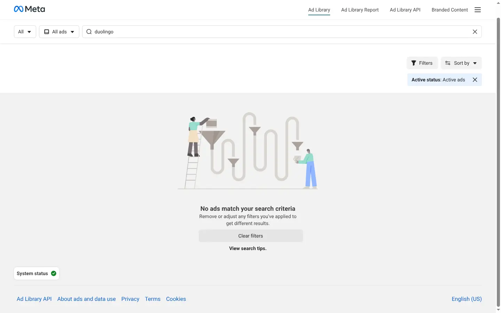
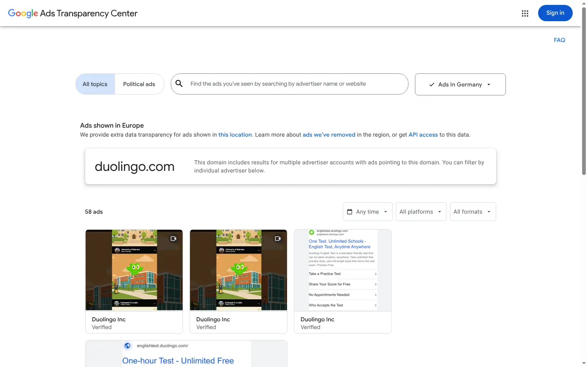
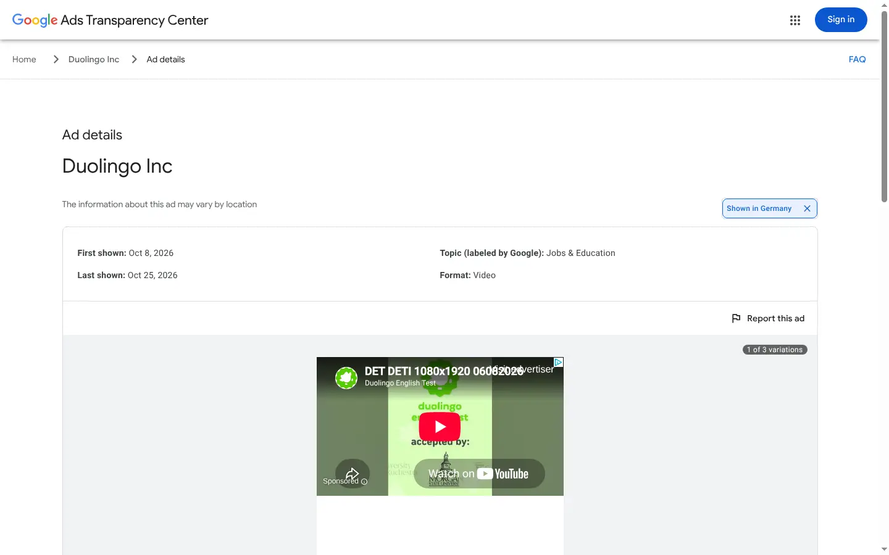
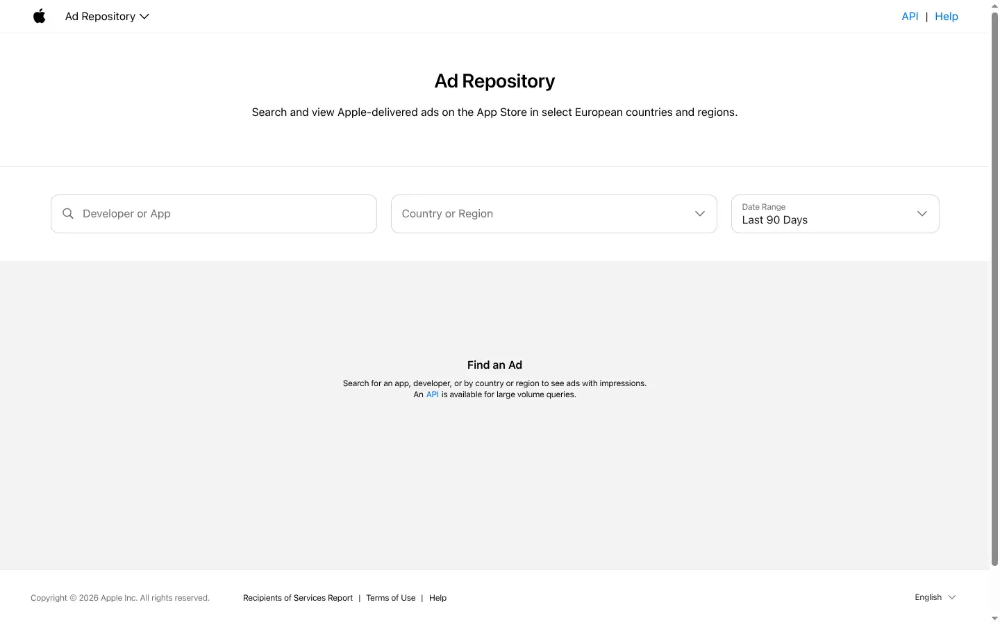

# 05 – Ads, virale Videos & Onboardings: Datenquellen, App-Zuordnung, Medien, Recht

> **Prefix:** `media` · **Stand:** 2026-10-25 · **Teil von:** Research-Phase "AppKittie-Nachbau"
> **Frage:** Woher bekommen wir legal und skalierbar die Daten für (a) eine Winning-Ads-Library inkl. Ad-Spend, (b) virale organische Videos pro App und (c) Onboarding- und Paywall-Flows? Und wie ordnen wir diese Daten den Apps zu?

**Legende:**
- **[beobachtet]**: selbst gesehen. Quelle, URL oder Befehl stehen dabei.
- **[Doku]**: steht in der offiziellen Dokumentation des Anbieters (Link dabei).
- **[Drittquelle]**: Blog, Vendor oder Sekundärquelle, nicht offiziell bestätigt.
- **[abgeleitet]**: eigene Schlussfolgerung oder Schätzung.

Alle Kosten in USD, Stand Oktober 2026, ohne Gewähr.

---

## 0. TL;DR

1. **Ads aus EU-Transparenzpflichten (DSA Art. 39) sind die einzige saubere, skalierbare Primärquelle.** Meta, TikTok, Google, Apple und Snap müssen jede in der EU ausgelieferte Anzeige ein Jahr nach der letzten Impression öffentlich halten. Für Nicht-EU-Märkte (USA, Japan, Brasilien) gibt es **keine** offizielle Quelle für kommerzielle Ads. AppKittie zeigt auf der Startseite trotzdem Spend für US/JP/BR. Das ist also entweder ein Modell (Extrapolation) oder Drittanbieter-/Scraping-Daten [abgeleitet].
2. **Unterschätzte Primärquelle: Apples "Ad Repository API".** Sie ist öffentlich und ohne Login nutzbar. Sie liefert alle Apple-Search-Ads im App Store in 25 EU-Ländern, **direkt mit `appId`**, also ohne jedes Matching. Ein Testaufruf ergab 179.484 Anzeigen in DE in den letzten 90 Tagen [beobachtet, §2.5].
3. **Meta Ad Library API (`ads_archive`)** ist kostenlos, braucht aber eine Identitätsprüfung. Sie liefert alle EU-Anzeigen mit Start-/Enddatum, Plattformen, Texten, `page_id`, EU-Reichweite und Reichweite pro Land/Alter/Geschlecht. **Nicht** enthalten sind Ziel-URL, Mediendateien und Spend (Spend nur bei politischen Ads) [Doku]. Ziel-URL und Videos gibt es nur über die Website bzw. Scraper-APIs (z. B. ScrapeCreators `snapshot.link_url`, `video_hd_url`, ab ca. $1–2 pro 1.000 Requests) [Drittquelle].
4. **Ad → App:** Am zuverlässigsten ist die Ziel-URL (Store-Link direkt oder aufgelöster OneLink-/Adjust-/Branch-Link). Danach kommt eine kuratierte Zuordnung Advertiser-Seite → App mit Konfidenz-Score. Apple liefert die App-ID direkt.
5. **"Winning"** ist bei allen Anbietern eine Heuristik aus Laufzeit (≥ 30 Tage), Anzahl Varianten (`collation_count`), Reichweite, Plattformanzahl und Wiederverwendung. **Ad-Spend** wird aus Reichweite × Frequenz × CPM geschätzt und muss klar als Schätzung gekennzeichnet sein.
6. **Organische Videos:** Für kommerzielle Nutzer gibt es **keine** offizielle TikTok-API für fremde Inhalte. Die Research API ist nur für Akademiker. Instagram geht nur eingeschränkt: `business_discovery` für Business-/Creator-Accounts und 30 Hashtags pro 7 Tage. Bei **YouTube** ist es gut machbar: `videos.list` und `playlistItems.list` kosten je 1 Unit (10.000 Units/Tag). **`search.list` ist seit Neuestem ein eigener Topf mit nur 100 Aufrufen pro Tag** [beobachtet in der Doku]. TikTok und Instagram laufen praktisch nur über Drittanbieter (EnsembleData, ScrapeCreators, Apify, Bright Data). Das ist rechtlich grau. Daher: nur Metadaten speichern und Videos über die offiziellen Embeds anzeigen, **nicht selbst hosten**.
7. **Onboardings/Paywalls:** Kein Anbieter (Mobbin, ScreensDesign, Appllama, Superwall) dokumentiert öffentlich, wie er aufnimmt. Plausibel sind Menschen mit echten iPhones und Bildschirmaufnahme [abgeleitet]. Der iOS-Simulator kann keine App-Store-Apps ausführen. Für das MVP empfehlen wir Freelancer mit echten Geräten (ca. $5–12 pro Flow), automatische Segmentierung und Vision-LLM-Labeling (Haiku 5.5 unter $0,01 pro Flow, Sonnet 5.5 ca. $0,12). Später kommt Android-Automatisierung mit Emulator und LLM-Agent dazu (z. B. DroidRun).
8. **Medien:** Cloudflare R2 (Speicher $0,015/GB-Monat, **kein Egress**) mit progressivem MP4 ist um Größenordnungen billiger als minutenbasierte Video-APIs (Stream/Mux). AppKittie selbst liefert sein Hero-Video als MP4 aus einem öffentlichen R2-Bucket aus [beobachtet].
9. **Recht:** Am risikoärmsten sind offizielle APIs, nur Metadaten und offizielle Embeds/Links. Am riskantesten sind Rehosting fremder TikTok-/Instagram-Videos (Urheber- **und** Musikrechte, ToS) und Scraping eingeloggter Bereiche. Bei Creator-Daten greift die DSGVO: berechtigtes Interesse ist möglich (EuGH C-621/22), die niederländische Datenschutzbehörde ist aber sehr restriktiv. Datenminimierung und Opt-out sind Pflicht.

---

## 1. Was AppKittie in diesen Bereichen zeigt (Bezugspunkt)

Quelle ist die öffentliche Startseite https://www.appkittie.com. Sie wurde vom Koordinator gerendert (`scratchpad/recon/home.json`) und von mir einmal mit Netzwerk-Mitschnitt geladen (`scratchpad/media/ak_media.json`). Es gab weder Login noch API-Aufrufe.

| Element | Was zu sehen ist [beobachtet] | Was es vermutlich bedeutet [abgeleitet] |
|---|---|---|
| Ad-Karten | "Duolingo · Active for 93 days · Top #1 Ad", "Lyfta · Active for 3 days · Top #5 Ad", "Cal AI · Active for 28 days · Top #3 Ad" | `heute − Startdatum` aus der Ad Library. Dazu ein Ranking pro App (oder global) nach Score |
| Spend-Tracker | "Cal AI · Ad spend by country · last 30 days: $2.4M United States, $1.2M United Kingdom, $480K Germany, $355K Japan, $186K Brazil" | Spend für **Nicht-EU-Länder** ist aus DSA-Daten nicht ableitbar, also Modell oder Drittdaten. Es kann auch Marketing-Mock-Daten sein |
| App-Karte | "Active ads 292 · Viral videos 830 · Est. Monthly Downloads 520K …" | Zählt aktive Ads und als viral klassifizierte Videos pro App |
| Onboarding-Library | "Brainrot · 35 steps · DISCOUNT · PAYWALL", "PushScroll · 26 steps", "Lightly · 33 steps · PAYWALL" | Flows als Schrittfolge mit Typ-Tags pro Schritt |
| Onboarding-Assets | Bilder `/assets/onboarding/brainrot-01.webp` … `-30.webp` (33 Dateien), `pushscroll-01…24.webp` (24 Dateien), ausgeliefert über `/_next/image` | Auf der Marketing-Seite sind Flows als **nummerierte Einzel-Screenshots (WebP)** gespeichert. Das Produkt selbst kann zusätzlich Videos haben ("Watch the highest-converting onboardings") |
| Organic-Assets | `/assets/organic-calai-protein.webp`, `organic-aura-runs.webp` usw. | Selbst gehostete Thumbnails von Videos |
| Video-Hosting | `<video src="https://pub-…r2.dev/0824(1).mp4">`, HTTP 206 (Range), `video/mp4` | **Cloudflare R2 Public Bucket, progressives MP4, kein HLS.** Das ist ein Indiz für den Medien-Stack |

---

## 2. Ads: Quellen, Felder, Zuordnung, "Winning", Spend

### 2.1 Überblick aller Ad-Quellen

| Quelle | Zugang | Abdeckung | App-Zuordnung | Medien | Kosten | Risiko |
|---|---|---|---|---|---|---|
| **Meta Ad Library API** (`ads_archive`) | Developer-App, Identitätsprüfung, User-Token | Politische Ads weltweit. **Alle** Ads mit EU-Auslieferung, 1 Jahr nach letzter Impression | Indirekt (`page_id`, Texte, Link-Captions) | Nein, nur `ad_snapshot_url` | Kostenlos | Niedrig (offiziell). Nutzungsbedingungen beachten (§2.2) |
| Meta Ad Library **Website** | Öffentlich | Alle **aktiven** Ads weltweit, EU-Ads mit Zusatzinfos | Ziel-Link sichtbar | Ja (fbcdn) | Kostenlos, aber Scraping nötig | Mittel/hoch (ToS, Anti-Bot) |
| **TikTok Commercial Content API** | Antrag (Developer-Account, offizielle E-Mail), Prüfung 1–2 Wochen | Nur EU-Ads, 1 Jahr | Nur Advertiser-Name, **kein Landing-Page-Feld** | Ja (`ad.videos[].url`, `image_urls`) | Kostenlos | Niedrig bis mittel (Eignung für kommerzielle Nutzer unklar) |
| TikTok Creative Center (Top Ads) | Öffentliche Website | Auswahl "high-performing" Ads, Filter Region/Objective | Markenname | Ja | Kostenlos, keine API | Hoch (ToS, Anti-Bot, bei uns 403) |
| **Google Ads Transparency Center** | Website öffentlich. **BigQuery-Datensatz** (EEA + Türkei) | Search, YouTube, Display, Play, Maps, Shopping | Advertiser-ID, Domain | Website ja, BigQuery Metadaten | BigQuery-Abfragekosten | Niedrig (BigQuery). Mittel (Website-Scraping) |
| **Apple Ad Repository API** | **Öffentlich, ohne Auth** | Apple Search Ads im App Store, 25 EU-Länder, 1 Jahr | **Direkt `appId`** | Ja (mzstatic-URLs) | Kostenlos | Niedrig |
| **Snap Ads Gallery API** | Öffentlich, **ohne OAuth** | EU-Ads, 12 Monate, plus "sponsored content" | Advertiser-Name | Creative-Preview | Kostenlos | Niedrig |
| LinkedIn Ad Library | Website (laut Drittquelle keine API) | EU-Ads | Advertiser | Ja | – | Für Consumer-Apps irrelevant |
| X Ads Repository | CSV-Downloads | EU | Advertiser | – | – | Für Consumer-Apps kaum relevant |
| Kommerzielle Anbieter (Foreplay, SocialPeta, AppGrowing, BigSpy …) | Vertrag | Global, eigene Crawler | Teils mit App-Mapping | Ja | $49–5.000+/Monat | Weiterverkauf meist vertraglich verboten |
| Scraper-APIs (ScrapeCreators, Apify, SearchAPI …) | API-Key | Wie die Websites (Meta, Google, TikTok, LinkedIn) | `link_url` (Meta) | Ja | ab ca. $0,2–2 pro 1.000 | Mittel (ToS-Grauzone, Risiko liegt beim Nutzer) |

### 2.2 Meta Ad Library

**Website vs. API**
- Die **Website** (facebook.com/ads/library) zeigt laut Meta "all active ads running across products from Meta". Bei EU-Ads zeigt sie zusätzlich Reichweite, Targeting und Payer/Beneficiary [Doku: https://transparency.meta.com/researchtools/ad-library-tools/].
- Die **API** dient laut Meta "a deeper analysis of ads about social issues, elections or politics, as well as ads that deliver to the EU and associated territories". Autorisierte Nutzer können zusätzlich aktiven, öffentlichen **Branded Content** (Label "paid partnership") auf FB/IG analysieren [Doku, ebd.]. Das ist interessant für Creator-Videos, die Apps bewerben. Endpoint und Felder dafür habe ich nicht verifiziert.
- **Aufbewahrung:** EU-Ads 1 Jahr ab letzter Impression, politische Ads 7 Jahre [Doku, ebd.].
- Kernsatz zur Abdeckung aus der Parameter-Doku: *"Ads that did not reach any location in the EU will only return if they are about social issues, elections or politics."* [Doku: https://developers.facebook.com/docs/graph-api/reference/ads_archive/]

**Zugang** [Drittquellen, offizielle Seite war nicht abrufbar]
- Meta-Developer-Account und Developer-App, Produkt "Ad Library API" hinzufügen.
- **Identitätsprüfung** über facebook.com/ID (Ausweis-Upload, Wohnsitzland, ggf. Brief mit Code). Dauer: einige Tage.
- Token aus dem Graph API Explorer, als Long-lived Token ca. 60 Tage gültig. Danach Rotation nötig.
- Beim Hinzufügen werden Bedingungen akzeptiert ("Authorized Access to Public Information"). Laut einem Entwickler-Guide verbieten sie **Weiterverkauf und Ad-Targeting** mit den Daten. Das ist **nicht** am Originaltext verifiziert, siehe Offene Fragen.
- **Die Seite https://www.facebook.com/ads/library/api/ antwortete aus dieser Umgebung mit HTTP 403** (WebFetch und curl) [beobachtet].

**Parameter** [Doku: ads_archive]
`ad_reached_countries` (Pflicht, ISO oder ALL), `ad_type` (ALL, POLITICAL_AND_ISSUE_ADS …), `ad_active_status` (ACTIVE/INACTIVE/ALL), `ad_delivery_date_min/max`, `search_terms` (max. 100 Zeichen) **oder** `search_page_ids` (bis zu 10 Seiten pro Call), `search_type`, `media_type` (IMAGE/VIDEO/MEME/NONE), `publisher_platforms` (FACEBOOK, INSTAGRAM, AUDIENCE_NETWORK, MESSENGER, WHATSAPP, THREADS …), `languages`.

**Felder (ArchivedAd)** [Doku: https://developers.facebook.com/docs/graph-api/reference/archived-ad/]

| Feld | Nutzen für uns | Verfügbarkeit |
|---|---|---|
| `id`, `ad_creation_time` | ID, Erstellung | alle |
| `ad_delivery_start_time`, `ad_delivery_stop_time` | **"Active for N days"** | alle |
| `page_id`, `page_name` | Advertiser, Basis der App-Zuordnung | alle |
| `publisher_platforms` | Badges FB/IG/Messenger/Threads | alle |
| `ad_creative_bodies`, `…_link_titles`, `…_link_descriptions`, `…_link_captions` | Ad-Text, Hook, CTA-Texte. Captions enthalten oft die Ziel-Domain [abgeleitet] | alle |
| `languages` | Sprache | alle |
| `ad_snapshot_url` | Link auf gerenderte Anzeige (HTML, kein Media-File). Enthält das Access-Token, eignet sich also nicht zum Einbetten im Frontend [abgeleitet] | alle |
| `eu_total_reach` | Reichweite in der EU, Basis der Spend-Schätzung | nur EU-Ads |
| `age_country_gender_reach_breakdown` | **Reichweite pro Land/Alter/Geschlecht**, also Spend nach Land | EU- und UK-Ads (sowie politische BR) |
| `target_ages`, `target_gender`, `target_locations` | Targeting | EU/UK |
| `beneficiary_payers` | Begünstigter/Zahler, zeigt oft die juristische Firma (Matching mit dem Store-"Seller") | nur EU |
| `total_reach_by_location` | Reichweite EU/UK/BR | – |
| `spend`, `impressions`, `estimated_audience_size`, `demographic_distribution` | Spend/Impressions als Spannen | **nur politische Ads** |

**Was fehlt:** Ziel-URL (Store-Link), Mediendateien, Spend für kommerzielle Ads und der Varianten-Zähler. `collation_count`/`collation_id` liefert nur die Website bzw. Scraper [Drittquelle].

**Rate-Limits:** Für `ads_archive` nicht offiziell dokumentiert. Die allgemeine Graph-API-Doku nennt `ads_archive` nicht. Das App-Limit "200 × Anzahl Nutzer pro Stunde" gilt für Graph-Plattform-Calls insgesamt [Doku: https://developers.facebook.com/docs/graph-api/overview/rate-limiting/]. Drittquellen berichten von Fehlercode 613 bzw. HTTP 429 bei Drosselung und raten zu exponentiellem Backoff [Drittquelle: https://adligator.com/blog/meta-ad-library-api-competitor-monitoring, https://docs.zernio.com/platforms/meta-ads/ad-library].

**Medien-Download:** Die API liefert keine Medien. Möglich sind nur (a) das Rendern von `ad_snapshot_url` mit Extraktion der fbcdn-Medien (Grauzone, siehe §6) oder (b) Scraper-APIs. ScrapeCreators liefert z. B. `snapshot.link_url`, `cta_type`, `videos[].video_hd_url`, `video_sd_url`, `video_preview_image_url`, `cards`, `images`, `collation_id`, `collation_count`, `is_active`, `start_date`, `end_date`, `publisher_platform`. 1 Credit pro Request [Drittquelle: https://docs.scrapecreators.com/v1/facebook/adLibrary/company/ads].

**Eigene Beobachtung:** Die Ad-Library-Website ließ sich im Headless-Chrome über den Proxy zwar laden, zeigte aber für "duolingo" (Land ALL, aktiv) und "cal ai" (DE) **"No ads match your search criteria"**, obwohl ein GraphQL-Call mit 200 antwortete [beobachtet, Screenshot `assets/media-meta-ad-library-headless-empty.webp`]. Vermutlich filtert Meta Headless- bzw. Rechenzentrums-Clients [abgeleitet]. Ich habe das nicht umgangen. Für uns heißt das: Website-Scraping ist fragil, die offizielle API ist robuster.



### 2.3 TikTok

**Commercial Content API (DSA)**
- [Doku: https://developers.tiktok.com/products/commercial-content-api]: Antrag mit TikTok-for-Developers-Account und offizieller E-Mail. In dieser Phase *"we are ONLY including data from EU countries"*. Antragsteller dürfen von überall kommen. Enthalten sind Ads, Advertiser-Metadaten und "other commercial content". Daten sind bis 1 Jahr nach letzter Ausspielung abrufbar. Rückmeldung laut Drittquelle in 1–2 Wochen.
- Endpoint `POST /v2/research/adlib/ad/query`, Scope `research.adlib.basic` [Doku: https://developers.tiktok.com/doc/commercial-content-api-query-ads].
  - Felder: `ad.id`, `ad.first_shown_date`, `ad.last_shown_date`, `ad.status`, `ad.videos[].url`, `ad.image_urls`, `ad.reach.unique_users_seen` (z. B. "11K"), `advertiser.business_id`, `advertiser.business_name`, `advertiser.paid_for_by`.
  - Filter: `ad_published_date_range` (Pflicht, max. 1 Jahr zurück), `country_code_list`, `ad_type`, `ad_status`, `ad_reach` (Buckets), `ages`, `gender`, `search_term` (max. 50 Zeichen).
  - **`max_count` maximal 10 pro Call**, Paginierung über `search_id`.
  - **Kein Landing-Page-Feld.** Ein Quota steht nicht auf der Seite.
- Offen ist, ob kommerzielle Datenanbieter zugelassen werden. TikTok spricht von "the public and researchers". Eine Drittquelle meint, kommerzielle Analysten kämen durch, eine andere hält die Route für Firmen für nicht planbar [Drittquellen: https://adlibrary.com/posts/eu-dsa-ad-repositories-developers, https://www.datashake.com/blog/tiktok-data-coverage-in-2026-what-social-intelligence-teams-need-to-know].
- Die Website https://library.tiktok.com/ads war erreichbar (Suche nach Advertiser/Keyword, Zielland, Zeitraum, plus "All ads report") [beobachtet, `assets/media-tiktok-commercial-content-library.webp`].

**Creative Center – Top Ads**
- Öffentliche Seite "See high-performing auction ads on TikTok" mit Filtern Region, Objective, Sprache, Format, Likes und Sortierung For You/Reach/CTR [WebFetch der Seite].
- **Keine offizielle API.** Diverse Apify-Actors scrapen die Seite. Laut einem Actor sieht man ohne Login pro Filterkombination nur 20–100 Ads, und die Video-URLs verfallen nach 24–48 h [Drittquelle: https://apify.com/fetch_cat/tiktok-ads-library-scraper u. a.].
- Aus dieser Umgebung lieferte der Headless-Chrome **HTTP 403 "Access to ads.tiktok.com was denied"** [beobachtet]. Nicht umgangen.
- Fazit: als Inspiration für Menschen geeignet, nicht als Datenpipeline.

**Research API:** nur für qualifizierte, nicht-kommerzielle Forschung. *"Creators, advertisers, and commercial users are not eligible"* (sinngemäß aus der FAQ). Quota 1.000 Requests bzw. 100.000 Records pro Tag [Doku: https://developers.tiktok.com/doc/research-api-faq]. **Für uns nicht nutzbar.**

### 2.4 Google Ads Transparency Center

- Website https://adstransparency.google.com: Suche nach Advertiser oder Domain. Für Europa gibt es den Hinweis *"We provide extra data transparency for ads shown in this location … or get API access to this data"*. "API access" verlinkt auf den **BigQuery-Datensatz** `bigquery-public-data.google_ads_transparency_center` [beobachtet, Screenshot unten].
- Beispiel `duolingo.com` (Region DE): "58 ads", Filter Zeitraum/Plattform/Format. Creative-Detailseite: "First shown: Oct 8, 2026 · Last shown: Oct 25, 2026 · Format: Video · 1 of 3 variations · Times shown: *You'll be able to see this data starting on Jan 6, 2027*" (also ca. 90 Tage Verzögerung), dazu Audience-Selection-Kategorien [beobachtet].
- Die Website lädt ihre Daten über interne RPCs (`/anji/_/rpc/SearchService/SearchCreatives`) [beobachtet im Netzwerk-Mitschnitt]. Diese RPCs sind kein öffentlicher Vertrag, Scraping widerspricht laut Drittquelle den Google-ToS.
- **BigQuery:** Tabellen `creative_stats` und `removed_creative_stats`, nur Advertiser mit Auslieferung in EEA oder Türkei, zeitverzögert. Laut Forum unvollständiger als die Website (3 statt ca. 200 Creatives für einen Advertiser) [Drittquelle: https://discuss.google.dev/t/querying-public-google-ads-transparency-center-table-doesnt-show-all-the-needed-data/177804]. Ein Nutzer beschreibt die Tabelle als "150 GB … with nested values" mit `UNNEST(region_stats)` [Drittquelle: https://www.pvalues-blog.com/article/13].
  - Die genauen Felder konnte ich nicht verifizieren. `bq` ist im Container vorhanden, aber ohne Credentials ("Invalid Credentials") [beobachtet].
- Abdeckung laut Drittquelle: Search, YouTube (inkl. Shorts), Display, Shopping, Maps, **Play** (App-Kampagnen). Keine Spend-Daten für kommerzielle Ads, nur Domain bzw. Host als Ziel [Drittquelle: https://www.admapix.com/blog/ad-intelligence/google-ads-transparency-center-guide].




### 2.5 Apple Ad Repository (App Store, EU): die direkteste Quelle

- Website https://adrepository.apple.com: *"Search and view Apple-delivered ads on the App Store in select European countries and regions … An API is available for large volume queries."* Der Link führt zur PDF-Doku https://developer.apple.com/support/downloads/Ad-Repository.pdf (Version 1.0, März 2025) [beobachtet].
- **Endpoints** [Doku, PDF]:
  - `GET /api/v1/ad-repository-entities?name=…&types=APP|DEVELOPER`: App/Developer suchen (liefert `id` = appId bzw. developerId).
  - `GET /api/v1/countries-or-regions`: 25 EU-Länder.
  - `GET /api/v1/ad-repository-ads?ql=type==APP;id==…;countryOrRegion=in=(DE,FR);datePreset==LAST_90_DAYS&offset&limit`: RSQL-Filter, `datePreset` LAST_90_DAYS/LAST_180_DAYS/LAST_YEAR.
  - `GET /api/v1/ad-repository-ads/{adId}`: Varianten (Locale, Geräte, Assets).
  - `GET /api/v1/restrictions`: entfernte bzw. gesperrte Werbung.
  - Daten sind **7 Tage verzögert**. Der Header `Accept: */*` wird nicht akzeptiert.
- **Felder:** `adId`, **`appId`**, `appName`, `developerId`, `developerName`, `legalName`, `placement` (SEARCH_RESULTS, TODAY_TAB, SEARCH_TAB), `format` ("Icon Ad", "Icon + Asset Ad"), `countryOrRegion`, `audienceRefinement` (age/gender/location/customerType), `firstImpressionDate`, `lastImpressionDate`, `adBanner` (Subtitle, Kategorie, IAP, Promo-Text), `adAssets[]` (`videoUrl`, `pictureUrl`, Maße, Orientierung), `adLocaleVariations`.
- **Eigener Test** (je ein Aufruf, `curl -H "Accept: application/json"`) [beobachtet]:
  - `ad-repository-entities?name=duolingo&types=APP` liefert `{"id":570060128,"name":"Duolingo: Learn Languages","type":"APP"}`.
  - `ad-repository-ads?ql=countryOrRegion=in=(DE);datePreset==LAST_90_DAYS&limit=3` liefert `"totalResults": 179484`, Zeitraum 2026-07-22 bis 2026-10-20. Beispiel: App "1-2-3 Tanken" (appId 688981330, Bottled Software GmbH), "Icon + Asset Ad", aktiv seit 2026-03-28. Assets sind App-Store-Screenshots auf `is5-ssl.mzstatic.com`.
  - Für Duolingo in DE: 0 Ads.
  - Der Varianten-Endpoint antwortete bei einem Versuch mit HTTP 503 (vermutlich temporär).
- **Bewertung:** Für das Signal "**Apple Search Ads aktiv** (EU)" ist das ideal: kostenlos, offiziell, ohne Matching, mit Laufzeit. Die Creatives sind aber nur Store-Assets, also für "Winning Creatives" wenig spannend. Keywords liefert die API nicht. Spezifische Nutzungsbedingungen fand ich nicht. Die Website verlinkt nur allgemeine Apple-Ads-Terms (https://ads.apple.com/app-store/terms).



### 2.6 Snapchat, LinkedIn, X, Pinterest, Microsoft

- **Snap Ads Gallery API** [Doku: https://developers.snap.com/marketing-api/Ads-Gallery-Api/using-the-api]:
  - `POST https://adsapi.snapchat.com/v1/ads_library/ads/search` mit `countries` (EU), `paying_advertiser_name`, `start_date`/`end_date`, `status`, `cursor`, außerdem `/sponsored_content` (organischer kommerzieller Content) und Creator-Suche.
  - *"open for use by 3rd parties and do not require an OAuth token"*.
  - Die Felder der Ergebnisse dokumentiert die Seite nur als Platzhalter.
  - Gute Ergänzung, weil viele Consumer-Apps auf Snap werben.
- **LinkedIn**: Website, laut Drittquelle ohne offizielle API und mit Ergebnis-Limit. **X**: CSV-Repository. **Pinterest/Bing**: eigene Repositories. Für Consumer-Apps habe ich das nicht vertieft (geringe Priorität) [Drittquelle: https://adlibrary.com/posts/eu-dsa-ad-repositories-developers].

### 2.7 Kommerzielle Ad-Intelligence-Anbieter und Scraper-APIs

| Anbieter | Typ | Preis (laut Seite/Quelle) | Abdeckung | Eignung für uns |
|---|---|---|---|---|
| **Foreplay** | Swipe-File-SaaS + API/MCP | $49–389/Monat (jährlich), 10.000 API-Credits/Monat inkl., 1 Ad = 1 Credit, Zukauf in 100k/250k/500k-Paketen [https://www.foreplay.co/pricing, https://help.foreplay.co/en/articles/9082255-credits-and-pricing] | Meta, TikTok, LinkedIn, YouTube Shorts, Google (Teil "coming soon"). Footer: 54,7 Mio. Ads | Prototyping und Benchmark. **Weiterverkauf/Rehosting vermutlich vertraglich ausgeschlossen** (ToS nicht geprüft) |
| MagicBrief, AdSpy, BigSpy | SaaS | nicht geprüft | Meta/TikTok u. a. | Nur Benchmark |
| **SocialPeta** | Enterprise | "contact vendor", laut FitGap ab ca. $5.000/Jahr [https://www.capterra.com/p/203185/SocialPeta/] | 69 Länder, 70 Kanäle (Mobile-Apps/Games) | Lizenzdaten möglich, teuer |
| **AppGrowing** | Mobile-Ad-Intelligence | Freemium/Enterprise, keine Preise | 30+ Kanäle, Budget-Schätzung | Wie SocialPeta |
| **ScrapeCreators** | Scraper-API | $47 für 25k Credits ($1,88/1k) bis $497 für 500k ($0,99/1k). 1 Credit pro Request, Cache-Hits kostenlos [https://scrapecreators.com/] | FB Ad Library, Google Ad Library, LinkedIn Ad Library, TikTok Ad Library, plus TikTok/IG/YT-Endpoints | **Praktischste Brücke** für `link_url` und Medien. Rechtliches Risiko trägt der Nutzer |
| **Apify** `curious_coder/facebook-ads-library-scraper` | Actor | "from $0.75/1,000 ads". README nennt ca. $0,20 pro 1.000 [https://apify.com/curious_coder/facebook-ads-library-scraper] | Meta | Ähnlich |
| Apify TikTok Creative Center Actors | Actor | variiert | Top Ads, CTR-Labels, Video-URLs | Riskant (ToS) |
| AdLibrary.com API | API | Business €329/Monat, 100 req/min, 10.000/Tag [Drittquelle: https://adlibrary.com/posts/google-ads-transparency-center-api] | Meta/Google | Alternative |

**[abgeleitet]** Fast alle Anbieter beziehen ihre Daten aus denselben öffentlichen Ad Libraries (offizielle API plus Website-Scraping). Echte "Exklusivität" gibt es nur bei Panel- oder SDK-Daten (z. B. Sensor Tower/Pathmatics), und die sind teuer und nicht weiterverkaufbar.

### 2.8 Zuordnung Ad → App

Wir gehen kaskadiert vor: die erste Stufe mit hoher Konfidenz gewinnt [abgeleitet, Designvorschlag].

| Stufe | Signal | Konfidenz | Quelle |
|---|---|---|---|
| 1 | **App-ID im Datensatz** (Apple Ad Repository `appId`) | 1,0 | Apple |
| 2 | **Ziel-URL ist Store-Link**: `apps.apple.com/{cc}/app/{slug}/id(\d+)`, `itunes.apple.com/…/id(\d+)`, `play.google.com/store/apps/details?id=([\w.]+)`, `market://details?id=` | 0,98 | Meta-Website/Scraper `link_url`, Google ATC |
| 3 | **Attributions-Link auflösen**: AppsFlyer OneLink (`*.onelink.me`, `app.appsflyer.com/{bundle}`), Adjust (`app.adjust.com/{token}`, `*.go.link`), Branch (`*.app.link`, `*.test-app.link`), Kochava, Singular (`*.sng.link`), Firebase Dynamic Links (Abschaltung angekündigt). HTTP-Redirects **einmal mit iOS- und einmal mit Android-User-Agent** verfolgen, Ziel parsen. Bei JS-/Meta-Refresh-Weiterleitung Headless-Fallback. Manche Links tragen den Store-Link als Query-Parameter (z. B. Adjust `redirect_ios=`) [abgeleitet] | 0,95 | eigene Pipeline |
| 4 | **Landingpage-Domain → App**: Domain der Ziel-URL bzw. `ad_creative_link_captions` ↔ "Developer Website" bzw. "Support URL" aus dem Store-Eintrag. Smart-App-Banner (`<meta name="apple-itunes-app" content="app-id=…">`) und `/.well-known/apple-app-site-association` bzw. `assetlinks.json` der Domain liefern App-IDs bzw. Package-Names [abgeleitet] | 0,9 | Store-Metadaten + Webseite |
| 5 | **Advertiser-Seite → App** (`page_id` → app_id), einmalig gelernt aus Stufen 2–4 und dann wiederverwendet. Seed: `search_terms=<App-Name>` und Frequenz der `page_id`s | 0,85 | Mapping-Tabelle |
| 6 | **Namens-Matching**: `page_name` ↔ App-Name bzw. Developer, `beneficiary_payers` bzw. TikTok `business_name` ↔ Store-"Seller"/Legal Name (Apple `legalName`), fuzzy (Trigram/Jaro-Winkler) + Kategorie-Plausibilität | 0,6–0,8 | – |
| 7 | **Creative-Inhalt**: OCR/ASR des Videos (App-Name, Store-Badge, Endcard-Logo), Logo-Ähnlichkeit (Icon-Embedding) per Vision-LLM | 0,5–0,8 | LLM |
| 8 | Manuelle Review-Queue für Top-Advertiser | 1,0 | Mensch |

**Fallstricke** [abgeleitet]:
- Eine Seite bewirbt mehrere Apps (Publisher wie Bending Spoons, Apalon). Deshalb pro **Ad** zuordnen und `page_id` nur als Prior nutzen.
- Web-to-App-Funnels (Quiz-Landingpage → Web-Checkout) haben keinen Store-Link. Dann zählt die Domain-Zuordnung über Stufe 4.
- Lokalisierte Seiten (Duolingo DE/FR …) bündeln wir unter einem Advertiser.

### 2.9 "Winning"-Logik und Top-N-Ranking

Die Libraries markieren keine Gewinner. Branchenüblich ist "Laufzeit + Varianten" als Proxy: Schwache Creatives werden schnell abgeschaltet [Drittquelle: https://billo.app/blog/meta-ad-library/]. Gegenbefund: Laut einem Sample laufen die Ads im Median nur 4 Tage, 29,8 % laufen ≥ 30 Tage und 15,5 % ≥ 90 Tage [Drittquelle: https://adspyder.io/blog/ad-fatigue-benchmarks/]. "≥ 30 Tage" ist also selektiv, aber kein Beweis für Profitabilität.

**Vorschlag Score** [abgeleitet]:
```
days_active   = (is_active ? today : last_seen) − start_date
winning_score = 0.35·norm(log1p(days_active))
              + 0.20·norm(log1p(variant_count))        # collation_count bzw. gleiche Media-Hashes
              + 0.20·norm(log1p(eu_reach))             # Meta eu_total_reach / TikTok reach-Bucket
              + 0.10·platform_count/Max                # FB, IG, Messenger, AN, Threads
              + 0.10·norm(creative_reuse)              # gleiche Video-pHash in mehreren Ads/Ländern
              + 0.05·is_active
```
- Normierung pro Kategorie, damit Games nicht alles dominieren.
- "Top #N Ad" ist der Rang innerhalb der App (oder Kategorie/global) nach Score.
- **Media-Dedupe** über perceptual hash (pHash des 1. und mittleren Frames + Audio-Fingerprint), weil dasselbe Video in vielen Ad-IDs steckt.

### 2.10 Ad-Spend-Schätzung

- **Datenlage:** Meta gibt für kommerzielle EU-Ads **keinen Spend**, nur Reichweite: `eu_total_reach` sowie Reichweite pro Land/Alter/Geschlecht für EU **und UK** [Doku]. Manche Blogs behaupten Spend-Spannen für EU-Ads. Das widerspricht der Feld-Doku (Spend nur politisch) [Drittquelle vs. Doku].
- **Methode:** Branchenüblich ist Reichweite × CPM-Benchmark [Drittquelle: https://adligator.com/blog/estimate-competitor-facebook-ad-spend, https://admapix.com/blog/best-practices/competitor-ad-spend].
  ```
  impressions_c = reach_c × frequency (Annahme 1,5–3, kategorieabhängig)
  spend_c       = impressions_c / 1000 × CPM_c (Land × Plattform × Kategorie, Benchmark-Tabelle)
  spend_30d     = Σ_ads anteilig nach aktiven Tagen im Fenster
  ```
- **Nicht-EU-Länder** (USA, JP, BR wie bei AppKittie): Es gibt keine Primärdaten. Möglich ist nur eine Extrapolation. Beispiel: EU+UK-Spend ÷ geschätzter EU+UK-Anteil an Downloads bzw. Umsatz (aus Store-Rankings/Download-Schätzungen anderer Module) × Länderanteil. **Unsicherheit ±50 % oder mehr.** In der UI zeigen wir das als Spanne und mit "Schätzung"-Label.
- **Validierung:** Spend-Bänder politischer Ads (echte Spend/Impression-Paare) liefern länderspezifische effektive CPMs. Eigene Testkampagnen oder Daten von Partner-Apps dienen zur Kalibrierung.

---

## 3. Organische virale Videos

### 3.1 Offizielle Schnittstellen

| Plattform | Schnittstelle | Was geht | Was nicht geht | Quelle |
|---|---|---|---|---|
| TikTok | **Research API** | Videos/Kommentare suchen, 1.000 Requests bzw. 100k Records pro Tag | **Nicht für kommerzielle Nutzer**. Statistiken bis 10 Tage verzögert | [Doku FAQ](https://developers.tiktok.com/doc/research-api-faq) |
| TikTok | **Display API** (Login Kit) | Profil und öffentliche Videos **eines Users, der unsere App autorisiert** | Fremde Accounts | [Doku](https://developers.tiktok.com/doc/display-api-overview) |
| TikTok | **oEmbed / Embed Player** | `GET https://www.tiktok.com/oembed?url=…` liefert iframe-HTML. "Embed Videos will be deprecated soon", Nachfolger ist der Embed Player | Statistiken | [Doku](https://developers.tiktok.com/doc/embed-videos/) |
| Instagram | **Business Discovery** (Graph API) | Für **Business-/Creator-Accounts** per Username: `followers_count`, `media_count`, Media mit `like_count`, `comments_count`, `view_count` ("includes both paid and organic"). `media_url` fehlt bei Reels mit lizenzierter Musik bzw. deaktiviertem Download | Private bzw. persönliche Accounts, Einzel-GET auf Medien | [Doku](https://developers.facebook.com/docs/instagram-platform/instagram-api-with-facebook-login/business-discovery/) |
| Instagram | **Hashtag Search** | `top_media`/`recent_media`, **max. 30 Hashtags pro 7 Tage** pro IG-Account. App Review "Instagram Public Content Access" nötig | Username-Suche, Volltext | [Doku](https://developers.facebook.com/docs/instagram-platform/instagram-api-with-facebook-login/hashtag-search/) |
| Instagram | **oEmbed** | Embeds, 1.000 Requests pro Stunde. **Ausdrücklich nur zum Einbetten**, die Metadaten dürfen nicht für Analytics genutzt werden | Analytics | [Doku](https://developers.facebook.com/docs/instagram-platform/oembed/) |
| Meta | Ad Library API **Branded Content** | Aktiver, öffentlicher Branded Content ("paid partnership") auf FB/IG für autorisierte Nutzer | Endpoint/Felder nicht verifiziert | [Meta](https://transparency.meta.com/researchtools/ad-library-tools/) |
| YouTube | **Data API v3** | `videos.list` (1 Unit, bis 50 IDs: Statistiken, Dauer), `channels.list`, `playlistItems.list` (Uploads, 1 Unit), `commentThreads.list`. **10.000 Units/Tag**. **`search.list` hat einen eigenen Topf: 100 Aufrufe pro Tag, je 1 Quota** | Kein Shorts-Flag. Viel Suche geht nur mit Quota-Erhöhung (Audit) | [beobachtet in der Doku](https://developers.google.com/youtube/v3/determine_quota_cost) |

Das YouTube-Zitat (beobachtet per `curl` der Doku-Seite am 2026-10-25): *"Projects that enable the YouTube Data API have a default quota allocation of 100 search.list calls, 100 videos.insert calls, and 10,000 units per day combined for all other endpoints."* Das ist eine Änderung gegenüber dem früheren Modell (search.list = 100 Units). Für das Design heißt das: Videos **nicht über Suche** finden, sondern über bekannte Kanäle (Uploads-Playlist) und dann `videos.list` in 50er-Batches. Bei 5.000 Kanälen sind das ca. 5.000 Units/Tag für Uploads plus ca. 100–1.000 Units für Statistiken.

**YouTube Shorts erkennen** [abgeleitet, nicht offiziell]:
- `contentDetails.duration` ≤ 180 s (Shorts dürfen seit Ende 2024 bis 3 Min lang sein, laut Drittquellen)
- Hashtag `#shorts`
- Kanal-RSS listet `youtube.com/shorts/…`-Links [Drittquelle: https://forum.newsblur.com/t/detect-and-tag-shorts-in-youtube-feeds/9711]
- verbreiteter Trick: `HEAD https://www.youtube.com/shorts/{id}`, wobei Nicht-Shorts auf `/watch` umleiten (nicht verifiziert)

**YouTube-Speicherregeln:** Laut Sekundärquellen dürfen nicht autorisierte API-Daten maximal 30 Tage gespeichert werden, dann müssen sie aktualisiert oder gelöscht werden. Ein Policy-Update vom 2026-06-01 erlaubt bei akzeptiertem Use-Case längere Speicherung "derived metrics". Die Details sind unklar [Drittquelle: https://ppc.land/youtube-data-api/]. Konsequenz: Metriken mindestens alle 30 Tage refreshen. Videos nur per YouTube-Player einbetten.

### 3.2 Drittanbieter für TikTok/Instagram (und YouTube)

| Anbieter | Modell | Preis | Felder (Beispiel) | Quelle |
|---|---|---|---|---|
| **EnsembleData** | Units pro Tag (TikTok, IG, YT, Threads, Reddit, Twitch, X, Snapchat) | Wood $100 (1.500 Units/Tag) · Bronze $200 (5.000) · Silver $400 (11.000) · Gold $800 (25.000) · Platinum $1.400 (50.000). Keyword-/Hashtag-Suche = 1 Unit je 20 Posts, Post-Info 2 Units | Posts, Stats, User | [ensembledata.com/pricing](https://ensembledata.com/pricing) |
| **ScrapeCreators** | Credits | $0,99–1,88 pro 1.000 Requests | 22 TikTok-, 20 IG-, 18 YT-Endpoints | [scrapecreators.com](https://scrapecreators.com/) |
| **Apify** `clockworks/tiktok-scraper` | Pay-per-Result | "from $1.70 / 1,000 results". Video-Download, Transkript und KI-Beschreibung kosten extra | `playCount`, `diggCount`, `shareCount`, `commentCount`, `collectCount`, `createTimeISO`, `text`, `hashtags`, `authorMeta`, `musicMeta`, `videoMeta` | [apify.com](https://apify.com/clockworks/tiktok-scraper) |
| **Bright Data** | pro Record | ca. $1,50 pro 1.000 Records PAYG, 5.000 frei pro Monat (laut Vergleichsblogs, nicht verifiziert) | – | [Drittquelle](https://www.socialcrawl.dev/blog/best-tiktok-data-apis-2026) |

**Rechtlich** sind all diese Anbieter Scraping-Dienstleister. Die Plattform-ToS (TikTok, Instagram) verbieten automatisierte Erhebung ohne Erlaubnis. Das Vertrags- und Sperrrisiko liegt beim Anbieter, das Urheberrechts- und DSGVO-Risiko für die Weiterverwendung bei uns (§6).

### 3.3 Zuordnung Video → App

Pipeline-Vorschlag [abgeleitet]:

1. **Kandidaten finden**
   - **Offizielle App-Accounts**: Handle aus Store-Eintrag, Developer-Website (Footer-Links), Linktree/Link-in-Bio, Meta-Advertiser-Seite. Alle Videos dieser Accounts gehören zur App (Konfidenz 0,95).
   - **Keyword-/Hashtag-Suche**: App-Name, `#appname`, Marken-Hashtags, typische Kampagnen-Hashtags.
   - **Creator, die die App bewerben**: Accounts mit Link-in-Bio zum Store bzw. OneLink, wiederkehrende Erwähnungen, "paid partnership"-Label (Meta Branded Content).
   - **UGC-Farmen**: Viele App-Firmen betreiben Netzwerke von "Faceless"-Accounts. Erkennbar am gleichen Link-in-Bio-Ziel.
2. **Signale extrahieren**: Caption, Hashtags, Erwähnungen, On-Screen-Text (OCR auf 3–5 Keyframes), Audio-Transkript (ASR, z. B. Whisper lokal), Logo bzw. Icon-Ähnlichkeit (Embedding gegen App-Icons), Link-in-Bio.
3. **Klassifikation per LLM**:
   - Input: extrahierter Text plus Kandidaten-Apps (Top-k aus Volltextsuche über App-Namen).
   - Output: `{app_id, confidence, evidence}`.
   - Kosten mit Claude Haiku 5.5 ($0,10 / $0,50 pro 1 Mio. Input-/Output-Tokens): ca. 2.000 Input- und 100 Output-Tokens pro Video ergeben **ca. $0,00025 pro Video**, also etwa $250 pro 1 Mio. Videos. Mit 3 Keyframes als Bild (Annahme ca. 1.600 Tokens pro Bild) ca. $0,0007 [Preise aus der claude-api-Skill-Referenz, Stand 2026-10; Token-Schätzung abgeleitet].
4. **Schwellen:** ≥ 0,9 automatisch, 0,6–0,9 Review-Queue, darunter verwerfen.
5. **Fehlerquellen:** gleichnamige Apps ("Calm"), generische Namen, Konkurrenzvergleiche in einem Video.

### 3.4 Metriken und Definition "viral"

- **Erfassen:** Views (`playCount`/`view_count`), Likes, Kommentare, Shares, Saves, Veröffentlichungsdatum, Follower des Accounts zum Abrufzeitpunkt, Dauer, Sound/Musik-ID. Zusätzlich **Zeitreihe** (Snapshots), um Wachstum pro Tag zu messen.
- **Definition** [abgeleitet aus Drittquellen; keine Standarddefinition]:
  - absolut: Views ≥ 100k (TikTok/Reels) bzw. ≥ 50k (Shorts) innerhalb von 30 Tagen, **oder**
  - relativ: Views ≥ 5× Follower des Accounts ("5–10x your follower count" [https://www.socialcrawl.dev/blog/how-many-views-is-viral]) **oder** ≥ 2× Median-Views des Accounts (Outlier-Score) [https://virlo.ai/blog/how-many-views-is-viral-on-tiktok-in-2026].
  - Zusätzlich Engagement-Rate (Likes+Kommentare+Shares)/Views über dem Plattform-Median. Kleine Accounts mit 125x-Ausreißern brauchen eine Mindest-View-Grenze.
- **Ranking:** `viral_score = log10(views) + 0,5·log2(views/median_account_views) + Wachstum_7d`.

### 3.5 Abruf- und Refresh-Strategie und Kosten (Beispiel) [abgeleitet]

- **Tiering:** Top-1.000 Apps täglich, Top-1.000 bis 10.000 wöchentlich, Long Tail monatlich. Metriken eines Videos refreshen wir nur in den ersten 14 Tagen täglich, danach wöchentlich, und nach 90 Tagen friert ein.
- **Beispielrechnung TikTok + IG für die Top-1.000:** ca. 5 Requests pro App und Tag (Account-Feed, 2 Keyword-Seiten, 2 Stats-Refresh-Batches) ergeben ca. 150k Requests pro Monat. Bei ScrapeCreators sind das **ca. $150–280 pro Monat**. Bei EnsembleData reicht etwa der Bronze- oder Silver-Tarif ($200–400).
- **YouTube:** offiziell und kostenlos innerhalb der Quota.
- **Anzeige:** offizielle Embeds plus **eigenes Thumbnail** (klein, 320 px) oder das Thumbnail der Plattform via oEmbed. **Kein Rehosting der Videos** (§6).

---

## 4. Onboarding- und Paywall-Flows

### 4.1 Wie bestehende Bibliotheken arbeiten

| Anbieter | Umfang (laut eigener Seite bzw. Quelle) | Format | Erfassungsmethode |
|---|---|---|---|
| **Mobbin** | 621.500+ Screens, 142.200+ Flows, 1.000+ Apps (iOS, Android, Web). Laut Reviews "new content weekly" [Drittquelle: https://lazylanding-labs.onrender.com/compare/mobbin-vs-pageflows] | Screenshots, Flows mit Hotspots | **Nicht öffentlich dokumentiert**. mobbin.com/faq lieferte 403 |
| **ScreensDesign** | "2,855 apps in the top charts". Pro App "Full recordings from first screen to after the purchase", Kapitel Onboarding/Paywall, Screens getaggt, Umsatz-/Download-Schätzungen. Beispiel "Calorie Counter by Numify: 90 onboarding steps" [https://screensdesign.com/] | **Video** + Screens | Nicht dokumentiert. "after the purchase" deutet auf echte Käufe auf echten Geräten hin [abgeleitet] |
| **Appllama** | "76,900+ screens from 1,680+ top-grossing iOS apps", "New apps weekly" [https://appllama.io/] | Stills + Videos | Nicht dokumentiert |
| **Paywallscreens.com** (Superwall) | "11,350 real-world paywalls", 25 Kategorien [https://www.paywallscreens.com/] | Screenshots | Nicht dokumentiert |

**Beobachtung über die Appllama-MCP** (im Container verbunden; je 1 Aufruf, `get_credits` ist kostenlos, `list_flows` kostet 1 Credit) [beobachtet]: Die Flow-Taxonomie ist nach Größe sortiert:

| Flow | Screens | Apps |
|---|---|---|
| Onboarding | 23.855 | 1.531 |
| Welcome Screen | 4.675 | 1.624 |
| Paywall | 3.028 | 1.555 |
| Settings | 2.765 | 741 |
| Others | 2.202 | 971 |
| Profile | 696 | 218 |
| Home | 455 | 156 |

Insgesamt gibt es 5.425 Flow-Typen. **Im Mittel hat eine App ca. 15,6 Onboarding-Screens und ca. 2 Paywall-Screens.** Wir nutzen das als Größenordnung für unsere Speicher- und Kostenrechnung. Die Tool-Beschreibung der MCP nennt außerdem Filter wie `onboarding_steps_min/max`, IAP-Preise (`in_app_purchases: [{title, duration, price}]`) und Umsatzschätzungen pro App. Das ist eine ähnliche Datenstruktur, wie wir sie brauchen. Wir übernehmen **keine** Daten (Brief-Regel und Appllama-ToS gegen "harvesting").

### 4.2 Erfassungsoptionen

| Option | iOS | Android | Bewertung |
|---|---|---|---|
| **A. Manuell auf echten Geräten** (Freelancer/Inhouse): App installieren, Bildschirmaufnahme (iOS-Kontrollzentrum bzw. QuickTime am Mac), Onboarding bis Paywall durchklicken, Paywall schließen, um eine **Discount-Paywall** auszulösen, Upload | ✓ | ✓ | **Für das MVP empfohlen.** Robust gegen Anti-Bot und Sign-in-Hürden. Menschen beantworten Quizfragen sinnvoll |
| **B. iOS-Simulator** | ✗ | – | App-Store-Builds sind FairPlay-verschlüsselt und für die Plattform "iOS", nicht "iOS Simulator". Sie laufen nicht im Simulator ("Binary with wrong platform"); Umwege brauchen entschlüsselte Binaries (Jailbreak) [Drittquelle: Apple Developer Forums https://developer.apple.com/forums/thread/748650] |
| **C. iOS auf echten Geräten automatisiert**: eigenes Device-Lab (Mac mini + iPhones), Appium-XCUITest-Treiber bzw. WebDriverAgent steuern installierte Apps per Bundle-ID. Installation per App-Store-UI oder Apple Configurator [abgeleitet]. Maestro unterstützt echte iOS-Geräte nicht nativ, nur über Cloud-Anbieter oder `maestro-runner` [Drittquelle: https://requestly.com/blog/maestro-testing-on-real-ios-devices/, https://github.com/devicelab-dev/maestro-runner] | ✓ (aufwendig) | – | Phase 2/3 |
| **D. Device-Farmen** | ✓ (eingeschränkt) | ✓ | **BrowserStack App Live** kann Apps aus App Store und Play Store auf echte Geräte installieren (manuelle Live-Sessions, Bezahlpläne) [Doku: https://www.browserstack.com/support/faq/app-live/features-app-live/can-i-install-apps-from-apple-app-store-and-google-play-store-on-app-live]. **AWS Device Farm**: $0,17 pro Geräteminute oder $250 pro Slot und Monat, privates Gerät ab $200 pro Monat. Store-Installation ist dort nicht dokumentiert (normalerweise eigene IPA/APK) [Doku: https://aws.amazon.com/device-farm/pricing/] |
| **E. Android-Emulator + Automatisierung**: Emulator mit Google Play, Installation über Play-Store-UI. UIAutomator2/Appium/Maestro für Tap/Swipe, `adb shell screenrecord` (max. 3 Min pro Segment) oder `scrcpy --record`. **LLM-Agent** (z. B. DroidRun, MIT-Lizenz, Planner/Executor, unterstützt Claude/OpenAI/Gemini) beantwortet Quizfragen und erkennt Paywalls [Drittquelle: https://pypi.org/project/droidrun/] | – | ✓ | Phase 2. Benchmark: DroidRun 43 % Erfolg bei 65 Android-Aufgaben, ca. $0,075 pro erfolgreicher Aufgabe [Drittquelle: https://research.aimultiple.com/mobile-ai-agent]. Hürden: Play Integrity bzw. Emulator-Erkennung, ARM-only-Apps, SMS-Verifikation, Captchas |
| **F. Apple-Silicon-Mac** führt viele iPhone-Apps aus dem Mac App Store aus (sofern der Entwickler das nicht abschaltet). Automatisierung über macOS Accessibility und Bildschirmaufnahme [abgeleitet] | teilweise | – | Experimentell. Layout ist iPad- bzw. Fensterformat |

**Typische Hürden** [abgeleitet]:
- Pflicht-Login (Apple-/Google-Sign-in, E-Mail, SMS)
- **A/B-Tests**: Paywalls variieren je nach Nutzer, Land und Zeit. Deshalb erfassen wir pro Flow Land, Sprache, Gerät, App-Version und Datum.
- ATT- und Push-Prompts
- Geo-Sperren
- Käufe: Den Zustand "nach dem Kauf" gibt es nur mit echtem Kauf. Wir verzichten im MVP darauf.

### 4.3 Verarbeitungspipeline (Recording → Schritte → Tags) [abgeleitet]

1. **Ingest:** Video (H.264/HEVC) plus Metadaten (`app_id`, Plattform, App-Version aus dem Store, Land, Sprache, Gerät, Datum, Tester).
2. **Schritt-Segmentierung:**
   - Szenenwechsel per Frame-Differenz/SSIM (z. B. PySceneDetect) und Stillstands-Erkennung. Ein Screen gilt als Schritt, wenn er ≥ 0,7 s stabil ist.
   - Tap-Overlay der Bildschirmaufnahme ("Berührungen anzeigen") als Signal.
   - Dedupe per pHash.
3. **Keyframe pro Schritt** als WebP speichern (1290 px Breite, q≈75, ca. 150–300 KB). Zeitstempel bzw. Clip-Grenzen speichern, damit wir in der UI den Schritt im Video anspringen können.
4. **OCR** (Apple Vision bzw. Tesseract bzw. Cloud-OCR) für Text, Preise und Buttons.
5. **Vision-LLM-Klassifikation pro Schritt:**
   - Typen: `WELCOME`, `VALUE_PROP`, `QUESTION/QUIZ`, `PERSONALIZATION/LOADING`, `SOCIAL_PROOF/REVIEW_ASK`, `PERMISSION` (ATT/Push/Health), `SIGN_IN/ACCOUNT`, `PAYWALL`, `DISCOUNT/SPECIAL_OFFER`, `TRIAL_REMINDER`, `HOME`.
   - Zusätzlich extrahieren: Preis, Periode, Trial-Länge, Plan-Optionen, "Restore", Schließen-Button-Verzögerung (Hard vs. Soft Paywall).
   - Regel-Prior: Preisregex (`\d+[.,]\d{2}\s?(€|\$)`, "/Woche", "/week", "free trial", "Restore Purchases", "Terms") in Kombination mit LLM.
   - `DISCOUNT` erkennen wir an Prozent-Rabatt, durchgestrichenem Preis, Countdown oder "one-time offer", erscheint typischerweise **nach** dem Schließen der ersten Paywall.
6. **Flow-Zusammenfassung:** Anzahl Schritte ("35 steps"), Position der Paywall(s), Typ-Sequenz, Dauer und LLM-Kurzbeschreibung. Daraus ergeben sich Filter wie "Onboarding ≥ 20 Schritte mit Discount".
7. **QA-UI:** Ein Mensch bestätigt bzw. korrigiert Labels und Reihenfolge, ca. 2–5 Min pro Flow.

**LLM-Kosten pro Flow** (30 Screens, Annahme ca. 1.600 Tokens pro Screenshot plus 2k Prompt ≈ 50k Input-Tokens, ca. 1,8k Output-Tokens):

| Modell | Kosten pro Flow | 5.000 Flows | mit Batch (−50 %) |
|---|---|---|---|
| Claude Haiku 5.5 ($0,10/$0,50 pro MTok) | ca. $0,006 | ca. $30 | ca. $15 |
| Claude Sonnet 5.5 ($2/$10) | ca. $0,12 | ca. $600 | ca. $300 |
| Claude Opus 5.5 ($4/$20) | ca. $0,24 | ca. $1.200 | ca. $600 |

Ein **LLM-Navigationsagent** (Option E) braucht ca. 40 Schritte × ca. 5k Input-Tokens plus ca. 200 Output-Tokens. Mit Sonnet 5.5 sind das **ca. $0,50 pro Durchlauf**, mit Wiederholungen ca. $1 [abgeleitet; Preise laut claude-api-Referenz, Stand 2026-10-06, Token pro Bild ist eine Faustregel].

### 4.4 Aufwand, Kosten und Skalierung [abgeleitet, Schätzungen]

| Posten | Manuell (Freelancer, echte Geräte) | Automatisiert Android (Emulator + Agent) | Automatisiert iOS (Device-Lab) |
|---|---|---|---|
| Zeit pro Flow | 10–20 Min Aufnahme + 5–15 Min Upload/QA | 5–15 Min Maschinenzeit + 2–5 Min Menschen-QA | 10–20 Min + QA |
| Direkte Kosten pro Flow | **ca. $5–12** (bei $10–20/h) | ca. $1–3 (Agent-LLM + Compute) + QA | ca. $1–3 + QA, aber Hardware |
| Einmalig | Geräte (3–5 iPhones, 2–3 Android, je ca. $300–1.000), Test-Accounts pro Land, Upload-Tool | 4–8 Personenwochen Engineering, Emulator-Server mit KVM | 6–10 Personenwochen, Mac mini + iPhones |
| Erfolgsquote | ca. 95 % | 40–70 % (dann manuell nacharbeiten) | unbekannt, eher niedrig |
| **Top-1.000 initial** | $5k–12k | ca. $1k–3k + Engineering | – |
| **Top-5.000 initial** | $25k–60k | ca. $5k–15k + Engineering | – |
| **Refresh** | Top-1.000 vierteljährlich bzw. bei Paywall- oder Major-Update: ca. $1,5k–4k pro Monat | billig, sobald es stabil läuft | – |

- **Update-Trigger:** Wir erfassen neu, wenn sich im Store die `version` ändert **und** (Release Notes erwähnen "onboarding/paywall/subscription" **oder** IAP-Preise/-Liste ändern sich **oder** die App gehört zu den Top-200). Sonst gilt ein fester Rhythmus (90 Tage).
- **Crowd/Freelancer:**
  - Upwork bzw. Fiverr oder kleine Agenturen mit festen QA-Testern in Ländern mit niedrigen Lohnkosten.
  - Klare SOP: Gerät, iOS-Version, Sprache EN-US + DE, "Berührungen anzeigen" an, nichts kaufen, Paywall einmal schließen.
  - Bezahlung pro abgenommenem Flow, Stichproben-QA.
  - Datenschutz: Tester nutzen Dummy-Accounts. Keine echten personenbezogenen Daten dürfen im Video erscheinen; ggf. per OCR automatisch verpixeln.

---

## 5. Speicherung und Auslieferung von Medien

### 5.1 Speicherbedarf [abgeleitet, Annahmen]

Annahmen:
- Ad-Video Ø 25 s, 720p H.264 mit ca. 1,2 Mbit/s, also **ca. 3,75 MB**
- Bild-Ad ca. 150 KB (WebP), Thumbnail ca. 30 KB
- Onboarding: 30 Screens × 200 KB = 6 MB plus Video 120 s × 1,5 Mbit/s ≈ 22,5 MB, also **ca. 28,5 MB pro Flow**

| Bestand | Menge | Speicher |
|---|---|---|
| Ads MVP | 2.000 werbende Apps × 50 Creatives = 100k (60 % Video) | **ca. 235 GB** |
| Ads skaliert | 20.000 Apps × 100 Creatives = 2 Mio. | **ca. 4,7 TB** (ohne Löschung alter Ads) |
| Onboardings | 5.000 Flows (×4 Versionen Historie) | ca. 140 GB (ca. 570 GB) |
| Organic: nur Thumbnails | 1 Mio. Videos × 40 KB | ca. 40 GB |
| Organic: Rehosting (nicht empfohlen) | 1 Mio. × 5 MB | ca. 5 TB |

### 5.2 Preise (Stand Oktober 2026, laut Anbieterseiten)

| Dienst | Speicher | Auslieferung | Encoding | Quelle |
|---|---|---|---|---|
| **Cloudflare R2** | $0,015/GB-Monat (Infrequent Access $0,01). Class A $4,50/Mio., Class B $0,36/Mio. Ops | **Egress kostenlos** | – (selbst mit ffmpeg) | [Doku](https://developers.cloudflare.com/r2/pricing/) |
| **Cloudflare Stream** | $5 pro 1.000 Minuten Speicher pro Monat | $1 pro 1.000 Minuten ausgeliefert | kostenlos | [Doku](https://developers.cloudflare.com/stream/pricing/) |
| **Bunny Storage + CDN** | $0,01/GB (1 Region), $0,02 für 2 Regionen, SSD $0,02 | EU/NA $0,01/GB, Volume-Netz $0,005/GB | Bunny Stream: Encoding kostenlos, ab $0,01/GB Speicher, ab $0,005/GB Delivery | [bunny.net/pricing](https://bunny.net/pricing/), [/storage](https://bunny.net/pricing/storage/), [/stream](https://bunny.net/pricing/stream/) |
| **Mux** | $0,003 pro Minute und Monat | $0,001 pro Minute, 100.000 Minuten pro Monat frei | Basic kostenlos | [mux.com/pricing](https://www.mux.com/pricing) |

**Rechenbeispiel** [abgeleitet] mit 3.000 zahlenden Nutzern × 300 Ad-Previews pro Monat × 3,75 MB ≈ **3,4 TB Delivery pro Monat**:

| | Speicher MVP (235 GB / ca. 25k Min) | Speicher skaliert (4,7 TB / ca. 500k Min) | Delivery (3,4 TB / ca. 375k Min) |
|---|---|---|---|
| R2 | ca. $3,50 | ca. $70 | **$0** (Ops ca. $1) |
| Bunny (1 Region + CDN EU/NA) | ca. $2,35 | ca. $47 | ca. $34 (Volume ca. $17) |
| Cloudflare Stream | ca. $125 | ca. $2.500 | ca. $375 |
| Mux | ca. $75 | ca. $1.500 | ca. $275 |

**Empfehlung** [abgeleitet]:
- **R2 als Origin**, öffentlich über eine eigene Domain mit Cloudflare-CDN-Cache.
- **Progressives MP4** (faststart, H.264 720p, AAC) plus **Poster-WebP** plus optional ein 3-s-Hover-Preview. Bei Clips unter 60 s bringt HLS keinen Mehrwert. Genau so macht es AppKittie auf der Landingpage.
- **Transcoding** selbst mit ffmpeg auf einem günstigen CPU-Worker (Queue). Ein 25-s-Clip braucht wenige CPU-Sekunden, 100k Clips also ca. 100–200 CPU-Stunden (einmalig unter $50).
- Bilder über Cloudflare Images/Resizing oder vorab in 2–3 Größen erzeugen.
- Signierte URLs bzw. Hotlink-Schutz gegen Fremdnutzung.
- Lifecycle-Regel: Ads ohne Impression seit über 13 Monaten nach R2 Infrequent Access verschieben oder löschen (DSA-Fenster 1 Jahr).
- **Bunny** ist die gleichwertige Alternative (sehr günstig, EU-Firma). **Stream/Mux** lohnen sich nur, wenn wir adaptive Streams langer Videos brauchen.

---

## 6. Rechtliches (kein Rechtsrat, Einordnung für die Produktentscheidung)

### 6.1 Urheberrecht an Ad-Creatives, Videos und Screenshots

- **Ad-Creatives** (Videos, Bilder, Texte) sind regelmäßig urheberrechtlich geschützt (Werbeagentur, Advertiser, Creator, **Musik**). Die DSA-Pflicht (Art. 39) verpflichtet die **Plattform** zur Veröffentlichung. Eine Lizenz für Dritte zur Vervielfältigung oder öffentlichen Zugänglichmachung (§§ 16, 19a UrhG) folgt daraus **nicht** [abgeleitet].
- **Hosting vs. Embedding/Verlinken:**
  - Einfache Hyperlinks und Embedding frei zugänglicher Inhalte sind nach EuGH *Svensson* (C-466/12) und *BestWater* (C-348/13) grundsätzlich keine neue öffentliche Wiedergabe.
  - **Aber:** Wer technische Schutzmaßnahmen gegen Framing umgeht, braucht eine Zustimmung (EuGH *VG Bild-Kunst*, C-392/19, 9.3.2021) [Drittquelle: https://www.scl.org/12210-cjeu-confirms-that-framing-embedded-content-on-a-website-may-require-authorisation-of-the-copyright-holder/].
  - Offizielle Embed-Player (YouTube, TikTok Embed Player, Instagram oEmbed) sind die vom Rechteinhaber bzw. von der Plattform vorgesehenen Wege, also **niedriges Risiko**.
- **Eigene Kopien hosten** (wie Foreplay, AdSpy usw.) ist Branchenpraxis, rechtlich aber nicht abgesichert.
  - § 51 UrhG (Zitat) setzt einen Zitatzweck voraus, also eine eigene Auseinandersetzung. Eine reine Sammlung trägt das kaum.
  - TDM-Schranken (§ 44b, § 60d UrhG) decken Analyse, **nicht Anzeige**.
  - In den USA ist Fair Use (transformativ, Forschung/Kommentar) einzelfallabhängig.
  - **Abmilderung:** Notice-and-Takedown (DMCA-Agent; DSA Art. 16 "Notice and Action"), Opt-out für Advertiser, Wasserzeichen und Quellenangabe, nur zahlende Nutzer (kein öffentliches SEO-Archiv der Videos), niedrigere Auflösung.
- **TikTok/IG-Videos rehosten** ist **hohes Risiko**: Creator-Urheberrecht, **Musikrechte** (lizenziert nur für die Plattform) und ToS. Deshalb: Embed + Thumbnail + Link.
- **Screenshots und Aufnahmen von App-Onboardings:**
  - Eine GUI ist nicht als Computerprogramm geschützt, kann aber als eigenes Werk geschützt sein (EuGH *BSA*, C-393/09, aus Erinnerung, nicht nachgeprüft). Grafiken, Illustrationen und Texte sind oft geschützt.
  - App-EULAs untersagen teils kommerzielle Nutzung.
  - Branchenüblich (Mobbin, ScreensDesign, Appllama), bisher wenig Konflikte bekannt (nicht recherchiert).
  - **Abmilderung:** Takedown/Opt-out, keine Inhalte hinter einer Paywall veröffentlichen (nur Onboarding und Paywall selbst), personenbezogene Daten im Bild verpixeln.

### 6.2 Plattform-ToS und Scraping

| Fall | Einordnung |
|---|---|
| Offizielle APIs (Meta ads_archive, TikTok CCA, Apple Ad Repository, Snap, YouTube, Google BigQuery) | **Erlaubt im Rahmen der API-Bedingungen.** Meta: laut Drittquelle Verbot von Weiterverkauf und Ad-Targeting mit Archivdaten, **vor Produktstart am Originaltext prüfen**. YouTube: Developer Policies (Refresh nach 30 Tagen, Player-Pflicht). Instagram oEmbed: Metadaten nicht für Analytics |
| Scraping öffentlicher Seiten **ohne Login** | Meta-/TikTok-AGB verbieten automatisierte Erhebung ohne Erlaubnis. In den USA gilt *Meta v. Bright Data* (N.D. Cal., 2024): Meta-AGB greifen nicht für ausgeloggtes Scraping öffentlicher Daten. Meta nahm die Klage später zurück und verzichtete auf Berufung [Drittquelle: https://www.fbm.com/data-analytics/publications/major-decision-affects-law-of-scraping-and-online-data-collection-meta-platforms-v-bright-data/, https://www.mediapost.com/publications/article/393996/meta-abandons-lawsuit-against-bright-data-over-scr.html]. Das ist kein Präzedenzfall in der EU. In der EU können AGB die Nutzung nicht geschützter Datenbanken vertraglich beschränken (EuGH *Ryanair*, C-30/14, aus Erinnerung) |
| Scraping **mit Login** / Fake-Accounts | **Hohes Risiko** (Vertragsbruch; vgl. *hiQ v. LinkedIn*, Vergleich zulasten hiQ wegen Fake-Accounts). Ausschließen |
| Sui-generis-Datenbankrecht (§ 87b UrhG) | Systematische Entnahme wesentlicher Teile einer EU-Datenbank (z. B. Meta Ireland, Mobbin) kann verletzen. Offizielle API-Nutzung ist durch die Bedingungen lizenziert. **Konkurrenz-Datenbanken (Mobbin, AppKittie, Appllama) nie abgreifen** |
| Anti-Bot-Maßnahmen umgehen | Nicht tun (wir haben 403 bei TikTok Creative Center und leere Meta-Ergebnisse nicht umgangen) |

### 6.3 DSGVO bei Creator- und Advertiser-Daten

- Handles, Namen, Gesichter, Stimmen und Follower-Zahlen von Creators sind **personenbezogene Daten**. Bei Advertisern sind meist Firmen betroffen, `beneficiary_payers` kann aber Einzelpersonen enthalten.
- **Rechtsgrundlage:** Art. 6 Abs. 1 lit. f (berechtigtes Interesse).
  - Der EuGH (C-621/22 *KNLTB*, 4.10.2024) hat entschieden, dass **kommerzielle Interessen** berechtigt sein können. Erforderlichkeit und Abwägung bleiben Pflicht [Drittquelle: https://cornerstonebarristers.com/the-court-of-justice-of-the-european-union-decides-that-commercial-interests-can-constitute-a-legitimate-interest-under-article-61f-gdpr/].
  - Die niederländische AP (Leitfaden 1.5.2024) hält Scraping durch Private für "almost always" rechtswidrig. Diese Position ist umstritten und durch KNLTB teilweise überholt [Drittquelle: https://www.pinsentmasons.com/out-law/news/dutch-web-scraping-guidance-warn-businesses-gdpr-breach-risk].
- **Maßnahmen:**
  - Datenminimierung: nur Video-ID, Handle, öffentliche Metriken, Datum, App-Zuordnung. Keine Follower-Listen, keine Profilbildung über Personen, keine sensiblen Daten.
  - Art.-14-Information über die Datenschutzerklärung, ggf. Art. 14 Abs. 5 lit. b (unverhältnismäßiger Aufwand).
  - **Opt-out/Löschung** auf Anfrage.
  - Speicherfristen (z. B. Video-Metadaten 24 Monate).
  - Interessenabwägung dokumentieren (LIA), ggf. DSFA.
  - Auftragsverarbeitungsverträge mit Scraping-Dienstleistern.
- Personen in Onboarding-Aufnahmen (Tester) per Dummy-Daten vermeiden.

### 6.4 Risikomatrix (risikoärmste Variante zuerst)

| Variante | Recht | ToS | Aufwand | Empfehlung |
|---|---|---|---|---|
| Offizielle APIs, nur Metadaten, Links zur Quelle | niedrig | niedrig | niedrig | ✅ Basis |
| + offizielle Embeds (YouTube/TikTok/IG) + kleine Thumbnails | niedrig | niedrig | niedrig | ✅ Organic |
| + Ad-Creatives aus offiziellen APIs (TikTok `ad.videos`, Apple `adAssets`) selbst hosten, mit Takedown | mittel | niedrig/mittel | mittel | ✅ mit Takedown-Prozess |
| + Meta-Creatives über Scraper-API (`video_hd_url`) selbst hosten | mittel | mittel | mittel | ⚠️ nur mit Rechtsberatung, Opt-out und Takedown |
| Eigenes Scraping der Meta-/TikTok-Websites | mittel | hoch | hoch (Anti-Bot) | ❌ eher nicht |
| TikTok/IG-Videos herunterladen und rehosten | hoch (inkl. Musik) | hoch | mittel | ❌ |
| Login-/Fake-Account-Scraping, Konkurrenzdaten abgreifen | hoch | hoch | – | ❌ niemals |

---

## 7. Empfohlene Pipeline je Datentyp (MVP → später)

### 7.1 Ads

| Phase | Schritt | Aufwand | Laufende Kosten | Risiko |
|---|---|---|---|---|
| **MVP 1** | **Apple Ad Repository API**: täglich je EU-Land `countryOrRegion` mit Paginierung (179k Ads in DE pro 90 Tage, also ca. 3.600 Seiten à 50, ggf. per `id` nur für getrackte Apps) → Signal "Apple Search Ads aktiv", Laufzeit, Länder | 2–3 Tage | $0 | niedrig |
| **MVP 1** | **Meta Ad Library API**: Identitätsprüfung, Token-Rotation. Pro getrackter App bzw. `page_id` täglich `search_page_ids` (10 pro Call) mit `ad_reached_countries`=EU+…, `ad_active_status=ALL`, Delta über `ad_delivery_date_min`. Felder: Start/Stop, Plattformen, Texte, EU-Reach, Länder-Breakdown | 1,5–2 Wochen | $0 | niedrig (Bedingungen prüfen) |
| **MVP 1** | **Advertiser→App-Mapping** (Kaskade §2.8) mit Review-UI für die Top-2.000 | 1–2 Wochen | Review-Zeit | – |
| **MVP 1** | **Winning-Score + "Active for N days" + Top-N** | 3–5 Tage | – | – |
| **MVP 1** | **Spend-Schätzung EU/UK** (Reach × Frequenz × CPM), als Spanne und mit Label | 1 Woche | – | Reputationsrisiko bei Fehlern, daher klar kennzeichnen |
| **MVP 2** | **Creatives/Ziel-URLs** für Meta: Scraper-API (ScrapeCreators) nur für Top-Apps; Videos und Poster nach R2 (ffmpeg) | 1–2 Wochen | ca. $300–600 pro Monat (ca. 300k Requests) + R2 einstellig bis zweistellig | mittel (§6) |
| Später | **TikTok Commercial Content API** (Antrag sofort stellen!) → EU-TikTok-Ads inkl. Video-URL | 1 Woche nach Zulassung | $0 | niedrig bis mittel |
| Später | **Google ATC BigQuery** (EEA/TR) für YouTube-/Play-App-Ads; **Snap Ads Gallery API** | je ca. 1 Woche | BigQuery-Abfragekosten | niedrig |
| Später | Nicht-EU-Spend-Modell (Extrapolation über Download-/Umsatz-Anteile), ggf. Lizenzdaten (SocialPeta/AppGrowing) | 2–4 Wochen | $5k+ pro Jahr bei Lizenz | – |

### 7.2 Organische Videos

| Phase | Schritt | Aufwand | Kosten | Risiko |
|---|---|---|---|---|
| **MVP** | **YouTube Data API**: Kanäle der Apps finden (Store-/Website-Links, einmalig `search.list`, 100 pro Tag), Uploads per `playlistItems`, Stats per `videos.list`, Shorts-Heuristik, Embed | 1–1,5 Wochen | $0 | niedrig |
| **MVP** | **TikTok + Instagram der offiziellen App-Accounts** über Drittanbieter (EnsembleData/ScrapeCreators): Metadaten + Metrik-Snapshots. Anzeige per Embed + Thumbnail | 1,5–2 Wochen | ca. $150–400 pro Monat (Top-1.000) | mittel (ToS; nur Metadaten) |
| **MVP** | **Viral-Score + LLM-Zuordnung** (Caption/Hashtags/OCR/ASR, Haiku 5.5) | 1–2 Wochen | ca. $0,25–0,70 pro 1.000 Videos LLM + Compute für ASR | – |
| Später | Keyword-/Hashtag-Discovery von Creator-Videos, UGC-Netzwerke, Meta Branded Content via Ad Library API, Instagram Business Discovery (eigene App, App Review) | 2–4 Wochen | + Drittanbieter-Volumen | mittel |
| Später | Opt-in: Apps verbinden eigene TikTok-/IG-Accounts (Display API/Graph API) als Premium-Feature für eigene Daten | 2 Wochen | $0 | niedrig |

### 7.3 Onboardings/Paywalls

| Phase | Schritt | Aufwand | Kosten | Risiko |
|---|---|---|---|---|
| **MVP** | **SOP + Freelancer-Team** (2–4 Personen), echte iPhones, Bildschirmaufnahme. Start mit **Top-300 bis 500 Apps** (iOS, US-Store, EN) | Setup 1 Woche | ca. $5–12 pro Flow, also $2,5k–6k | niedrig/mittel |
| **MVP** | **Upload-Tool + Pipeline** (Szenen-Split, Keyframes, OCR, Vision-LLM-Tags, Review-UI, R2) | 2–3 Wochen | LLM unter $0,15 pro Flow | – |
| Phase 2 | Ausbau auf Top-2.000 bis 5.000, DE-Store als zweite Locale, Android manuell | laufend | $10k–60k einmalig | – |
| Phase 2 | **Android-Automatisierung** (Emulator-Farm + Appium/UIAutomator2 + LLM-Agent wie DroidRun), Mensch nur für QA und Fehlschläge | 4–8 Wochen | ca. $1–3 pro Flow | mittel (Play-Integrity, ToS der Apps) |
| Phase 3 | iOS-Device-Lab-Automatisierung (WDA/XCUITest) für Refreshs | 6–10 Wochen | Hardware + Wartung | mittel |
| Laufend | Refresh-Trigger (Version + IAP-Änderung + Top-Rang), A/B-Varianten als eigene Flows speichern | – | $1,5k–4k pro Monat (Top-1.000 vierteljährlich) | – |

### 7.4 Datenmodell-Skizze (für spätere Umsetzung) [abgeleitet]

```
advertiser(id, platform, external_id /*page_id, business_id, AR-ID*/, name, legal_name)
advertiser_app(advertiser_id, app_id, confidence, method, verified_by, valid_from)
ad(id, platform, external_id, advertiser_id, app_id, app_match_conf, start_date, stop_date,
   first_seen, last_seen, is_active, platforms[], countries[], eu_reach, reach_by_country jsonb,
   variant_group /*collation_id*/, variant_count, cta, link_url, resolved_store_url, body_text,
   winning_score, rank_in_app)
ad_creative(id, ad_id, media_type, sha256, phash, duration_s, width, height, r2_key, poster_key)
ad_spend_estimate(app_id, country, window_end, spend_low, spend_mid, spend_high, method_version)
organic_video(id, platform, external_id, author_handle, author_followers, app_id, match_conf,
   match_evidence jsonb, posted_at, duration_s, caption, hashtags[], embed_url, thumb_key)
video_metric_snapshot(video_id, captured_at, views, likes, comments, shares, saves)
onboarding_flow(id, app_id, platform, app_version, locale, store_country, device, captured_at,
   steps_count, has_paywall, has_discount, paywall_type, trial_days, video_key, source /*manual|agent*/)
onboarding_step(flow_id, idx, type, t_start, t_end, screenshot_key, ocr_text, price_info jsonb)
```

---

## 8. Offene Fragen

1. **Meta-Ad-Library-API-Bedingungen** ("Authorized Access to Public Information"): Erlauben sie die kommerzielle Anzeige bzw. den Weiterverkauf abgeleiteter Daten in einem SaaS? Die Originalseite war aus der Umgebung nicht abrufbar (403). Vor dem Bau prüfen, idealerweise anwaltlich.
2. **Rate-Limits `ads_archive`** sind nicht dokumentiert. Das klären wir per Lasttest mit echtem Token.
3. **TikTok Commercial Content API:** Werden kommerzielle Antragsteller zugelassen? Welches Quota gilt? Wir sollten **sofort einen Antrag stellen**.
4. **Google-ATC-BigQuery-Schema** und Vollständigkeit (Forum: deutlich weniger Creatives als die Website). Mit eigenem GCP-Projekt prüfen.
5. **Snap Ads Gallery:** Welche Felder (Ziel-URL, Medien) liefert die Antwort wirklich? Einmal testen.
6. **Apple Ad Repository:** Nutzungsbedingungen für die API (keine spezifischen gefunden), Stabilität des Varianten-Endpoints (503 im Test), Rate-Limits.
7. **Wie berechnet AppKittie Nicht-EU-Spend** (US/JP/BR)? Modell, Drittdaten oder Mock? Von außen nicht feststellbar.
8. **Erfassungsmethode** von Mobbin, ScreensDesign und Appllama ist nicht öffentlich. Kauft ScreensDesign wirklich Abos ("after the purchase")?
9. **YouTube-Policy-Update 2026-06-01** zur längeren Speicherung abgeleiteter Metriken: Welche Felder, welche Dauer?
10. Ist die **Shorts-Erkennung** per `/shorts/{id}`-Redirect verlässlich? Wir testen das mit bekannten Videos.
11. **Rechtsberatung** zu (a) Hosting von Ad-Creatives, (b) Onboarding-Screenshots, (c) DSGVO-Interessenabwägung für Creator-Daten (LIA/DSFA).

---

## 9. Empfehlungen für unseren Nachbau

1. **Mit den offiziellen DSA-Quellen starten.** Apple Ad Repository (sofort, ohne Auth) und Meta Ad Library API (Identitätsprüfung heute anstoßen). Den Antrag für die TikTok Commercial Content API parallel stellen.
2. **Ads im MVP zuerst als Metadaten-Produkt bauen:** aktive Ads, Laufzeit, Plattformen, Länder, EU-Reichweite, Winning-Score, Spend-Spanne (EU/UK). Creatives erst nach rechtlicher Freigabe und mit Takedown-Prozess hosten.
3. **Die App-Zuordnung ist das eigentliche Asset.** Mapping-Tabelle Advertiser/Domain/Handle → App mit Konfidenz und Review-UI bauen. Sie dient Ads **und** Videos.
4. **Spend ehrlich als Schätzung zeigen.** Spannen, Methodik-Seite, Länder ohne Primärdaten deutlich markieren.
5. **Organic:** YouTube offiziell. TikTok/IG über einen Drittanbieter nur für Metadaten und Zeitreihen. Anzeige über offizielle Embeds. **Kein Rehosting.**
6. **Onboardings:** Mensch + echtes iPhone + automatische Segmentierung + Vision-LLM. Erst die Top-500, dann skalieren. Android-Automatisierung als Phase 2.
7. **Medien-Stack:** Cloudflare R2 + CDN, progressives MP4 + WebP, ffmpeg-Worker. Das entspricht dem, was AppKittie selbst nutzt, und kostet bei MVP-Volumen unter $10 pro Monat.
8. **Compliance von Anfang an:** Takedown-/Opt-out-Formular, Datenschutzerklärung mit Art.-14-Infos, Löschfristen, keine Login-Scrapes, keine Konkurrenzdaten.

---

## 10. Quellen

**Offizielle Dokumentation**
- Meta: https://developers.facebook.com/docs/graph-api/reference/ads_archive/ · https://developers.facebook.com/docs/graph-api/reference/archived-ad/ · https://transparency.meta.com/researchtools/ad-library-tools/ · https://developers.facebook.com/docs/graph-api/overview/rate-limiting/ · https://developers.facebook.com/docs/instagram-platform/instagram-api-with-facebook-login/business-discovery/ · https://developers.facebook.com/docs/instagram-platform/instagram-api-with-facebook-login/hashtag-search/ · https://developers.facebook.com/docs/instagram-platform/oembed/
- TikTok: https://developers.tiktok.com/products/commercial-content-api · https://developers.tiktok.com/doc/commercial-content-api-query-ads · https://developers.tiktok.com/doc/research-api-faq · https://developers.tiktok.com/doc/display-api-overview · https://developers.tiktok.com/doc/embed-videos/ · https://ads.tiktok.com/business/creativecenter/inspiration/topads/pc/en · https://library.tiktok.com/ads
- Google/YouTube: https://adstransparency.google.com · https://console.cloud.google.com/marketplace/details/bigquery-public-data/google-ads-transparency-center · https://developers.google.com/youtube/v3/determine_quota_cost
- Apple: https://adrepository.apple.com · https://developer.apple.com/support/downloads/Ad-Repository.pdf · https://ads.apple.com/app-store/terms
- Snap: https://developers.snap.com/marketing-api/Ads-Gallery-Api/Introduction · https://developers.snap.com/marketing-api/Ads-Gallery-Api/using-the-api
- Infrastruktur: https://developers.cloudflare.com/r2/pricing/ · https://developers.cloudflare.com/stream/pricing/ · https://bunny.net/pricing/ · https://bunny.net/pricing/storage/ · https://bunny.net/pricing/stream/ · https://www.mux.com/pricing · https://aws.amazon.com/device-farm/pricing/ · https://www.browserstack.com/support/faq/app-live/features-app-live/can-i-install-apps-from-apple-app-store-and-google-play-store-on-app-live

**Anbieter-/Produktseiten**
- https://scrapecreators.com/ · https://docs.scrapecreators.com/v1/facebook/adLibrary/company/ads · https://apify.com/curious_coder/facebook-ads-library-scraper · https://apify.com/clockworks/tiktok-scraper · https://apify.com/fetch_cat/tiktok-ads-library-scraper · https://ensembledata.com/pricing · https://www.foreplay.co/pricing · https://help.foreplay.co/en/articles/9082255-credits-and-pricing · https://www.capterra.com/p/203185/SocialPeta/ · https://screensdesign.com/ · https://appllama.io/ · https://www.paywallscreens.com/ · https://pypi.org/project/droidrun/

**Drittquellen (Blogs, Vergleiche, Recht)**
- https://adlibrary.com/posts/eu-dsa-ad-repositories-developers · https://adlibrary.com/posts/google-ads-transparency-center-api · https://metapi.io/compare/facebook-ad-library-api · https://www.admapix.com/blog/ad-intelligence/google-ads-transparency-center-guide · https://discuss.google.dev/t/querying-public-google-ads-transparency-center-table-doesnt-show-all-the-needed-data/177804 · https://www.pvalues-blog.com/article/13 · https://appstance.com/blog/apple-search-ads-ad-repository · https://www.datashake.com/blog/tiktok-data-coverage-in-2026-what-social-intelligence-teams-need-to-know · https://adligator.com/blog/estimate-competitor-facebook-ad-spend · https://admapix.com/blog/best-practices/competitor-ad-spend · https://billo.app/blog/meta-ad-library/ · https://adspyder.io/blog/ad-fatigue-benchmarks/ · https://www.socialcrawl.dev/blog/how-many-views-is-viral · https://www.socialcrawl.dev/blog/best-tiktok-data-apis-2026 · https://virlo.ai/blog/how-many-views-is-viral-on-tiktok-in-2026 · https://research.aimultiple.com/mobile-ai-agent · https://requestly.com/blog/maestro-testing-on-real-ios-devices/ · https://github.com/devicelab-dev/maestro-runner · https://developer.apple.com/forums/thread/748650 · https://lazylanding-labs.onrender.com/compare/mobbin-vs-pageflows · https://theapplaunchpad.com/blog/mobbin-vs-screensdesign/ · https://ppc.land/youtube-data-api/ · https://forum.newsblur.com/t/detect-and-tag-shorts-in-youtube-feeds/9711
- Recht: https://www.fbm.com/data-analytics/publications/major-decision-affects-law-of-scraping-and-online-data-collection-meta-platforms-v-bright-data/ · https://www.mediapost.com/publications/article/393996/meta-abandons-lawsuit-against-bright-data-over-scr.html · https://www.pinsentmasons.com/out-law/news/dutch-web-scraping-guidance-warn-businesses-gdpr-breach-risk · https://cornerstonebarristers.com/the-court-of-justice-of-the-european-union-decides-that-commercial-interests-can-constitute-a-legitimate-interest-under-article-61f-gdpr/ · https://www.scl.org/12210-cjeu-confirms-that-framing-embedded-content-on-a-website-may-require-authorisation-of-the-copyright-holder/

---

## Anhang A: Protokoll eigener Beobachtungen (Befehle)

Scratch-Ordner: `/tmp/claude-0/-home-user-app-check/d63162d4-fab3-5636-9ce0-a454efc0c4f0/scratchpad/media/`

| Was | Befehl / Tool | Ergebnis |
|---|---|---|
| Meta-API-Infoseite | `curl -A "Mozilla/5.0 …" https://www.facebook.com/ads/library/api/` und WebFetch | HTTP 403 |
| Meta Ad Library Website | Headless-Chromium (CDP-Port 9241) + Playwright, `?q=duolingo&country=ALL` bzw. `?q=cal ai&country=DE` | Seite lädt, "No ads match your search criteria", GraphQL 200 |
| Apple Ad Repository Website | Playwright-Render | Hinweis auf API + PDF-Link, XHR `POST /graphql` |
| Apple-API-Doku | `curl -L …/Ad-Repository.pdf` + `pdftotext -layout` | 26 Seiten, Endpoints/Felder siehe §2.5 |
| Apple-API-Test | `curl -H "Accept: application/json" "https://adrepository.apple.com/api/v1/ad-repository-entities?name=duolingo&types=APP&limit=5"` | appId 570060128 |
| | `curl -G … /ad-repository-ads --data-urlencode "ql=countryOrRegion=in=(DE);datePreset==LAST_90_DAYS" … limit=3` | `totalResults: 179484` |
| | `… /ad-repository-ads/{adId}?datePreset=LAST_90_DAYS` | HTTP 503 (ein Versuch) |
| Google ATC | Playwright `?region=DE&domain=duolingo.com` und Creative-Seite | 58 Ads, "API access" → BigQuery, Times-shown-Verzögerung bis 6.1.2027 |
| BigQuery | `bq show bigquery-public-data:google_ads_transparency_center` | "Invalid Credentials" (kein GCP-Login) |
| TikTok Creative Center | Playwright | HTTP 403 "Access to ads.tiktok.com was denied" |
| TikTok Library | Playwright `library.tiktok.com/ads?...` | Seite erreichbar, Suche ohne Treffer (URL-Parameter griffen evtl. nicht) |
| YouTube-Quota | `curl https://developers.google.com/youtube/v3/determine_quota_cost` + Textauszug | 100 search.list pro Tag (eigener Topf), 10.000 Units für den Rest |
| AppKittie-Medien | Playwright-Render der Startseite mit Response-Logging (1 Seitenaufruf) | Hero-Video `pub-…r2.dev/0824(1).mp4` (206, video/mp4). 134 Bilder von www.appkittie.com |
| Appllama-MCP | `get_credits` (kostenlos), `list_flows` (1 Credit) | Taxonomie siehe §4.1 |
| Erreichbarkeit | `curl -o /dev/null -w "%{http_code}"` | facebook.com/ads/library 403, linkedin.com/ad-library 403. adstransparency, ads.tiktok (curl 200, Headless 403), adsgallery.snap.com, adrepository.apple.com, mobbin.com, screensdesign.com 200 |

**Screenshots** (in `docs/research/assets/`):
- `media-apple-ad-repository.webp`
- `media-google-ads-transparency-domain.webp`
- `media-google-ads-transparency-creative.webp`
- `media-tiktok-commercial-content-library.webp`
- `media-meta-ad-library-headless-empty.webp`
