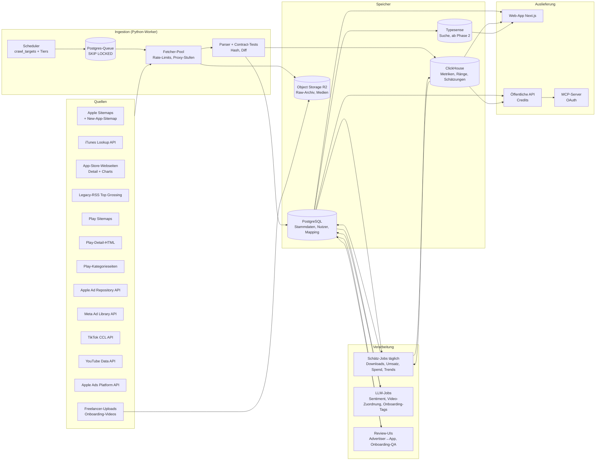

# 07 – Zielarchitektur, Datenmodell und Roadmap für unseren Nachbau

> **Stand:** 26.10.2026 · **Status:** Synthese aus den Dokumenten 01–06 (kein Produktcode)
> Dieses Dokument beschreibt, **wie wir das Produkt bauen**. Die Belege und Details stehen in den
> Fachdokumenten; Verweise in eckigen Klammern, z. B. [03 §8] = `03-datenbank-aufbau.md`, Abschnitt 8.
> **Keine Rechtsberatung.** Rechtliche Punkte sind Leitplanken und vor dem Start anwaltlich zu prüfen [06 §4].

---

## 1. Grundsätze

1. **Eigene Daten aus Primärquellen.** Wir bauen den Katalog aus den Store-Sitemaps, offiziellen APIs und den
   EU-Transparenz-Archiven der Werbeplattformen. **Keine Daten von AppKittie oder anderen Anbietern abgreifen**
   (verboten laut deren Terms, Lauterkeitsrecht) [06 §2, §4].
2. **Zeitreihen ab Tag 1.** Wachstum, Trends und Schätzungen leben von eigener Historie. Die lässt sich nicht
   nachträglich crawlen. Der Chart- und Metrik-Collector ist deshalb das **erste Stück Code**, das live geht
   [03 §0 Nr. 7, 04 §9.1].
3. **Ehrliche Schätzungen.** Spannen, Konfidenz-Badges und eine öffentliche Methodik-Seite. Schwache Schätzungen
   werden ausgeblendet statt geraten [04 §8]. Das ist zugleich unser Unterscheidungsmerkmal [06 §3].
4. **Robots-konform zuerst.** Grauzonen-Quellen (Google-Play-`batchexecute`, Apples `amp-api`) erst nach
   juristischer Freigabe [03 §7, 06 §4].
5. **Eigene Marke, eigenes Design.** Muster übernehmen (Explorer, Karten, Bibliotheken), aber keine 1:1-Kopie von
   Texten, Grafiken oder UI. Seit Mai 2025 schützt das nicht eingetragene EU-Design auch Benutzeroberflächen
   [06 §4].
6. **DSGVO by design.** Keine Klarnamen von Reviewern, keine Kontakt- oder „Decision-Maker“-Daten, Opt-out- und
   Takedown-Prozess [05 §6, 06 §4].

---

## 2. Produktmodule (Zielbild)

| Modul | Was der Nutzer sieht | Wichtigste Datenquellen | Phase |
|---|---|---|---|
| **App-Explorer** | Suche + Filter über Millionen Apps (Plattform, Kategorie, Launch-Datum, Preis, IAP-Spanne, geschätzte Downloads/Umsatz, Wachstum, Ads aktiv), Tabelle + Karten | Sitemaps, iTunes Lookup, Play-Detail-HTML [03 §3–4] | MVP |
| **App-Detail** | Stammdaten, IAP-Preise, Ratings-Histogramm, Versionshistorie, Ränge, Schätzungen mit Spanne, Ads, Videos, Reviews | dto. + Charts + Schätzmodelle [03, 04] | MVP |
| **Rankings** | Top Free/Paid/Grossing pro Land und Kategorie, Auf- und Absteiger | Apple Web-Charts + Legacy-RSS, Play-Kategorieseiten [03 §3.5–3.6, §4.4] | MVP |
| **Trending/Neu** | Schnell wachsende und neue Apps | Zeitreihen + New-App-Sitemap [04 §7] | MVP (einfach), v1 robust |
| **Ads-Library** | Aktive Anzeigen, Laufzeit, Plattformen, Länder, „Winning“-Score, EU-Reichweite | Apple Ad Repository API, Meta Ad Library API [05 §2] | MVP (Metadaten) |
| **Spend-Tracker** | Geschätzte Werbeausgaben nach Land als Spanne | EU-Reichweite × Frequenz × CPM; Nicht-EU nur modelliert und so gekennzeichnet [04 §4, 05 §2] | v1 |
| **ASO** | Keyword-Popularität, Difficulty, Positionen | Apple Ads Platform API (`search-term-popularity`), eigene Positionsmessung [04 §5] | v1 |
| **Reviews & Sentiment** | Review-Feed, Themen, Stimmung | iOS-Reviews-RSS, LLM-Klassifikation [03 §3.7, 04 §6] | v1 |
| **Virale Videos** | Videos pro App mit Views/Likes, Viral-Score | YouTube Data API (offiziell), TikTok/IG-Metadaten über Drittanbieter, Anzeige nur per Embed [05 §3] | v1 |
| **Onboarding-Library** | Komplette Onboarding- und Paywall-Flows als Schrittfolge | Freelancer mit echten iPhones + Vision-LLM-Tagging [05 §4] | v1 (Top 300–500) |
| **Watchlists & Alerts** | Apps/Konkurrenten beobachten, Benachrichtigung bei Rang-, Preis-, Ad-Änderungen | alle Zeitreihen | v1 (Differenzierung [06 §3]) |
| **Export, API, MCP** | CSV-Export, REST-API mit Credits, MCP-Server für Claude/ChatGPT & Co. | interne API | v1 / v2 |

Details zu Seiten, Komponenten und Design-Mustern: [01].

---

## 3. Systemarchitektur

**Datenfluss in einem Satz:** Der Scheduler legt fällige Ziele in eine Postgres-Queue. Fetcher holen sie unter
strengen Rate-Limits, Rohdaten landen komprimiert im Object Storage. Parser schreiben Stammdaten bei Änderung nach
Postgres und Messwerte täglich nach ClickHouse. Nächtliche Jobs rechnen daraus Schätzungen. Web-App, API und
MCP-Server lesen aus denselben Speichern [03 §8].

---

## 4. Technologie-Entscheidungen

| Bereich | Empfehlung | Begründung / Alternative |
|---|---|---|
| Web-Frontend | **Next.js (App Router) + TypeScript, Tailwind, shadcn/ui, TanStack Table, ECharts oder Recharts** | Bewährt für datenlastige Dashboards. AppKittie nutzt Next.js 16, Tailwind v4, shadcn/ui und Recharts [02]. Alternative: SvelteKit |
| Interne API | **tRPC + Zod** (typisiert zwischen Web und Server) | AppKittie nutzt tRPC v11 mit 89 Prozeduren [02]. Für die öffentliche API zusätzlich REST |
| Ähnliche Apps / Konkurrenzsuche | **pgvector** (Embeddings aus Name, Beschreibung, Kategorie) + optionale LLM-Prüfung | AppKittie macht die Competitor-Suche über Embeddings + LLM [02] |
| Crawler, Parser, Schätzungen, LLM-Jobs | **Python 3.12+** (httpx async, selectolax/lxml, orjson; pandas, statsmodels, LightGBM) | Eine Sprache für Crawling **und** Modellierung. Alternative für reine Fetcher: Go [03 §14] |
| Queue | **Postgres-Queue** (Procrastinate oder eigene `crawl_targets`-Tabelle mit `SKIP LOCKED`) | Kein Zusatzdienst. Bei ~6 Requests/s reicht das dauerhaft [03 §8.3] |
| OLTP-Datenbank | **PostgreSQL 17** + `pg_trgm` | Stammdaten, Nutzer, Mapping-Tabellen, Queue [03 §8.7] |
| Zeitreihen | **ClickHouse** | Milliarden Zeilen, schnelle Aggregationen (Top-Gainer, Wachstum). Alternative: TimescaleDB, wenn eine einzige DB gewünscht ist [03 §8.7] |
| Suche | **Postgres-Indizes im MVP**, **Typesense** ab Phase 2 | Filterliste funktioniert mit B-Tree auf `app_search`; Typesense für Instant-Suche mit Tippfehler-Toleranz [03 §8.7] |
| Object Storage + Medien | **Cloudflare R2** (kein Egress) + progressives MP4/WebP | AppKittie nutzt ebenfalls R2 für Videos [05 §1, §5] |
| Hosting Daten | **Dedizierter Server** (z. B. Hetzner AX-Klasse) für Postgres + ClickHouse, 2–4 VMs für Worker | Laufende Kosten ~€500–700/Monat [03 §9.4] |
| Hosting Web | Vercel oder selbst gehostet (Coolify o. ä.) | Vercel für schnellen Start; später Kosten prüfen |
| Auth | Better Auth (selbst gehostet) oder Auth.js | Login per E-Mail-Link + Google/Apple. AppKittie: Auth.js v5 + Magic Link über Resend [02] |
| Billing | **Stripe** mit fairer Trial-Logik | Abbuchung erst nach Trial-Ende + Erinnerungsmail. Genau hier hat AppKittie Beschwerden [06 §1] |
| LLM | Claude Haiku 5.5 (Batch) für Sentiment/Labeling, Sonnet 5.5 für schwierige Vision-Fälle | ~12 USD pro 1 Mio. Reviews im Batch [04 §6]; < $0,15 pro Onboarding-Flow [05 §4] |
| Monitoring | Prometheus + Grafana, Sentry, Uptime-Checks | Canary-Parser-Alarme sind Pflicht [03 §8.8]. AppKittie hat kein sichtbares Error-Monitoring [02] |
| Produkt-Analytics + Consent | PostHog (EU-Hosting) oder Simple Analytics; Werbe-Pixel nur nach Einwilligung; Security-Header (CSP, HSTS) | AppKittie setzt Pixel vor der Einwilligung und sendet keine Security-Header [02, 06 §2] |
| Externe Schnittstellen | REST-API mit Credits + **MCP-Server mit echtem OAuth 2.1** | AppKittie nutzt einen vereinfachten OAuth-Ersatz (API-Key als Client-Secret) [02] |

---

## 5. Konsolidiertes Datenmodell

Die Detail-Schemata stehen in den Fachdokumenten. Hier die Gesamtsicht, wer welche Tabelle „besitzt“:

| Domäne | Tabellen | Speicher | Quelle der Definition |
|---|---|---|---|
| Katalog | `developers`, `products` (plattformübergreifend), `apps`, `app_storefronts`, `app_versions`, `app_snapshots`, `iap_products`, `privacy_labels` | Postgres | [03 §10.1] |
| Charts | `charts` (Definition) · `chart_ranks` (Einträge) | Postgres · ClickHouse | [03 §10.1–10.2] |
| Metriken | `app_metrics_daily` (Ratings pro Storefront, Android `realInstalls`, Preis, Version) | ClickHouse | [03 §10.2] |
| Schätzungen | `estimates_daily` (P10/P50/P90 Downloads, Umsatz brutto/netto, Konfidenz, Modellversion) · `ground_truth` | ClickHouse · Postgres | [04 §9.4] |
| Reviews | `reviews` (Autor nur gehasht, Sentiment, Themen) | Postgres (partitioniert) | [03 §10.1, 04 §9.4] |
| Ads | `advertiser`, `advertiser_app` (Mapping mit Konfidenz), `ad`, `ad_creative`, `ad_reach`, `ad_spend_estimate` | Postgres (+ Reach-Reihen in ClickHouse) | [05 §7.4, 04 §9.4] |
| Videos | `organic_video`, `video_metric_snapshot` | Postgres · ClickHouse | [05 §7.4] |
| Onboardings | `onboarding_flow`, `onboarding_step` (Screenshots/Video in R2) | Postgres + R2 | [05 §7.4] |
| ASO | `keyword_popularity`, `keyword_rank` | ClickHouse | [04 §9.4] |
| Crawling | `crawl_targets` (Fälligkeit, Tier, Fehler, Hash) | Postgres | [03 §10.1] |
| Produkt/Konto | `users`, `teams`, `subscriptions`, `watchlists`, `alerts`, `api_keys`, `api_usage` | Postgres | neu (Phase 2) |

**Schlüssel-Entscheidung:** `apps.id` ist die interne ID für alles. `products` verbindet iOS- und Android-Variante
derselben App (über `bundle_id` = Paketname, Entwickler-Domain, manuell) [03 §10.1, 04 §2]. Die
**Advertiser→App-Zuordnung** ist ein eigenes, gepflegtes Asset mit Review-UI, weil Ads **und** Videos davon
abhängen [05 §9 Nr. 3].

---

## 6. Datenquellen-Matrix (Risiko-Ampel)

| Quelle | Liefert | Risiko | Einsatz |
|---|---|---|---|
| Apple-Sitemaps (Apps, New Apps, Charts) | ~2,0 Mio. iOS-App-IDs | 🟢 in robots.txt verlinkt | Phase 1 |
| iTunes Lookup API | Stammdaten, Ratings pro Storefront, 200 IDs/Request, ~20/min/IP | 🟢 offiziell | Phase 1 |
| App-Store-Webseiten (Detail, Charts) | IAP-Preise, Histogramm, Privacy, Versionen, Top 200 | 🟢/🟡 öffentliche Seiten, Last begrenzen | Phase 1 |
| Legacy-RSS Top Grossing | Top 100 Grossing pro Genre/Land | 🟢 öffentlich, Abschaltrisiko | Phase 1 |
| Play-Sitemaps | ~4 Mio. App-URLs (inkl. toter) | 🟢 in robots.txt verlinkt | Phase 1 |
| Play-Detail-HTML | exakte Installationszahl (`realInstalls`), Ratings, IAP-Spanne | 🟡 erlaubt laut robots.txt, aber Blocking-Risiko | Phase 1–2 |
| Play `batchexecute` (Charts, Reviews, Suche) | Charts, Reviews | 🔴 robots.txt verbietet → nur nach Anwaltsfreigabe | offen |
| Apple `amp-api` | Zusatzfelder | 🔴 intern, ToS-Risiko | nicht geplant |
| Apple Ad Repository API | Apple-Search-Ads in 25 EU-Ländern, mit `appId` | 🟢 öffentlich | Phase 3 |
| Meta Ad Library API | EU-Anzeigen, Reichweite pro Land | 🟢 offiziell, Identitätsprüfung; Nutzungsbedingungen klären | Phase 3 |
| TikTok Commercial Content API | EU-TikTok-Ads | 🟢 Antrag nötig | später |
| YouTube Data API | Shorts der App-Kanäle, Statistiken | 🟢 offiziell, Quota beachten | Phase 4 |
| TikTok/Instagram über Drittanbieter | Video-Metadaten | 🟡 ToS-Grauzone; nur Metadaten + Embeds | Phase 4 |
| Apple Ads Platform API | Keyword-Popularität 1–100 | 🟢 offiziell, Account nötig | Phase 3–4 |
| Onboarding-Aufnahmen (eigene) | Flows, Screens | 🟡 Screenshots fremder Apps → Takedown-Prozess | Phase 4 |
| Daten von AppKittie/Wettbewerbern | – | 🔴 tabu | nie |

---

## 7. Roadmap

### Phase 0 – Vorbereitung (Woche 0, parallel)
- **Recht:** ~1 Tag Anwaltsberatung (DB-Recht §§ 87a ff. UrhG, UWG, AGB/ToS der Stores, DSGVO, Hosting von
  Creatives/Screenshots) → Entscheidung „robots-strikt vs. pragmatisch“ [03 §11, 06 §4].
- **Name und Marke:** Namensideen sammeln, EUIPO/DPMA/USPTO-Recherche, Domain sichern [06 §4].
- **Zugänge beantragen, die Vorlauf brauchen:** Meta-Identitätsprüfung für die Ad Library API, Antrag TikTok
  Commercial Content API, Apple-Ads-Account mit API-Rolle, Google-Cloud-Projekt für YouTube [05 §9, 04 §5].
- **Infrastruktur:** Server, Postgres, ClickHouse, R2, Monitoring, Repo-Struktur.

### Phase 1 – Datenfundament (Wochen 1–2)
- **Tag 1: Chart-Collector live** (Apple Web-Charts, Legacy-RSS Grossing, Play-Kategorieseiten), mehrmals täglich.
- Sitemaps beider Stores einlesen → ~6 Mio. Kandidaten-IDs.
- iOS-Vollkatalog über Lookup (Batch 200); Web-Detail für die Top ~60k.
- Metrik-Zeitreihen starten: iOS-Ratings pro Storefront, Android `realInstalls`.
- Parser mit Fixture-Tests und Canary, Raw-Archiv.
- **Ergebnis:** ≥ 95 % der iOS-IDs mit Status, Charts täglich in ClickHouse [03 §11].

### Phase 2 – Vollkatalog + erste Oberfläche (Wochen 3–5)
- Play-Detail-Vollpass (~4 Mio. URLs, Tier-Scheduler, IP-Pool), tote Apps markieren.
- `app_search`-Tabelle, Explorer mit Filtern (< 300 ms p95), App-Detailseite, Rankings.
- Login, Teams, Stripe-Abo (noch geschlossen/Beta).
- **Ergebnis:** ~4–4,5 Mio. aktive Apps durchsuchbar, „updated daily“ für Tier 0.

### Phase 3 – Schätzungen, Ads, ASO (Wochen 5–8)
- Cross-Platform-Matching; Schätzmodell v0 (Android aus Δ `realInstalls`, iOS-Rangkurven, Umsatz aus
  Grossing-Rang + IAP-Preisen), Spannen + Konfidenz [04 §9].
- Ads v1 als Metadaten-Produkt: Apple Ad Repository + Meta Ad Library, Advertiser→App-Mapping mit Review-UI,
  „Active for N days“, Winning-Score [05 §7.1].
- ASO v0: Keyword-Popularität (Apple Ads Platform API), Positionsmessung für Watchlist-Keywords.
- Watchlists + E-Mail-Alerts.
- **Ergebnis:** geschlossene Beta mit ersten Nutzern.

### Phase 4 – Bibliotheken + Launch (Monate 3–4)
- Onboarding-Library: Freelancer-SOP, Upload-Tool, Segmentierung + Vision-LLM, Top 300–500 Apps [05 §7.3].
- Virale Videos: YouTube offiziell, TikTok/IG-Metadaten über Drittanbieter, Viral-Score, Embeds [05 §7.2].
- Reviews + Sentiment (LLM-Batch).
- Spend-Spannen EU/UK; Methodik-Seite mit Backtest-Zahlen.
- MCP-Server + öffentliche API mit Credits, CSV-Export.
- **Öffentlicher Launch.**

### Danach
- Schätzmodell v1/v2 (hierarchisch Bayes, GBM mit Quantilen), „Connect your app“ als Kalibrierungs-Panel
  [04 §10].
- TikTok-Ads, Google Ads Transparency, Nicht-EU-Spend-Modell.
- Android-Onboarding-Automatisierung (Emulator + LLM-Agent).
- 12-Monats-Wachstum aus eigener Historie ab Monat 12 (oder Backfill-Lizenz).

---

## 8. Budget-Rahmen (grob)

| Posten | Einmalig | Laufend pro Monat | Quelle |
|---|---|---|---|
| Infrastruktur (DB-Server, Worker, Suche, Storage, Monitoring) | – | €330–1.000 (typisch €500–700) | [03 §9.4] |
| Proxies (Datacenter + Residential-Fallback) | – | in Infrastruktur enthalten | [03 §9.4] |
| Meta-Creatives über Scraper-API (nur Top-Apps, optional) | – | $300–600 | [05 §7.1] |
| TikTok/IG-Video-Metadaten (Drittanbieter, Top 1.000) | – | $150–400 | [05 §7.2] |
| Onboarding-Flows Top 300–500 (Freelancer) | $2.500–6.000 | Refresh $1.500–4.000 | [05 §7.3] |
| LLM (Sentiment, Labeling) | – | zweistellig bis niedrig dreistellig | [04 §6, 05 §4] |
| Anwalt (Erstberatung) | ~1 Tag | – | [03 §11] |
| Optional: Historien-Backfill-Lizenz | 5- bis 6-stellig/Jahr laut Markt | – | [03 §0, §13] |

Zum Vergleich der Preispunkte im Markt: AppKittie $49–79/Monat, Sensor Tower fünf- bis sechsstellig pro Jahr
[06 §3].

---

## 9. Entscheidungen, die du treffen musst

1. **Name und Marke** (klar anders als AppKittie) [06 §4].
2. **Robots-strikt oder pragmatisch** bei Google Play (Charts/Reviews über `batchexecute`) – nach Anwaltsgespräch
   [03 §4.5].
3. **Länderfokus:** global wie AppKittie oder Start mit USA + EU/DACH (Similarweb: 19 % der AppKittie-Besuche aus
   Deutschland [06 §1]).
4. **Backfill-Lizenz** für 12 Monate Historie kaufen oder 12 Monate selbst sammeln [03 §13 Nr. 7].
5. **Positionierung:** offene Methodik + Alerts + EU-Compliance als Unterschied [06 §3, §5].
6. **Hosting:** Hetzner (günstig, EU) für Daten; Web auf Vercel oder selbst gehostet.

---

## 10. Nächste konkrete Schritte

1. Entscheidungen 1–3 aus Abschnitt 9 treffen.
2. Zugänge mit Vorlauf beantragen (Meta, TikTok, Apple Ads, YouTube).
3. **Chart-Collector + Sitemap-Import als erstes Code-Paket bauen** und sofort laufen lassen. Jeder Tag zählt für
   die Historie.
4. Danach: iOS-Lookup-Pipeline, Play-Detail-Parser mit `realInstalls`, Datenbankschema aus [03 §10].
5. Parallel: Design-System und Explorer-Prototyp auf Basis von [01].
